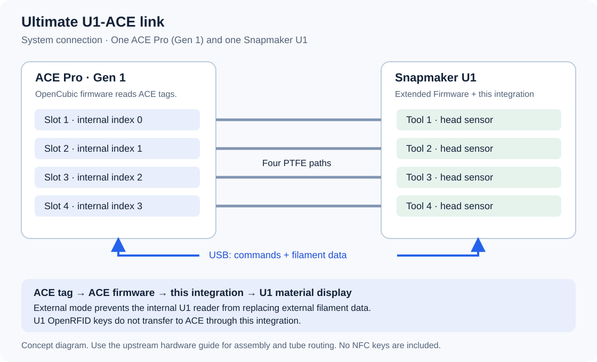
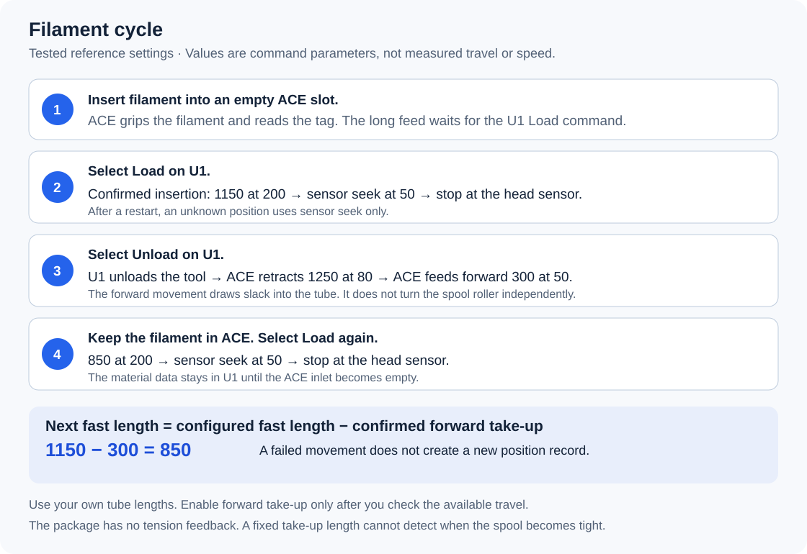

# Ultimate U1-ACE link

[简体中文](README.zh-CN.md)

Connect an **Anycubic ACE Pro Gen 1** to a **Snapmaker U1** and use it as a four-slot automatic feeder.

- Select Load or Unload on the U1 screen or web page. The ACE feeds and returns the filament.
- The ACE reads the NFC tag on the spool. Brand, material, and color go to the U1 automatically.
- After an unload, the filament stays in the ACE with its material data. The next load starts directly.

## What you need

| Item | Requirement |
| --- | --- |
| Printer | Snapmaker U1 with extended firmware `2.0.0-paxx12-24` |
| Feeder | Anycubic ACE Pro **Gen 1** (ACE 2 Pro is not supported) |
| ACE firmware | `CV1.3.863` / OpenCubic `1.1.1` |
| Computer | Windows 10 or 11 on the same network as the printer |
| Hardware | One ACE cable and four PTFE tubes, connected as in the [SnapAce hardware guide](https://github.com/BlackFrogKok/SnapAce#pinout-and-wiring) |

You do not need to find the U1 or ACE firmware. The wizard downloads, verifies, and installs both with you.

## Install

1. **Connect.** With the printer idle, cool, and without power, connect the cable and the four tubes. Then turn the power on.
2. **Download.** [Download the v0.1.6 ZIP](https://github.com/Alexantry/Ultimate-U1-ACE-link/raw/refs/heads/main/downloads/Ultimate-U1-ACE-link-v0.1.6.zip) ([SHA-256](downloads/SHA256SUMS)) and extract all files.
3. **Run.** Double-click **START-HERE.cmd**, select English, and follow the prompts.

The wizard does these stages in order: prepare the U1 firmware → prepare the ACE firmware → install this project → check the connection.
You enter the printer address and password, and you confirm some steps on the printer screen.

> [!CAUTION]
> **Do not copy the old SnapAce `filament_feed.py` or `extruder.py` onto U1 firmware 2.0.**
> This project replaces the SnapAce software installation. Use the upstream project only for the hardware connection.

For a first installation, read the illustrated [quick start](docs/quick-start.md).
If you do not want to run the wizard, follow the [manual installation](docs/installation.md) and run each command yourself.

## Daily use

| You do this | This happens |
| --- | --- |
| Put filament into an empty ACE slot | The ACE grips the filament, reads the NFC tag, and waits. |
| Select Load on the U1 | The ACE feeds to the print head and stops when the head sensor detects filament. The U1 completes the load. |
| Select Unload on the U1 | The U1 unloads the hotend. The ACE pulls the filament back and keeps it at the inlet. Material data stays. |
| Pull the filament fully out of the ACE | The material data of that slot is cleared. |

The feed lengths depend on your tube lengths. Calibrate them once after installation: [settings and calibration](docs/configuration.md).

## NFC support

The ACE reads and decodes the tags. The decoding comes from [OpenCubic](https://github.com/Jupsi/OpenCubic). You do not need NFC keys.

| Brand or format | Status |
| --- | --- |
| Bambu Lab | Tested here: brand, material, color |
| Anycubic, TigerTag, OpenSpool | Supported upstream, not tested here |
| Elegoo, OpenPrintTag (includes Prusa) | Implemented upstream, not tested |
| Creality, QIDI | Not supported |

For spools without a supported tag, enter the material on the U1. See the [NFC notes](docs/nfc.md).

## Documentation

| Task | Read |
| --- | --- |
| First installation | [Quick start](docs/quick-start.md) |
| Manual installation | [Manual steps](docs/installation.md) · [Methods and earlier releases](docs/install-options.md) |
| Firmware | [U1 firmware preparation](docs/u1-preparation.md) · [ACE firmware wizard](docs/ace-wizard.md) |
| Daily use and tuning | [Daily use](docs/daily-use.md) · [Settings and calibration](docs/configuration.md) |
| Problems | [Troubleshooting](docs/troubleshooting.md) · [Update and rollback](docs/update-and-rollback.md) |
| Removal | [Remove and restore](docs/restore.md) |
| Test scope | [Validation](docs/validation.md) · [Changes](CHANGELOG.md) · [Glossary](docs/glossary.md) |

## Sources and license

This project builds on
[SnapAce](https://github.com/BlackFrogKok/SnapAce),
the [U1 extended firmware](https://github.com/paxx12-snapmaker-u1/SnapmakerU1-Extended-Firmware),
[Snapmaker U1 Klipper](https://github.com/Snapmaker/u1-klipper), and
[OpenCubic](https://github.com/Jupsi/OpenCubic).
[THIRD_PARTY.md](THIRD_PARTY.md) lists the authors and their contributions.

OpenAI Codex wrote the code, the installation tools, and the documentation. The user set the requirements and did the physical tests.
You do not need Codex or programming knowledge to install or use this project.

The source is released under **GPLv3**. You can use, change, and share it. Keep the attribution, the license, and the source when you redistribute it.
U1 and ACE firmware that you download separately is not covered by this license. See the [licensing notes](docs/licensing.md).
