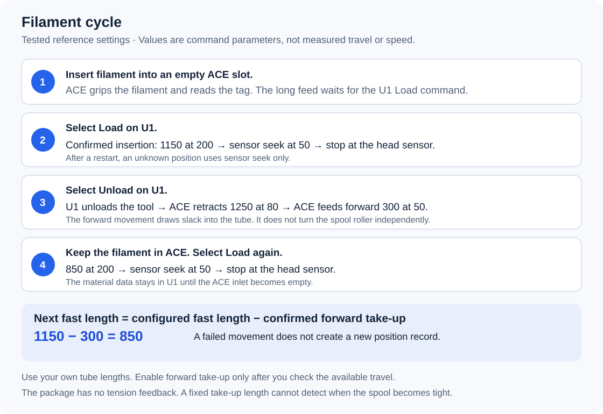

# Ultimate U1-ACE link

Connect **Anycubic ACE Pro Gen 1** to **Snapmaker U1**.
Read supported NFC spool tags, synchronize material details, and start loading from the U1 screen or its remote controls.
Unload to ACE, keep material information, and reduce loose loops with calibrated forward take-up.

**Built with OpenAI Codex. You do not need Codex, programming knowledge, or an API key to install this project.**

[简体中文](README.zh-CN.md) · [Download v0.1.2 ZIP](https://github.com/Alexantry/Ultimate-U1-ACE-link/raw/refs/heads/main/downloads/Ultimate-U1-ACE-link-v0.1.2.zip) · [SHA-256](downloads/SHA256SUMS)

## [GUIDED INSTALLATION — start here](docs/quick-start.md)

Download, extract, and double-click **START-HERE.cmd**. Select **English** or **中文**.
The same wizard can prepare the required U1 firmware on a USB drive and guide the screen steps.

## [MANUAL INSTALLATION — read source and run commands yourself](docs/installation.md)

**This is a complete alternative to the Windows wizard.** No launcher or closed EXE is required.
You still run the readable `installer.py` on the printer.
[Compare methods and retained releases](docs/install-options.md).

> [!CAUTION]
> **Do not copy old SnapAce `filament_feed.py` or `extruder.py` onto U1 firmware 2.0.**
>
> **This project replaces the original SnapAce software installation steps.**
> Use the upstream **hardware connection guide** for the cable arrangement.

## First installation in one guided workflow

1. Prepare the Gen 1 cable and four PTFE paths with the [SnapAce hardware guide](https://github.com/BlackFrogKok/SnapAce#pinout-and-wiring).
2. Download and extract this project's ZIP. Double-click **START-HERE.cmd**.
3. Select the U1 preparation path if the required firmware is not installed.
4. Let the wizard download, verify, and copy the exact U1 firmware to a suitable USB drive.
5. Follow its printer-screen steps for Local Update, Advanced Mode, and Root Access.
6. Continue in the same wizard with the printer address, password, and reviewed tube distances.
7. Confirm installation. Wait for the verified result, then perform the guided physical checks.

Open **START-HERE.html** or **START-HERE.en.html** for illustrated offline instructions.
The original **v0.1.0 and v0.1.1 archives remain unchanged**.

> [!IMPORTANT]
> **Initial firmware installation and access approval still need the printer screen.**
> The wizard prepares the official v24 file; it does not create a different firmware image or bypass these controls.
> **ACE firmware preparation is separate when the compatible OpenCubic build is not installed.** See [ACE preparation](docs/ace-firmware.md).

## What is automatic?

| The installer does this | You supply or prepare this |
| --- | --- |
| Download the pinned U1 file, check its SHA-256, and copy it to FAT32 USB | Select the USB drive and confirm Local Update on the U1 screen. |
| Show the access setup steps in the selected language | Enable Advanced Mode and set Root Access to Open on the screen. |
| Check firmware and device state | Connect the hardware and prepare compatible ACE firmware. |
| Find the ACE interface or preserve the existing one | Enter the printer address and SSH password. |
| Set **Filament Detection → External** | Review the physical distances for a new installation. |
| Save backups and configure persistence | Keep the machine idle and cold. |
| Install modules and verify the result | Check one slot after installation. |

The actual reader option is **External**, not a setting named extended.
The installer also disables the internal reader path and verifies the configuration.
Existing ACE parameters remain unchanged by default.
New installations start with forward take-up disabled.

## Prerequisites

> [!IMPORTANT]
> **The guided preparation covers the U1 steps below. The host installation starts only after they are complete.**
> **ACE Pro Gen 1 and the exact U1 version below are the tested baseline.**

| Component | Tested baseline |
| --- | --- |
| U1 extended firmware | `2.0.0-paxx12-24` |
| U1 access | Advanced Mode enabled; Root Access Open |
| ACE hardware | ACE Pro Gen 1, correct USB connection, four PTFE paths |
| ACE NFC firmware | `CV1.3.863` / OpenCubic `1.1.1` |

The wizard uses the original upstream U1 file. It does not silently reflash an existing system.
Its USB preparation does not format a drive or overwrite a different file with the same name.
See [the integrated preparation guide](docs/u1-preparation.md) for the exact file, checksum, and manual alternative.

## How it works

| Action | What happens | What to expect |
| --- | --- | --- |
| Insert into an empty ACE slot | ACE grips the filament and performs its short intake and NFC search. | It waits near ACE; it does not send the full tube length automatically. Untagged filament can use manual material details. |
| Select Load on U1 or an enabled remote control | ACE sends a fast segment, then approaches the head more slowly. | The head sensor ends the ACE transport stage; U1 completes its native hotend loading sequence. |
| Select Unload | U1 releases filament from the hotend, then ACE retracts the configured distance. | The tip remains in ACE and the rear tube. The material data stays available. |
| Finish unloading with forward take-up enabled | ACE feeds a calibrated short distance toward U1. | This takes up loose loops at the spool. It is not an independently powered roller or a tension-sensor stop. |
| Load again without removing the spool | The next fast segment accounts for successful take-up. | No new tag scan is required merely because the head was unloaded. |
| Remove filament from the ACE inlet | The inlet is confirmed empty. | Only then is that slot's stored material cleared. |

Use the physical U1 screen, [enabled remote screen, or web-console commands](docs/daily-use.md).
The installer does not enable the optional remote screen or AFC panel automatically.

Reference values are 1150 mm at speed 200, then speed 50; unload is 1250 mm at speed 80.
The tested take-up value is 300 mm at speed 50.
**These distances are examples for the tested tube arrangement, not universal settings.**
Forward take-up has no tension feedback and does not independently drive the spool roller.
**New installations start with take-up disabled.** Calibrate it before expecting automatic slack removal.
See [tube measurement and parameter editing](docs/configuration.md), [daily operation](docs/daily-use.md), and [validation limits](docs/validation.md).

## NFC support and keys

**Bambu brand, PLA Matte, and color were confirmed in this project.**
The pinned ACE firmware also reports support for Anycubic and several open tag formats.
This is not a claim that every mainstream brand works.
**Creality and QIDI are not usable decoders in the pinned ACE release.**

Read the [brand support table and key-entry instructions](docs/nfc.md).
The separate U1 internal-reader file is `extended/openrfid_user.cfg`.
**Keys in that file do not configure ACE.** The tested Bambu ACE workflow needs no extra key entry in this project.
No keys or links to proprietary key sources are included.

## Project sources and development

| Project | Foundation |
| --- | --- |
| [SnapAce](https://github.com/BlackFrogKok/SnapAce) | ACE control and the original hardware integration. |
| [U1 Extended Firmware](https://github.com/paxx12-snapmaker-u1/SnapmakerU1-Extended-Firmware) | The U1 firmware environment and configuration interface. |
| [Snapmaker U1 Klipper](https://github.com/Snapmaker/u1-klipper) | The native printer and filament workflow. |
| [OpenCubic](https://github.com/Jupsi/OpenCubic) | The tested ACE NFC firmware. |
| [OpenRFID](https://github.com/suchmememanyskill/OpenRFID) | Tag-format and material naming references. |
| [ACE Gen 1 protocol research](https://github.com/Godless50/ACE-PRO-v1.-NFC-UID) | The foundation for the separate optional USB updater. |

The user supplied requirements and performed physical tests.
**OpenAI Codex wrote and integrated this project's code, installation tools, and documentation.**
Upstream authors retain their credits and licenses. See [THIRD_PARTY.md](THIRD_PARTY.md) and [SOURCES.json](SOURCES.json).

This repository contains no NFC keys. Users must obtain required proprietary keys independently.
English procedures follow ASD-STE100 writing principles; this is not a certification claim.

## Use and sharing

**This source package uses GPLv3. You can use, modify, and share it under those conditions.**
Keep copyright notices, the license, change notices, and the corresponding source when distributing it.
Separately downloaded U1 and ACE firmware are not relicensed by this project.
See the **[license audit and redistribution rules](docs/licensing.md)** before making a combined firmware or commercial package.

[Beginner guide](docs/quick-start.md) · [NFC](docs/nfc.md) · [Update and rollback](docs/update-and-rollback.md) · [Troubleshooting](docs/troubleshooting.md)
