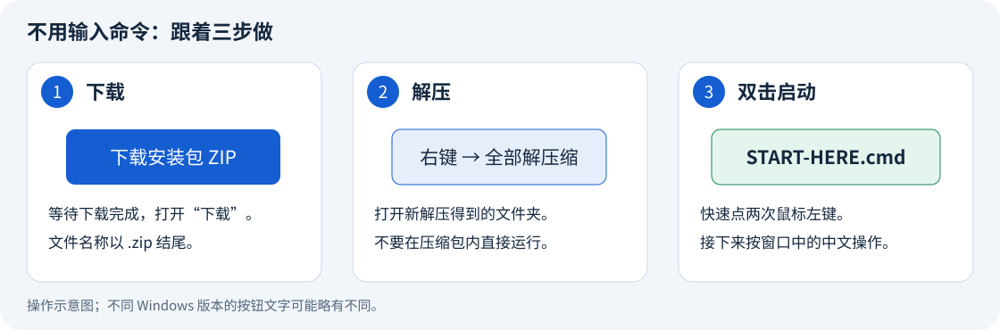

# Ultimate U1-ACE link

让 **Anycubic ACE Pro 第一代**连接 **Snapmaker U1**。
自动读取受支持的耗材 NFC 标签，同步品牌、材质和颜色；通过 U1 屏幕或远程控制进退料。
退料时保留材料信息，并可通过校准后的回送消松收紧松圈。

**本项目使用 OpenAI Codex 完成开发和文档整理。安装者不需要会编程，也不需要安装 Codex。**

## [安装向导入口：下载、双击、跟着提示操作](docs/quick-start.zh-CN.md)

**[下载 v0.1.2 安装包](https://github.com/Alexantry/Ultimate-U1-ACE-link/raw/refs/heads/main/downloads/Ultimate-U1-ACE-link-v0.1.2.zip)** → 全部解压 → 双击 **START-HERE.cmd** → 选择中文或 English。
尚未安装 U1 扩展固件时，在同一向导选择“准备 U1 固件”，自动下载、校验并复制到 U 盘。

## [手动安装入口：查看源码，逐条执行命令](docs/installation.md)

**不想运行 Windows 安装向导，直接点这里。** 完整手动步骤与向导并行保留，不需要封闭 EXE。
手动方式仍会运行可阅读的开源 `installer.py`。
[安装方式比较、旧版固定下载及校验值](docs/install-options.md)。

> [!CAUTION]
> **禁止把旧 SnapAce 的 `filament_feed.py` 或 `extruder.py` 覆盖到 U1 2.0。**
>
> **本项目替代原 SnapAce 的软件安装步骤。** 上游项目只需参考**硬件接线部分**。

## 第一次使用：从准备固件到安装，在同一流程完成

1. 先按 [SnapAce 硬件指南](https://github.com/BlackFrogKok/SnapAce#pinout-and-wiring)准备第一代 ACE 的连接线和四路料管。
2. 下载上面的安装包，右键选择“全部解压缩”。
3. 打开解压后的文件夹，双击 **START-HERE.cmd**，选择 **中文** 或 **English**。
4. 还没有指定 U1 固件时，选择准备流程；向导负责下载、校验及复制到 FAT32 U 盘。
5. 按窗口指引在 U1 屏幕确认本地更新，开启 Advanced Mode，再将 Root Access 设为 Open。
6. 回到同一向导，输入打印机地址、密码和适合自己料管的长度。
7. 核对摘要并安装，等验证通过后再做受控进退料检查。

接下来跟着所选语言的窗口操作即可，**不需要自己输入命令或修改配置文件**。
不熟悉下载、解压和双击操作，请看[逐步图文指南](docs/quick-start.zh-CN.md)。
安装包里的 **START-HERE.html**（中文）和 **START-HERE.en.html**（英文）也可以双击打开，离线阅读。

**v0.1.0 和 v0.1.1 的原安装包均保留，文件未被新版覆盖。**

> [!IMPORTANT]
> **首次更新固件和开启访问权限，仍需在打印机屏幕操作。** 向导会准备文件并逐步引导，不能在尚未开放访问时替你完成屏幕授权。
> **尚未安装兼容 OpenCubic 的 ACE，仍需单独完成 [ACE 固件准备](docs/ace-firmware.md)。** 不能承诺任何原厂组合都只改线就能全自动完成。

## 安装向导会帮你做好什么？

- 自动下载指定 U1 扩展固件、核对 SHA-256、复制到选定的 FAT32 U 盘。
- 在同一双语向导中提示屏幕升级、Advanced Mode 和 Root Access 步骤。
- 自动传本项目文件、检查版本、保存备份。
- 自动寻找 ACE 接口；已有接口和参数会保留。
- 自动把后台 **Filament Detection** 设置为 **External（外部）**，并处理内置读卡服务。
- 自动设置必要的持久化、ACE 配置和模块。
- 自动重启相关软件服务，核对连接、设置和材料信息。

后台选项的准确名称是 **External**；`extended` 是扩展固件和配置文件的名称。
你不用再手动找这个选项。

你需要输入打印机地址和密码。首次安装还需确认适合自己管路的长度；已有安装默认保留原参数。
速度等通用值已经预填。回送消松在首次安装时默认关闭，测试后再启用。

## 需要什么设备？

> [!IMPORTANT]
> **向导包含 U1 固件准备环节；以下条件完成后才开始安装适配模块。**
> **当前验证的是 ACE Pro 第一代和下表中的准确 U1 固件版本，不包含 ACE 2 Pro。**

| 项目 | 已验证的要求 |
| --- | --- |
| 电脑 | Windows 10 或 Windows 11，与打印机在同一网络。 |
| U1 | 扩展固件 `2.0.0-paxx12-24`；Advanced Mode 开启，Root Access 为 Open。 |
| ACE | ACE Pro 第一代，正确的 USB 连接和四路料管。 |
| ACE NFC 固件 | `CV1.3.863` / OpenCubic `1.1.1`。 |

U1 使用上游原版固定固件，不重新打包成未经验证的新固件，也不悄悄刷写已有系统。
U 盘准备不会格式化磁盘，不覆盖内容不同的同名文件。
具体步骤、校验值和手动替代方法见[整合固件准备说明](docs/u1-preparation.zh-CN.md)。

## 这些功能已整合

| 你做什么 | ACE 和 U1 怎么响应 | 应看到什么 |
| --- | --- | --- |
| 向空槽插入耗材 | 短咬料、预进料并尝试读取 NFC。 | 动作结束后停在 ACE 附近，不自动长送至挤出头。无芯片材料可手动填写。 |
| 在 U1 屏幕或远程点进料 | 先快速送一段，再慢速接近头端。 | 头端传感器到料后停止 ACE 输送阶段，U1 完成原生热端上料流程。 |
| 点退料 | U1 完成热端退料，再由 ACE 按设定长度回抽。 | 材料仍留在 ACE 及后方管路里，材料信息保留。 |
| 已启用退料后回送 | ACE 朝 U1 方向回送一段已校准的距离。 | 吸收料盘附近松圈；不是滚筒独立驱动，也没有张力检测停止。 |
| 不拔出材料，再点进料 | 下一次快段会扣除已经成功回送的距离。 | 可以再次快速送至头端，无需因为正常退料重新读卡。 |
| 完全移出 ACE 入口 | 确认该入口无料。 | 此时才清除对应材料信息。 |

远程可通过已启用的远程屏幕或网页控制台操作，具体入口见[日常使用](docs/daily-use.zh-CN.md)。
安装器不会自动开启可选的远程屏幕或 AFC 面板。

实测示例为快段 `1150/200`、头端接近速度 `50`、退料 `1250/80`，回送 `300/50`。
**这些长度仅适用于对应管路，不是所有机器的通用值。新装默认关闭回送，校准后才启用。**
请看[如何测量料管、填写参数并验证](docs/configuration.zh-CN.md)。

## NFC 支持与密钥说明

本项目实测成功的是 **拓竹品牌、PLA Matte 和颜色同步**。
固定 ACE 固件还支持 Anycubic 和部分开放标签格式，但不能写成所有主流品牌均可读。
**创想三维和 QIDI 在本项目固定 ACE 固件中尚无可用读取实现。**

[NFC 支持表及密钥填写说明](docs/nfc.zh-CN.md)区分了 ACE 与 U1 内置 OpenRFID。
U1 内置读卡器的私人文件是 `extended/openrfid_user.cfg`；**这里的密钥不会发送给 ACE**。
已测试的 ACE 拓竹读取不需要在本项目额外填密钥。项目不提供任何专有密钥或密钥来源链接。

## 项目是谁做的？

用户提出需求、观察设备并完成实机测试；**OpenAI Codex 编写和整合代码、安装工具及文档**。
本项目基于 [SnapAce](https://github.com/BlackFrogKok/SnapAce)、[U1 扩展固件](https://github.com/paxx12-snapmaker-u1/SnapmakerU1-Extended-Firmware)、[Snapmaker U1 Klipper](https://github.com/Snapmaker/u1-klipper)、[OpenCubic](https://github.com/Jupsi/OpenCubic) 等项目。
[项目来源与许可](THIRD_PARTY.md)列明上游作者、贡献和改进范围。

安装不需要 Codex、ChatGPT 订阅或 API 密钥。仓库不提供 NFC 密钥，所需专有密钥由用户自行寻找。
英文说明按 ASD-STE100 简洁写作原则编写，不宣称正式认证。

## 可以使用、修改和分享吗？

**本项目源码包按 GPLv3 发布，可以在遵守许可证条件的前提下使用、修改和分享。**
再分发时保留作者署名、许可证、修改声明和对应源码。
单独下载的 U1／ACE 固件不因此获得本项目的 GPL 授权。
重新打包固件或商业分发前，请看 **[许可核查与分享要求](docs/licensing.zh-CN.md)**。

[参数说明](docs/configuration.zh-CN.md) · [NFC 说明](docs/nfc.zh-CN.md) · [回退与更新](docs/update-and-rollback.md) · [验证范围](docs/validation.md) · [English](README.md)
