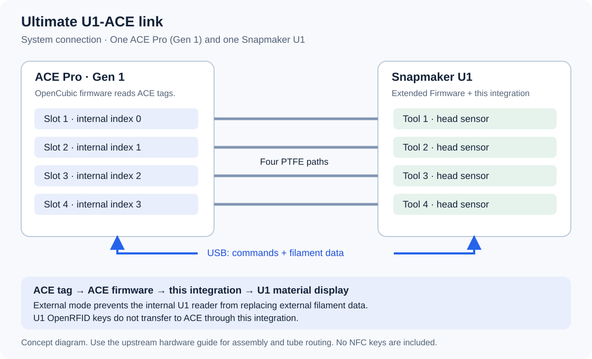

# Ultimate U1-ACE link

[English](README.md)

把 **Anycubic ACE Pro 第一代**接到 **Snapmaker U1** 上，当作四路自动供料器使用。

- 在 U1 屏幕或网页上点进料、退料，ACE 自动送料和收料。
- ACE 读取耗材 NFC 标签，品牌、材质、颜色自动同步到 U1。
- 退料后材料留在 ACE 里，信息保留，下次直接进料。

## 需要什么

| 项目 | 要求 |
| --- | --- |
| 打印机 | Snapmaker U1，扩展固件 `2.0.0-paxx12-24` |
| 供料器 | Anycubic ACE Pro **第一代**（不支持 ACE 2 Pro） |
| ACE 固件 | `CV1.3.863` / OpenCubic `1.1.1` |
| 电脑 | Windows 10 或 11，和打印机在同一网络 |
| 硬件 | 一根 ACE 连接线和四路料管，按 [SnapAce 硬件指南](https://github.com/BlackFrogKok/SnapAce#pinout-and-wiring)接线 |

U1 和 ACE 的固件不用自己找，安装向导会下载、校验并带你刷好。

## 安装

1. **接线。** 打印机空闲、冷却、断电后，接好连接线和四路料管，再开机。
2. **下载。** [下载 v0.1.6 安装包](https://github.com/Alexantry/Ultimate-U1-ACE-link/raw/refs/heads/main/downloads/Ultimate-U1-ACE-link-v0.1.6.zip)，右键“全部解压缩”。
3. **运行。** 双击 **START-HERE.cmd**，选中文，跟着提示走。

向导会依次完成：准备 U1 固件 → 准备 ACE 固件 → 安装本项目 → 检查连接。
你只需要输入打印机地址和密码，并在打印机屏幕上确认几次。

> [!CAUTION]
> **不要把旧 SnapAce 的 `filament_feed.py` 或 `extruder.py` 复制到 U1 2.0 固件上。**
> 本项目已经替代 SnapAce 的软件安装步骤，上游只需要参考硬件接线部分。

第一次安装看[图文快速开始](docs/quick-start.zh-CN.md)。
不想运行向导，可以按[手动安装](docs/installation.zh-CN.md)逐条执行命令。

## 装好以后怎么用

| 你做什么 | 会发生什么 |
| --- | --- |
| 把耗材插进 ACE 空槽 | ACE 咬住耗材并读取 NFC，然后停住等待。 |
| 在 U1 上点进料 | ACE 把耗材送到打印头，感应到料后自动停，U1 完成上料。 |
| 在 U1 上点退料 | U1 退出热端，ACE 把耗材收回并留在入口，材料信息保留。 |
| 把耗材完全拔出 ACE | 该槽的材料信息清除。 |

送料长度和你的料管长度有关，安装后需要校准一次：[参数与校准](docs/configuration.zh-CN.md)。

## NFC 支持

标签由 ACE 读取和解码，解码能力来自 [OpenCubic](https://github.com/Jupsi/OpenCubic)，不需要自己找 NFC 密钥。

| 品牌或格式 | 状态 |
| --- | --- |
| Bambu Lab／拓竹 | 已实测：品牌、材质、颜色 |
| Anycubic、TigerTag、OpenSpool | 上游支持，本项目未实测 |
| Elegoo／智能派、OpenPrintTag（含 Prusa） | 上游已实现，未实测 |
| Creality／创想三维、QIDI／起迪 | 不支持 |

没有标签或不支持的耗材，可以在 U1 上手动填写材料信息。详见 [NFC 说明](docs/nfc.zh-CN.md)。

## 文档

| 想做什么 | 看这里 |
| --- | --- |
| 第一次安装 | [快速开始](docs/quick-start.zh-CN.md) · [安装前准备](docs/before-you-start.zh-CN.md) |
| 手动安装 | [手动安装步骤](docs/installation.zh-CN.md) · [安装方式比较和旧版下载](docs/install-options.md) |
| 固件 | [U1 固件准备](docs/u1-preparation.zh-CN.md) · [ACE 固件向导](docs/ace-wizard.zh-CN.md) |
| 日常使用和调参 | [日常使用](docs/daily-use.zh-CN.md) · [参数与校准](docs/configuration.zh-CN.md) |
| 出问题了 | [故障排查](docs/troubleshooting.zh-CN.md) · [更新与回退](docs/update-and-rollback.zh-CN.md) |
| 了解测试范围 | [验证范围](docs/validation.md) · [更新记录](CHANGELOG.md) |

## 来源与许可

本项目基于这些项目：
[SnapAce](https://github.com/BlackFrogKok/SnapAce)、
[U1 扩展固件](https://github.com/paxx12-snapmaker-u1/SnapmakerU1-Extended-Firmware)、
[Snapmaker U1 Klipper](https://github.com/Snapmaker/u1-klipper)、
[OpenCubic](https://github.com/Jupsi/OpenCubic)。
各项目的作者和贡献见[项目来源](THIRD_PARTY.md)。

代码、安装工具和文档由 OpenAI Codex 编写，用户提出需求并完成实机测试。
安装和使用不需要 Codex，也不需要会编程。

源码按 **GPLv3** 发布，可以使用、修改和分享，再分发时保留署名、许可证和源码。
单独下载的 U1 和 ACE 固件不在本项目的授权范围内，详见[许可说明](docs/licensing.zh-CN.md)。
