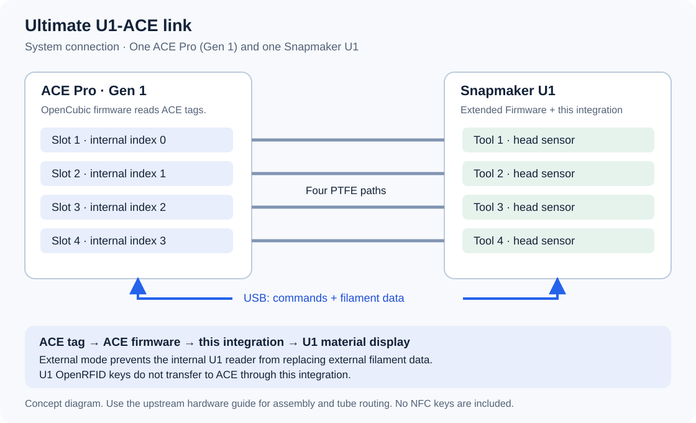

# 安装前准备

[返回首页](../README.zh-CN.md) · [快速开始](quick-start.zh-CN.md) · [手动安装](installation.zh-CN.md)

这一页帮你确认型号、屏幕设置、网络和接线。全部确认后，回到[快速开始](quick-start.zh-CN.md)运行向导。
U1 和 ACE 的固件都由向导准备，不用提前自己刷。

> [!IMPORTANT]
> **任何接线、固件更新或安装之前，先结束打印和全部耗材动作。**
> **关闭加热和 ACE 烘干，等待所有喷嘴和热床低于 50℃。**

## 一、确认设备

| 项目 | 要求 |
| --- | --- |
| 打印机 | **Snapmaker U1**。 |
| 送料盒 | **ACE Pro 第一代**。看机身铭牌、包装或购买记录，不要只凭“四个料槽”判断。 |
| 电脑 | Windows 电脑，能上网、下载和解压文件。 |
| 连接线 | 经过核对的 ACE 第一代专用 USB 连接线，见第五节。 |
| 料管 | 四路料管连接明确，没有压扁或急弯。 |

**ACE 2 Pro 不在支持范围内。** [OpenCubic 发布页](https://github.com/Jupsi/OpenCubic/releases/tag/v1.0.2)同时有 ACE 1 Pro 和 ACE 2 Pro 的固件，两者不能混用。

- **第一次安装：** 先在 U1 上正常退料，再把四路耗材拔出 ACE 入口。退料会加热喷嘴，之后重新等待冷却。
- **只是更新本项目：** 不用清空四路，但仍要空闲、关闭烘干并冷却。

## 二、查看 U1 固件版本

1. 在 U1 屏幕打开 **设置 → 关于 → 固件版本**。
2. 记下显示的版本。

本项目要求扩展固件 **`v2.0.0-paxx12-24`**。屏幕只显示 `2.0.0` 时不能确定，要在第四节的配置网页里确认。

| 现在的情况 | 下一步 |
| --- | --- |
| 已确认是 `v2.0.0-paxx12-24` | 跳到第三节。 |
| 还没装，或不确定 | 运行向导选菜单 2，由它下载、校验并准备 U 盘，见 [U1 固件准备](u1-preparation.zh-CN.md)。 |
| 其他扩展版本或自己改过的系统 | 先备份原配置并核对兼容性，不要直接覆盖。 |

U1 有自定义改动时，升级固件前先自己备份。本项目不备份整台 U1 的系统，安装时的备份也不保护升级之前的改动。
想手动下载和校验固件，同样见 [U1 固件准备](u1-preparation.zh-CN.md)。
屏幕入口参考 [Snapmaker 官方更新说明](https://wiki.snapmaker.com/en/snapmaker_u1/firmware_update_procedure)，升级报错参考[官方升级故障说明](https://wiki.snapmaker.com/en/snapmaker_u1/troubleshooting/firmware-update-failed)。

## 三、打开两个访问开关

### 1. Advanced Mode

1. 在 U1 屏幕打开 **设置 → 维护**。
2. 开启 **Advanced Mode**，按要求重启。

回到维护页面时它仍为开启，才算完成。见[上游配置说明](https://snapmakeru1-extended-firmware.pages.dev/firmware_config)。

### 2. Root Access

1. 打开 **设置 → 维护 → Root Access**。
2. 阅读说明，滚到底部点 **Agree／同意**。
3. 把状态设为 **Open**。

页面显示 **Open** 才算完成。向导靠它通过 SSH 连接打印机，见[上游 SSH 说明](https://snapmakeru1-extended-firmware.pages.dev/ssh_access)。

## 四、网络和登录

### 1. 找到打印机地址

1. 在 U1 屏幕打开 **设置 → Wi-Fi**，确认已连接。
2. 记下页面上的 **IP 地址**。

固件升级后可能要重新连 Wi-Fi，地址也可能变，以屏幕当前显示为准。
没有地址时先连上自己的 Wi-Fi，见 [Snapmaker 官方连接检查](https://wiki.snapmaker.com/en/snapmaker_orca/cloud_mode_fail)。

### 2. 电脑连同一个网络

电脑和打印机要接在同一个路由器下，电脑用网线也可以。不要一个连手机热点、一个连家里的网络。
见 [Snapmaker 官方网络准备说明](https://wiki.snapmaker.com/en/snapmaker_u1/set-static-ip-for-u1)。

### 3. 打开配置网页

1. 在电脑上打开 Edge 或 Chrome，点一下顶部地址栏。
2. 输入 `http://`，紧接打印机地址，再接 `/firmware-config/`，按回车。

能打开 **Firmware Config** 页面，并且构建版本是 **`2.0.0-paxx12-24`**，才算完成。见[页面说明](https://snapmakeru1-extended-firmware.pages.dev/firmware_config)。
打不开时依次检查：IP 是否变了、Wi-Fi 是否连着、Advanced Mode 是否开启。

### 4. 准备 SSH 密码

- 向导要的是 **SSH 密码**，不是 Wi-Fi 密码，也不是 Snapmaker 账号密码。
- 没改过的话，用户名是 `root`，初始密码是 `snapmaker`。见[上游凭据说明](https://snapmakeru1-extended-firmware.pages.dev/ssh_access)。
- 输入时不显示字符是正常的。不要把密码贴到公开页面。

## 五、接线

**软件不能代替正确的线缆。** 接口能插进去，不代表电气连接正确。

- 按 [SnapAce 的 Pinout and Wiring 硬件说明](https://github.com/BlackFrogKok/SnapAce#pinout-and-wiring)制作或购买 **ACE Pro 第一代连接 U1 USB** 的专用线。
- 不要按线的颜色猜线序，普通充电线不能代替。
- 不会看接线图或做接头时，用确认过的成品线，或请有经验的人完成。不要先通电“试试”。
- **只参考 SnapAce 的硬件部分。** 不要执行旧 SnapAce 的软件覆盖步骤。

线准备好以后：

1. 等喷嘴和热床冷却，关闭 U1 和 ACE 的电源。
2. 接上专用 USB 线。
3. 把 ACE 的四路出料管接到对应的 U1 通道，核对 1、2、3、4 路没有交叉。
4. 整理料管，避免压扁、急弯或妨碍打印头移动。
5. 重新开机。

这张图只说明连接关系，不提供线序或尺寸。
之后向导如果提示找不到 ACE 或找到多个设备，先检查连接，不要随便选一个串口。

## 六、ACE 固件

U1 固件和 ACE 固件是两回事，升级 U1 不会更新 ACE。**不用提前自己刷 ACE**，向导会在安装前检查并准备。

| 项目 | 要求 |
| --- | --- |
| 硬件 | ACE Pro 第一代 |
| 运行版本 | `CV1.3.863` |
| 对应固件 | OpenCubic Gen1 CFW `1.1.1`，文件 `ACE_V1.3.863_20260716.bin` |
| 上游位置 | [OpenCubic `v1.0.2` 发布页](https://github.com/Jupsi/OpenCubic/releases/tag/v1.0.2) |

- 向导只支持从 **`V1.3.856`、引导 `V1.0.1`** 升级。其他版本会被拒绝，不会强刷。
- `V1.3.863` 不等于 `CV1.3.863`，铭牌也不能代替版本检查。
- 发布页的 `v1.0.2` 是发布包的标签，不是固件版本。不要下载同页的 `ACE2_...` 文件。
- 已经有人替你刷好时，向对方确认固件来源和版本对应上表，就不用重刷。

步骤见 [ACE 固件向导](ace-wizard.zh-CN.md)，想逐条执行命令见[手动维护说明（英文）](ace-firmware.md)。
支持的标签不需要 NFC 密钥，范围见 [NFC 说明](nfc.zh-CN.md)。

## 七、最后确认

| 检查项 | 通过标准 |
| --- | --- |
| 固件 | 配置网页确认 `2.0.0-paxx12-24`，或准备用向导菜单 2 安装。 |
| 访问开关 | Advanced Mode 开启，Root Access 为 Open。 |
| 网络和登录 | 电脑能打开配置网页，已记下打印机地址和 SSH 密码。 |
| ACE | 确认是第一代。固件留给向导检查。 |
| 接线 | 专用线和四路料管已核对。 |
| 管路长度 | 第一次安装已按[参数与校准](configuration.zh-CN.md#calibrate-the-ptfe-paths)测量；已有安装保留原值。 |
| 状态 | 没有打印、进退料或烘干。第一次安装时四个打印头和四个 ACE 入口都没有耗材。 |
| 温度 | 喷嘴和热床目标温度为零，实际低于 50℃。 |

管路长度软件测不出来，不要照抄示例里的 1250 mm。
都通过后，回到[快速开始](quick-start.zh-CN.md)运行向导。
