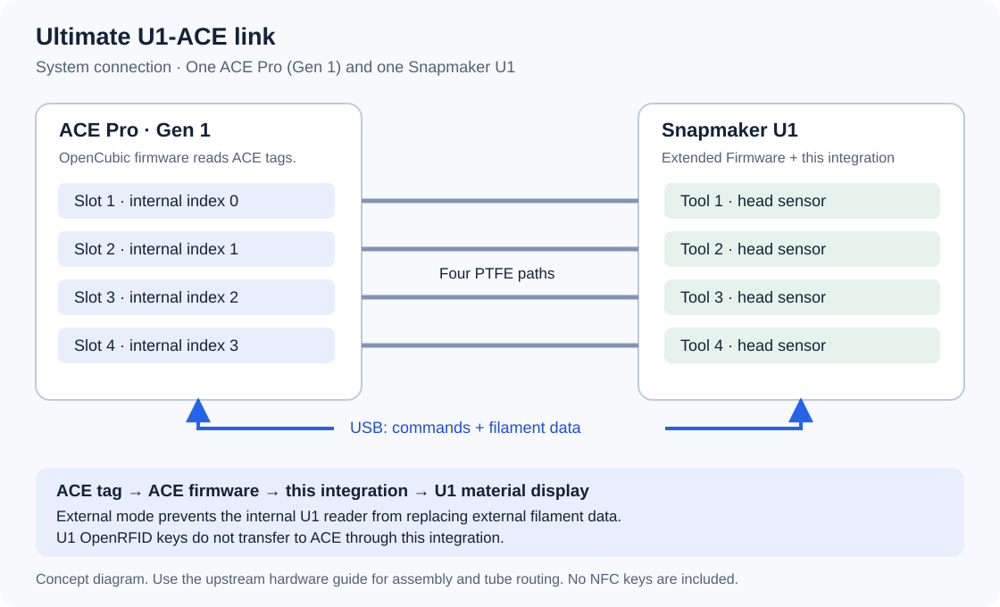

# 开始安装前：零基础准备指南

[返回中文首页](../README.zh-CN.md)

这篇说明只处理需要你亲手完成的准备工作。你不需要编程，也不需要编辑 JSON 或 Python 文件。

**想减少下载和复制操作：双击 START-HERE.cmd，选择“准备 U1 固件”。**
新向导可下载、校验并准备 U 盘，再逐步提示屏幕升级和访问开关；见[整合准备流程](u1-preparation.zh-CN.md)。
本页保留完整手动替代步骤。

准备完成后，主安装向导会处理文件传输、串口选择、备份、持久化、软件模块和 **External** 设置。你不需要安装 Codex，也不需要 API 密钥。

## 一、先确认你手上的设备

| 需要确认的项目 | 怎么看 | 完成标准 |
| --- | --- | --- |
| 打印机 | 查看机身标识或购买记录。 | 型号是 **Snapmaker U1**。 |
| 送料盒 | 查看 ACE 机身铭牌、包装或购买记录。 | 型号是 **ACE Pro 第一代**。 |
| 电脑 | 使用能连接家庭网络的 Windows 电脑。 | 能打开网页、下载文件和解压安装包。 |
| USB 连接 | 查看下面的硬件准备章节。 | 已有经过核对的 ACE 第一代专用 USB 连接线。 |
| 四路料管 | 查看 ACE 到 U1 的实际管路。 | 四路连接明确，管路没有压扁或急弯。 |

**ACE 2 Pro 不属于本项目当前的适用范围。** 不要仅凭“四个料槽”判断代际。看不清型号时，先请卖家或设备提供者确认。

[OpenCubic 发布页](https://github.com/Jupsi/OpenCubic/releases/tag/v1.0.2)同时列出了 ACE 1 Pro 和 ACE 2 Pro 的不同固件；两者不能混用。

如果机器正在打印，先等打印结束。接线、安装和更新都不应在打印过程中进行。

## 二、在打印机屏幕查看版本

1. 在 U1 屏幕打开 **设置 / Settings**。
2. 点 **关于 / About**。
3. 点 **固件版本 / Firmware Version**。
4. 记下当前显示的版本。

这个入口也用于后面的本地更新。[Snapmaker 官方更新说明](https://wiki.snapmaker.com/en/snapmaker_u1/firmware_update_procedure)

本项目使用的扩展固件版本是 **`v2.0.0-paxx12-24`**。

| 你现在的情况 | 下一步 |
| --- | --- |
| 明确已安装 `v2.0.0-paxx12-24`，配置网页也能确认该构建版本 | 跳到第四节，检查访问开关。 |
| 屏幕只显示原厂 `2.0.0`，不知道有没有扩展固件 | 不能只凭 `2.0.0` 判断；按下一节准备准确的扩展版本。 |
| 使用其他扩展版本或自己修改过的系统 | 先保留原配置，再按对应维护流程迁移；不要为了安装本项目直接覆盖。 |

主安装向导会再次核对版本。固件文件可以由向导准备，U1 仍在屏幕确认后执行本地升级。

## 三、还没有正确的 U1 扩展固件时

如果已有自定义配置，先让原维护者保存私有备份。后面的主安装备份不能保护这一步升级之前的系统修改。

### 1. 下载正确的文件

1. 在电脑浏览器打开 [v2.0.0-paxx12-24 发布页](https://github.com/paxx12-snapmaker-u1/SnapmakerU1-Extended-Firmware/releases/tag/v2.0.0-paxx12-24)。
2. 确认页面标题包含 **`v2.0.0-paxx12-24`**。
3. 向下找到 **Assets**，必要时点开它。
4. 下载 **`U1_extended_2.0.0-paxx12-24_upgrade.bin`**。

**你会看到：** 电脑下载文件夹中出现一个以 `.bin` 结尾的文件。

不要下载 `Source code` 作为打印机升级文件，也不要选择 `rolling` 预发布版本。本项目要求上述准确版本。

### 2. 准备 FAT32 格式的 U 盘

1. 把 U 盘插入电脑。
2. 按键盘 **Windows 键 + E**，打开文件资源管理器。
3. 点左侧的 **此电脑**。
4. 找到刚插入的 U 盘。
5. 右键该 U 盘，选择 **属性**。
6. 查看 **文件系统** 一项。

**完成标准：** 文件系统显示 **FAT32**。已经是 FAT32 时，不要重复格式化。

如果不是 FAT32，可以改用已经准备好的 FAT32 U 盘。需要自行格式化时：

1. 先把 U 盘中需要的文件复制到电脑。
2. 再次核对选中的确实是这个 U 盘。
3. 右键该 U 盘，选择 **格式化**。
4. 在 **文件系统** 中选择 **FAT32**。
5. 确认接受清空这个 U 盘后，再点 **开始**。

**格式化会删除所选盘内的数据。** 不确定哪个是 U 盘，或列表没有 FAT32 时，先停在这里，请熟悉电脑的人帮助准备。不要选择电脑系统盘或其他硬盘。

### 3. 把升级文件放到 U 盘

1. 打开电脑的 **下载** 文件夹。
2. 复制刚下载的 `.bin` 文件。
3. 打开 U 盘。
4. 直接把文件粘贴到 U 盘第一层，不要放进其他文件夹。
5. 等待复制完成。
6. 右键 U 盘，选择 **弹出**。
7. 从电脑拔出 U 盘。

“第一层”指双击 U 盘后立即看到的位置，也叫根目录。FAT32 和根目录要求来自[扩展固件安装说明](https://snapmakeru1-extended-firmware.pages.dev/install)。

### 4. 在打印机上安装

1. 确认打印已经结束。
2. 把 U 盘插入 U1 的 USB 接口。
3. 在屏幕依次点 **设置 → 关于 → 固件版本 → 本地更新**。
4. 选择 **`U1_extended_2.0.0-paxx12-24_upgrade.bin`**。
5. 按屏幕提示确认更新。
6. 等待更新结束和机器自动重启。

更新过程中不要拔 U 盘或切断电源。

**完成标准：** U1 能正常进入主界面，没有升级错误。后面的配置网页还要确认构建版本。

如果列表里没有该文件，先核对文件名、U 盘格式和文件位置。出现升级错误时，记录屏幕文字，按照[官方升级故障说明](https://wiki.snapmaker.com/en/snapmaker_u1/troubleshooting/firmware-update-failed)排查；不要反复换随机固件尝试。

## 四、打开两个不同的访问开关

### 1. 打开 Advanced Mode

1. 在 U1 屏幕打开 **设置 / Settings**。
2. 点 **维护 / Maintenance**。
3. 找到 **Advanced Mode**，将它开启。
4. 按要求重启打印机。

**完成标准：** 回到维护页面时，Advanced Mode 仍为开启状态。扩展配置网页需要这个开关。[上游配置说明](https://snapmakeru1-extended-firmware.pages.dev/firmware_config)

### 2. 打开 Root Access

1. 再次打开 **设置 → 维护**。
2. 点 **Root Access**。
3. 阅读页面说明，向下滚动到同意按钮。
4. 点 **Agree / 同意**。
5. 将状态设为 **Open**。

**完成标准：** Root Access 页面显示 **Open**。这是允许安装向导通过 SSH 连接打印机的开关。[上游 SSH 说明](https://snapmakeru1-extended-firmware.pages.dev/ssh_access)

Advanced Mode、Root Access 和系统持久化是三件不同的事。前两个需要在这里开启；持久化由本项目安装器处理，不需要你输入 `touch` 命令。

## 五、找到打印机地址，并确认电脑能够访问

### 1. 在 U1 上查看地址

1. 在打印机屏幕打开 **设置 → Wi-Fi**。
2. 确认打印机已经连接你家或工作室的网络。
3. 找到页面上的 **IP 地址 / IP Address**。
4. 把这串带小数点的数字完整记下来。

**完成标准：** 页面显示已连接，并且有 IP 地址。没有地址时，先选择自己的 Wi-Fi 网络并输入 Wi-Fi 密码。[Snapmaker 官方连接检查](https://wiki.snapmaker.com/en/snapmaker_orca/cloud_mode_fail)

固件更新后可能需要重新连接 Wi-Fi。地址也可能变化，请用屏幕现在显示的地址。

### 2. 让电脑连接同一个家庭网络

电脑和打印机应连接同一个路由器。电脑用网线、打印机用 Wi-Fi 也可以属于同一个家庭网络。

1. 点击 Windows 右下角的网络图标。
2. 检查电脑当前连接的网络。
3. 必要时连接到与打印机相同的家庭网络。

不要把电脑留在手机热点，而让打印机连接另一个网络。[Snapmaker 官方网络准备说明](https://wiki.snapmaker.com/en/snapmaker_u1/set-static-ip-for-u1)

### 3. 在电脑打开配置网页

1. 打开 Edge 或 Chrome。
2. 按 **Ctrl + L**，选中顶部地址栏。
3. 输入 `http://`，后面紧接刚才记下的打印机地址，再接 `/firmware-config/`。
4. 按回车键。

不要把地址输入搜索框，也不要把“打印机地址”四个汉字输入网址。

**你会看到：** 名为 **Firmware Config** 的配置页面。状态区域会显示基础固件、构建版本等信息。

**完成标准：** 页面可以打开，构建版本对应 **`2.0.0-paxx12-24`**。[页面说明](https://snapmakeru1-extended-firmware.pages.dev/firmware_config)

如果打不开，按顺序检查：屏幕 IP 是否变了、Wi-Fi 是否重连、Advanced Mode 是否开启。暂时不要继续主安装。

### 4. 准备登录密码

安装向导需要的是 **SSH 密码**，不是 Wi-Fi 密码，也不是 Snapmaker 账号密码。

如果从未修改过 SSH 密码，上游文档列出的用户名是 `root`，初始密码是 `snapmaker`。修改过就使用你自己的密码。[上游凭据说明](https://snapmakeru1-extended-firmware.pages.dev/ssh_access)

密码输入时，终端可能不显示字符或星号。这不表示键盘没有输入。不要把密码贴到公开问题页面。

## 六、准备 ACE 到 U1 的硬件连接

**软件不能代替正确的线缆。** 外形能插入，不代表电气连接正确。

1. 打开 [SnapAce 的 Pinout and Wiring 硬件说明](https://github.com/BlackFrogKok/SnapAce#pinout-and-wiring)。
2. 请线缆提供者确认它适用于 **ACE Pro 第一代连接 U1 USB**。
3. 确认线缆已经按该硬件方案制作并检查。

上游方案需要专门的 ACE 到 USB 连接。本页不根据线材颜色猜测线序，也不把普通充电线当成成品转接线。

如果你不会看接线图、制作接头或检查线路，请使用经过确认的成品线，或者请有经验的人完成这部分。不要先通电“试试”。

硬件已经准备好以后：

1. 等喷嘴和热床冷却。
2. 关闭 U1 和 ACE 的电源。
3. 按已经核对的硬件方案连接专用 USB 线。
4. 把 ACE 四路出料管接到对应的 U1 通道。
5. 核对第 1、2、3、4 路没有交叉接错。
6. 整理管路，避免压扁、急弯或妨碍打印头移动。
7. 重新开启设备电源。

**完成标准：** 接线方案和型号已经确认；四路对应关系清楚；安装向导稍后能够找到 ACE 串口。

如果向导报告“没有找到 ACE”或找到多个候选设备，先检查连接。不要随意选择一个串口继续。

这张图只说明连接关系，不提供线序或装配尺寸。

**只参考 SnapAce 的硬件部分。** 不要先执行旧 SnapAce 软件覆盖步骤；本项目会安装适合 U1 2.0 的软件模块。

## 七、确认 ACE 自己的固件是否已经准备好

U1 固件和 ACE 固件是两个独立的系统。给 U1 安装扩展固件，不会自动更新 ACE。

本项目验证的 ACE NFC 路径为：

| 项目 | 要求 |
| --- | --- |
| 硬件 | ACE Pro 第一代 |
| ACE 运行版本 | `CV1.3.863` |
| 对应社区固件 | OpenCubic Gen1 CFW `1.1.1` |
| 上游发布位置 | [OpenCubic `v1.0.2` 发布页](https://github.com/Jupsi/OpenCubic/releases/tag/v1.0.2) |
| 对应第一代文件 | `ACE_V1.3.863_20260716.bin` |

发布页的 `v1.0.2` 是整个发布包的标签，不是 ACE 固件的内部版本。不要下载同页的 `ACE2_...` 文件。

### 已经有人为你准备过 ACE

1. 向设备提供者确认具体固件来源和版本。
2. 确认它对应上表的第一代镜像，而不只是名称中带 `1.3.863`。

**完成标准：** 能确认使用的是上述版本。已有正确固件且 NFC 正常时，不必重复刷写。

### 全新原厂 ACE，或者你不知道里面是什么固件

机身铭牌通常只能帮助确认硬件，不能代替运行固件版本检查。不要因为看到了 `V1.3.863` 就当成 `CV1.3.863`。

本项目已把 [ACE 固件准备整合进双语向导](ace-wizard.zh-CN.md)。它通过 U1 的 USB 检查 ACE，不要求 Anycubic 打印机。
首次安装跟着窗口提示即可，也可在主菜单选择 ACE 固件入口；不用输入命令或编辑设备配置。

已实测的升级起点只有 **`V1.3.856`、引导版本 `V1.0.1`**。其他起点不能直接套用，也不能修改检测结果来绕过检查。

向导负责下载校验、只读检测、生成私人设备配置，并显示准确的源版本和目标。
你确认后才会执行一次更新，随后检查运行版本和后台就绪。断线后可从同一入口查看上次结果。
**不受支持的源版本会被拒绝，不会强刷，也不能假设未知固件具有同样的 NFC 能力。**
希望自己检查每条指令时，仍可使用[手动维护说明](ace-firmware.md)。

使用固定 OpenCubic 固件支持的标签，无需自行寻找或填写 NFC 密钥。
不受支持或无法识别的耗材，可在 U1 手动填写材料信息；支持范围见 [NFC 说明](nfc.zh-CN.md)。

## 八、留给主安装向导处理的项目

下面这些不用再手动操作：

| 项目 | 向导或安装器会做什么 |
| --- | --- |
| ACE 固件 | 从上游下载校验，检测已支持起点，经确认执行一次更新，并记录结果。 |
| 传输和安装软件 | 复制匹配版本的软件模块。 |
| 备份 | 保存它即将修改的内容，供回退使用。 |
| 系统持久化 | 配置所需的持久化标记。 |
| ACE 串口 | 沿用现有设置，或识别可用设备。 |
| 后台耗材来源 | 设置为 **External**，避免 U1 内置读卡器与 ACE 数据冲突。 |
| 通用通信参数 | 使用项目规定的参数。 |

后台选项叫 **External**，不是 **extended**。`extended` 是扩展配置目录或固件名称的一部分。External 不表示 ACE 只能读取某个品牌。

**实际管路长度不能由软件自动测出。** 如果是第一次安装，请记下自己四路管路的长度，或向装机者取得适合这套管路的送料、回抽距离。不要只因为示例写着 1250 mm 就照抄。

## 九、最后确认，再回到主安装页

| 检查项 | 通过标准 |
| --- | --- |
| 打印机与版本 | U1，配置网页确认 `2.0.0-paxx12-24`。 |
| 访问开关 | Advanced Mode 开启，Root Access 为 Open。 |
| 网络 | 电脑能打开打印机的配置网页。 |
| 登录信息 | 已记下当前打印机地址，并知道 SSH 密码。 |
| ACE | 第一代硬件，固件准备已完成。 |
| 接线与管路 | 连接经过核对，四路对应明确。 |
| 当前状态 | 没有打印、进料、退料或烘干任务。 |
| 温度 | 喷嘴与热床目标温度为零，实际温度低于 50 ℃。 |

第一次安装前，先用 U1 的正常退料操作退出头端耗材，再将四路耗材退出 ACE 入口。完成标准是四个头端和四个 ACE 入口都没有线材。

正常退料可能加热喷嘴。退料结束后，再确认目标温度为零，并等待实际温度降到 50 ℃ 以下。

已经在使用 ACE、只是升级本项目的用户，不需要为了升级退出四路耗材。按照主安装向导的状态检查提示处理即可。

准备完成后，回到[中文首页](../README.zh-CN.md)，按主安装向导继续。后续不需要手动编辑配置文件。
