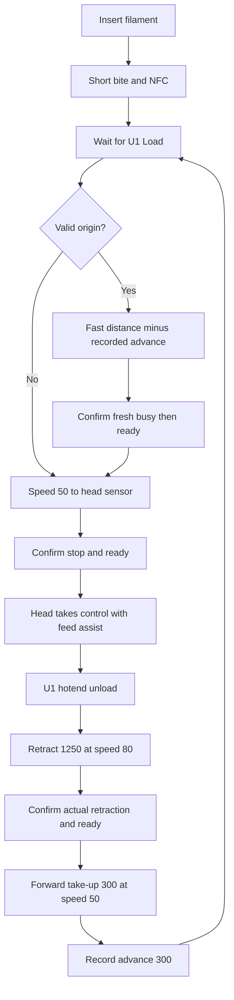

# Configuration and calibration

The [guided launcher](quick-start.md) writes settings for you.
Existing installations keep their current values by default.
The tables and manual commands below are reference material.

All distances below use millimeters.
Speed values are protocol requests in millimeters per second.
They are not measurements of actual roller or filament speed.

## Settings files

`config/settings.example.json` disables forward take-up.
`config/settings.tested-reference.json` contains the tested 300 mm take-up configuration.
The installer can identify one matching ACE interface automatically.
Both templates require an explicit calibration acknowledgement.

| Setting | Tested reference | Purpose |
| --- | --- | --- |
| `serial` | Your ACE USB device path | Identifies the ACE serial device. |
| `auto_detect_serial` | `true` by default | Find one matching ACE when no existing or custom serial choice applies. |
| `baud` | `115200` | Serial connection speed. |
| `feed_speed` | `200` | Legacy direct-feed default. It does not replace the staged-load settings. |
| `feed_length` | `1250` | Legacy direct-feed length. It is not the head-sensor load endpoint. |
| `retract_speed` | `80` | Speed request for the main ACE retraction. |
| `retract_length` | `1250` | Main ACE retraction distance after hotend release. |
| `forward_takeup_length` | `300` | Forward distance after confirmed retraction. Use `0` to disable it. |
| `forward_takeup_speed` | `50` | Speed request for forward take-up. |
| `fast_load_length` | `1150` | Fast distance from a known insertion position, before any advance deduction. |
| `fast_load_speed` | `200` | Speed request for the fast stage. |
| `sensor_load_speed` | `50` | Speed request for the head-sensor approach. |
| `sensor_load_max_length` | `2500` | Total requested load allowance before a travel fault. |
| `max_dryer_temperature` | `55` | Dryer temperature ceiling. This guide does not validate a drying recipe. |
| `calibrated_acknowledged` | `false` in templates | Requires explicit review of physical lengths and speeds before installation. |
| `apply_existing_settings` | `false` in the conservative template | Preserves existing ACE settings unless explicitly changed to `true`. |

The installer writes ACE options to `/home/lava/printer_data/config/extended/klipper/ace.cfg`.
It also sets External detection and applies the internal-reader service configuration.
Multiple automatic serial candidates stop installation instead of selecting one arbitrarily.
For an explicit path equal to the example default, set `auto_detect_serial` to `false`.
It sets staged-load constants in the installed `ace.py` from the JSON settings.
Use the installer for later parameter changes instead of editing that module directly.

The accepted take-up range is 0–500 mm.
Take-up must be shorter than both the retraction distance and the base fast distance.
The take-up and slow-stage speeds cannot exceed 50.
The fast-stage speed cannot exceed 200.

The fast distance must not exceed the retraction distance.
The total load allowance must exceed the fast distance.
Accepted numeric ranges do not establish mechanical suitability for your installation.

## How the distances interact

```text
next_fast_distance = fast_load_length - recorded_advance
```

| Known state | Recorded advance | Fast request | Final approach |
| --- | --- | --- | --- |
| New insertion | 0 mm | 1150 mm at speed 200 | Speed 50 until the head sensor detects filament |
| Successful reference unload | 300 mm | 850 mm at speed 200 | Speed 50 until the head sensor detects filament |
| Restart, interrupted movement, or uncertain position | Unknown | No fast stage | Speed 50 throughout |


This diagram is a control illustration, not a dimensioned tube layout.
The recorded advance is a conservative allowance, not a measured tip position.
The next load consumes that record once.



The head sensor can end loading during either stage.
The slow stage starts only after a valid fast-stage completion.
The take-up movement requires a successful main retraction and valid sensor checks.
An uncertain completion does not authorize another movement.

## Calibrate the PTFE paths

1. Finish the current print.
2. Remove power before you disconnect any hardware.
3. Measure each installed filament path from the ACE inlet to the head sensor.
4. Record the shortest path.
5. Choose a fast distance that leaves a slow approach before the shortest head path.
6. Keep at least the reference 100 mm approach allowance for the initial check.
7. Choose a retraction distance that releases the head while retaining filament in the ACE path.
8. Set `forward_takeup_length` to `0`.
9. Set `calibrated_acknowledged` to `true` after the measurements support your values.
10. Apply the settings with the procedure below.
11. Perform the [single-slot acceptance check](validation.md#repeat-the-acceptance-check).

The reference 1250 mm retraction suits the tested tube arrangement.
It is not a universal tube-length measurement.
Do not set a larger distance merely because a previous load failed.

## Enable forward take-up

1. Confirm successful loading and unloading with take-up disabled.
2. Inspect the loose filament after unloading.
3. Choose a limited take-up distance for that observed slack.
4. Set `forward_takeup_length` to that distance.
5. Keep `forward_takeup_speed` at or below `50`.
6. Set `apply_existing_settings` to `true`.
7. Apply the settings with the next procedure.
8. Repeat the unload check with one slot.
9. Stop the check if the filament snags or becomes excessively tight.

The tested 300 mm value is a reference, not a tension-controlled endpoint.
Take-up moves filament toward the U1 without independent roller control.
It cannot detect when a loose loop becomes tight.

## Apply changed settings

These commands use the PowerShell variables from [installation](installation.md).

1. Open the local settings file.

```powershell
notepad .\config\settings.local.json
```

2. Change the required values.
3. Set `apply_existing_settings` to `true` for intentional parameter replacement.
4. Save the file.
5. Copy the file to the staged project.

```powershell
scp -O .\config\settings.local.json "${PrinterTarget}:$RemoteDir/config/settings.local.json"
```

6. Complete the [idle preparation](installation.md#5-check-before-installation).
7. Check the effective configuration.

```powershell
ssh $PrinterTarget "cd '$RemoteDir' && python3 installer.py check --settings config/settings.local.json"
```

8. Install the changed configuration while the printer is idle.

```powershell
ssh $PrinterTarget "cd '$RemoteDir' && python3 installer.py install --settings config/settings.local.json"
```

9. Confirm the new values in the effective configuration.

```powershell
ssh $PrinterTarget "cd '$RemoteDir' && python3 installer.py check --settings config/settings.local.json"
```
