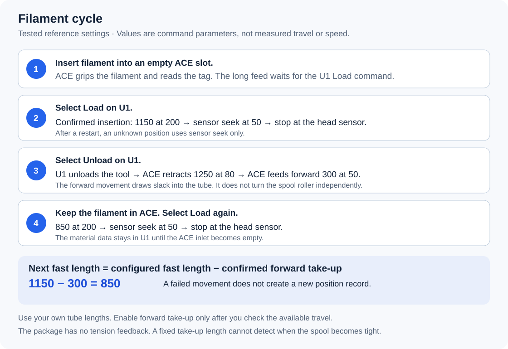

# Settings and calibration

[中文说明](configuration.zh-CN.md) · [Guided installation](quick-start.md)

Three distances control loading and unloading. All four slots share them and the speed settings, so check all four tube paths.
Distances are in millimeters (mm). Speeds are requested values in mm/s, not measured filament speeds.

| Letter | JSON setting | Function | Reference only |
| --- | --- | --- | --- |
| **A** | `retract_length` | Main ACE return distance, after the U1 releases filament from the hotend. | 1250 mm at speed 80 |
| **B** | `fast_load_length` | Fast segment of a load. It must end before the head, leaving a slow approach. | 1150 mm at speed 200 |
| **C** | `forward_takeup_length` | Forward movement after A, to draw loose filament into the PTFE tube. | Start at 0; tested reference 300 mm at speed 50 |

> [!CAUTION]
> **1250, 1150, and 300 are reference values for one tested arrangement. They are not universal values.**
> **Do not copy a measured tube length directly into A, B, or C.**
> Loading stops at the U1 head sensor. It does not intentionally push until a mechanical stall.
> A travel limit and a timeout stop an unsuccessful attempt.

<a id="settings-files"></a>

## Settings files

- **First installation:** the [guided launcher](quick-start.md) asks for A and B and starts with C = 0.
- **Existing installation:** running the launcher again does **not** apply new A, B, or C values. Use [Apply changed settings](#apply-changed-settings).
- `config/settings.example.json` is the conservative template: C is 0 and existing settings are preserved. `config/settings.local.json` is your working file for the procedure below.
- `config/settings.tested-reference.json` has C = 300 and requests replacement of existing settings. Do not use it to overwrite your own settings.

| Setting | Reference value | Note |
| --- | --- | --- |
| `serial` | Your ACE USB path | Keep the exported value. |
| `auto_detect_serial` | `true` | Requires exactly one matching ACE. |
| `baud` | `115200` | Keep. |
| `feed_speed` | `200` | Used only by direct `ACE_FEED`. |
| `feed_length` | `1250` | Legacy option. **Not B.** Leave it unchanged. |
| `retract_speed` | `80` | Speed of A. |
| `forward_takeup_length` | `0` initially | C. Zero disables the movement. |
| `forward_takeup_speed` | `50` | Speed of C. |
| `fast_load_speed` | `200` | Fast-stage speed. |
| `sensor_load_speed` | `50` | Final approach speed. |
| `sensor_load_max_length` | `2500` | Fault limit for a whole load, not a target. Do not increase it to hide a feed failure. |
| `max_dryer_temperature` | `55` | Dryer ceiling. Keep your existing value. |
| `calibrated_acknowledged` | `false` in templates | Set `true` after you review your physical lengths and speeds. It does not measure anything. |
| `apply_existing_settings` | `false` normally | Set `true` to change an existing installation. |

**Change parameters through the installer. Do not edit `ace.py` yourself.**
The installer rejects values outside these limits. Passing the check does not prove that the values suit your tubes.

- C is 0–500 mm, and is smaller than both A and B.
- B does not exceed A, and is smaller than the 2500 mm load limit.
- Fast speed does not exceed 200. Slow and take-up speeds do not exceed 50.

<a id="how-the-distances-interact"></a>

## How the distances interact

Inserting filament starts only the ACE's short bite and NFC reading. Long transport starts when you select **Load** on the U1.

With a valid starting-position record, the controller uses:

```text
fast request = max(0, B - recorded forward advance)
slow allowance = 2500 - fast request
```

- The head sensor can stop either stage early. The slow stage runs at speed 50, and its allowance is a maximum, not a target.
- After a successful unload with B = 1150 and C = 300, the fast request is 850 mm. The controller subtracts the recorded C itself. **Do not enter 850 as B to compensate for C = 300.** That would produce a 550 mm fast request.
- After a restart, an interrupted operation, or an uncertain position, there is no fast stage. A slow first load is then normal.



Unload: the U1 releases the hotend, the ACE retracts A at speed 80, then feeds C at speed 50 if enabled, and records C for the next load.
Afterwards, filament must remain in the ACE inlet and rear PTFE tube, and the U1 head sensor must be empty.

<a id="calibrate-the-ptfe-paths"></a>

## Calibrate the PTFE paths

### Measure the four paths

1. Finish printing and all filament operations. Let the printer cool. Remove power before disconnecting tubing or hardware.
2. Label both ends of each tube with its ACE slot and U1 head.
3. Measure each installed tube along its bends, not the straight distance. Record sections you cannot reach as unknown, not as zero.
4. Choose the parking point for the tip after unloading: inside the ACE-side PTFE tube. The tip must not reach the head or leave the ACE inlet.
5. Reconnect every tube securely before a powered test.

- A tape measure does not cover the ACE internal path, the initial bite, the head path, or the hotend release. Measurements help assess clearance only.
- Check B against the shortest path to a head. The reference A and B differ by 100 mm. That does not establish a 100 mm clearance on your printer.
- If the four paths have no safe common setting, correct the tube arrangement first.

### Choose and test A and B

1. Start from recorded, working values for your arrangement, when available. Resolve unknown dimensions before entering a long return. You can exit the wizard without installing.
2. Set C to `0`. Keep fast speed `200`, approach speed `50`, and return speed `80`.
3. Choose B short enough to leave a slow approach before the head. Choose A to return the tip to the parking point.
4. Enter A and B in the launcher (first installation) or with [Apply changed settings](#apply-changed-settings).
5. On one slot, select Load, Unload, then Load on the U1. Wait for each action to finish before the next.
6. After motion stops, check the tip position, the head sensor, the ACE inlet, and loose filament. Keep hands away from moving rollers. Remove power before disconnecting a tube.
7. Repeat on the other three slots with the same settings, before normal printing. Record the results in the [acceptance checklist](validation.md#repeat-the-acceptance-check).

### Adjust

- Fast travel reaches the head: reduce B. A sensor stop does not prove sufficient clearance.
- After unloading, the tip is too far toward the U1, the head is empty, and no fault occurred: increase A slightly, within the ACE-side margin. Retest with C = 0.
- The tip leaves the ACE inlet: correct the physical state, then reduce A. Do not repeat Unload to recover it.
- Unload fails, the head still detects filament, or filament slips or jams: stop. Inspect the hotend release and the tube path. Do not increase A blindly.
- Change one distance at a time, within the clearance you can verify. After changing or rerouting any tube, set C to 0 and repeat this section. Do not use old values to find out whether a new tube is too short.
- For other symptoms, see [Troubleshooting](troubleshooting.md).

<a id="enable-forward-take-up"></a>

## Enable forward take-up

C feeds a set length toward the U1 after A. It has no tension sensor.
**Enable C only after Load, Unload, and Load pass on all four slots with C = `0`.**

1. Inspect the loose filament after unloading.
2. Choose a limited C for the observed slack and the available head clearance. The tested C = 300 ([slot-4 record](validation.md)) is not a recommendation for your setup.
3. Keep `forward_takeup_speed` at or below `50`.
4. Apply the change and test one normal unload. The head must remain empty and the ACE inlet occupied.
5. Load again without removing the filament.
6. Repeat the checks on all four slots.

- More C moves the parked tip closer to the head. If filament becomes tight, snags, or reaches the head, stop and reduce or disable C.
- If slack remains, first confirm that filament moves freely. Do not increase A to compensate for excessive C.

<a id="apply-changed-settings"></a>

## Apply changed settings

This procedure changes an **existing installation**. It exports your current settings first, so your serial path and dryer ceiling are kept.
**Do not replace your full settings file with a generic example.**

### 1. Prepare the printer and project folder

1. Finish printing and all filament operations. Complete the [idle preparation](installation.md#5-check-before-installation).
2. Keep heater targets at zero and actual temperatures below 50 °C. Stop the ACE dryer and feed assist.
3. Open an extracted project version that supports your installed version. Enter the folder containing `installer.py` and `manifest.json`.
4. Type `powershell` in File Explorer's address bar, then press Enter. Use this window for every block. If any command reports an error, stop.

```powershell
$ProjectDir = (Get-Location).Path
if (-not (Test-Path -LiteralPath .\installer.py)) { throw "Open the folder containing installer.py first." }
$PrinterAddress = Read-Host "Printer IP from the Wi-Fi page"
$PrinterTarget = "root@$PrinterAddress"
$RemoteDir = "/userdata/ultimate-u1-ace-tuning-" + (Get-Date -Format "yyyyMMdd-HHmmss")
Get-Command ssh, scp
$UploadDir = Join-Path ([IO.Path]::GetTempPath()) ("U1AceSettings-" + [guid]::NewGuid().ToString('N'))
$PublicFiles = @('installer.py', 'manifest.json', 'LICENSE', 'THIRD_PARTY.md', 'SOURCES.json',
    'payload/ace.py', 'payload/filament_feed.py', 'payload/filament_detect.py', 'payload/extruder.py',
    'tools/ace_usb/wizard_backend.py', 'tools/ace_usb/ace_iap.py', 'tools/ace_usb/protocol.py',
    'tools/ace_usb/prepare_profile.py', 'tools/ace_usb/fetch_firmware.py',
    'tools/ace_usb/images.json', 'tools/ace_usb/device-profile.json', 'config/settings.example.json')
foreach ($Name in $PublicFiles) {
    $Destination = Join-Path $UploadDir $Name
    New-Item -ItemType Directory -Force -Path (Split-Path $Destination -Parent) | Out-Null
    Copy-Item -LiteralPath (Join-Path $ProjectDir $Name) -Destination $Destination -ErrorAction Stop
}
scp -O -r "$UploadDir" "${PrinterTarget}:$RemoteDir"
if ($LASTEXITCODE -ne 0) { throw "Upload failed. Stop here." }
```

Enter the printer IP and, when requested, the root password. The password is not displayed while you type. Verify a new host-key prompt with the [connection instructions](installation.md#confirm-the-connection).

### 2. Export the current settings

This check is read-only. It saves a time-stamped copy of any existing local working file, then opens the export in Notepad.

```powershell
$PlanText = ssh $PrinterTarget "cd '$RemoteDir' && python3 installer.py check --settings config/settings.example.json"
if ($LASTEXITCODE -ne 0) { throw "Check failed. Stop here." }
$Plan = ($PlanText -join "`n") | ConvertFrom-Json
if ($Plan.compatible -ne $true -or $Plan.fresh_install -ne $false) { throw "This procedure requires a supported existing installation." }
if (Test-Path -LiteralPath .\config\settings.local.json) {
    Copy-Item -LiteralPath .\config\settings.local.json -Destination (".\config\settings.local.before-" + (Get-Date -Format "yyyyMMdd-HHmmss") + ".json")
}
$Plan.effective_settings | ConvertTo-Json -Depth 8 | Set-Content -LiteralPath .\config\settings.local.json -Encoding UTF8
notepad .\config\settings.local.json
```

### 3. Edit the three distances

Change only these entries. This is a **partial example**, not a replacement for the complete file. Use the values from your calibration record.

```json
{
  "retract_length": 1250,
  "fast_load_length": 1150,
  "forward_takeup_length": 0,
  "apply_existing_settings": true,
  "calibrated_acknowledged": true
}
```

- Set `retract_length` to your A, `fast_load_length` to your B, and `forward_takeup_length` to your C. Use C = 0 during calibration.
- Set `apply_existing_settings` to `true`. Set `calibrated_acknowledged` to `true` after reviewing the physical values.
- Keep every other entry, including `feed_length` and any custom speeds. Use whole numbers without quotation marks or units, and lowercase `true`. Save the file and close Notepad.

### 4. Check, apply, and verify

Upload the edited file and run the read-only check:

```powershell
scp -O .\config\settings.local.json "${PrinterTarget}:$RemoteDir/config/settings.local.json"
if ($LASTEXITCODE -ne 0) { throw "Settings upload failed. Stop here." }
ssh $PrinterTarget "cd '$RemoteDir' && python3 installer.py check --settings config/settings.local.json"
if ($LASTEXITCODE -ne 0) { throw "Check failed. Do not install." }
```

In `effective_settings`, confirm A, B, C, the speeds, the serial path, and the dryer ceiling.
If the output shows old values or an error, do not install. With the printer idle and cold, apply the settings:

```powershell
ssh $PrinterTarget "cd '$RemoteDir' && python3 installer.py install --settings config/settings.local.json"
if ($LASTEXITCODE -ne 0) { throw "Install failed. Read the rollback result and backup ID. Stop here." }
```

Save the reported backup ID. Then run the read-only check again:

```powershell
ssh $PrinterTarget "cd '$RemoteDir' && python3 installer.py check --settings config/settings.local.json"
if ($LASTEXITCODE -ne 0) { throw "Verification failed. Do not start a transport test." }
```

Confirm the effective values, then repeat the four-slot checks.
If installation fails, read the automatic rollback result first. See [Update and rollback](update-and-rollback.md) and [Troubleshooting](troubleshooting.md).
