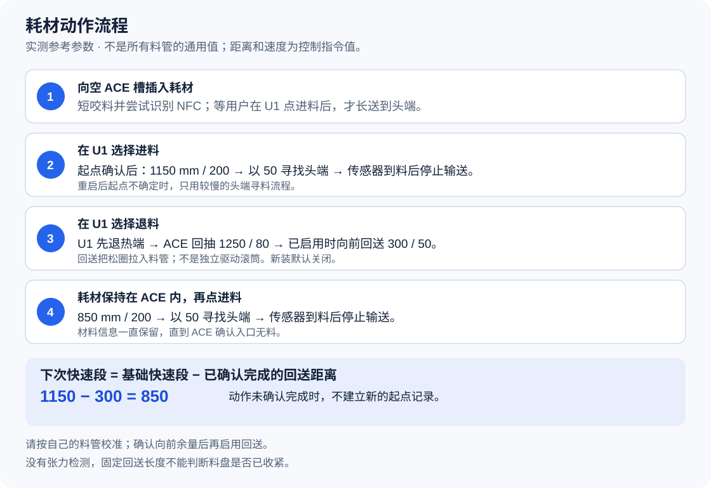

# 按料管长度设置进料、退料和消松回送

[English](configuration.md) · [新手安装向导](quick-start.zh-CN.md)

先记住三项：**A 是主退料长度，B 是快速送料长度，C 是退料后的消松回送长度。**
料管长度会影响它们，但量到的 PTFE 管长并不等于三个参数的值。

| 记号 | 设置文件中的名称 | 实际作用 | 仅供对照的参考值 |
| --- | --- | --- | --- |
| **A** | `retract_length` | U1 完成热端退料后，ACE 把线材拉回自身方向的距离。 | 1250 mm，速度 80 |
| **B** | `fast_load_length` | 送料前段允许快速前进的距离；之后改为慢速接近喷头。 | 1150 mm，速度 200 |
| **C** | `forward_takeup_length` | A 完成后，再往 U1 方向送一小段，把料盘处松出的线材吸入管内。 | 初次设 0；已测参考为 300 mm，速度 50 |

**这三项以及速度设置由四个槽共同使用，不是每个槽各设一套。**
不能只量一根管、只测试一个槽，就认为另外三个槽也一定适用。
本文长度单位均为毫米 mm，速度单位为协议请求的毫米/秒 mm/s。
请求速度不等于实测的滚筒转速或线材速度；ACE 固件可能限速。

> [!CAUTION]
> **1250／1150／300 是已测试装置的参考值，不是所有管路都能直接照抄的通用值。**
> 正常送料以 **U1 喷头端的耗材传感器检测到线材** 为停止条件，再交给 U1 原有挤出机上料流程。
> 它不会故意一直顶到堵转才停。找不到传感器时，会受最大行程和超时限制而报错。

<a id="settings-files"></a>

## 在哪里填写这些值

**第一次安装：**双击[安装向导](quick-start.zh-CN.md)，按提示填写 A 和 B。
向导初次安装时把 C 设为 0，并使用下文的参考速度。

**已经安装：**再次运行向导会保留现有参数，**不会替你改成新的 A／B／C**。
需要主动修改时，请按本文末尾的[应用新参数](#apply-changed-settings)操作。
该流程先导出机器当前实际参数，再只改需要的项目，避免覆盖串口、烘干温度上限等设置。

| 文件 | 用途 |
| --- | --- |
| `config/settings.example.json` | 保守模板：C 为 0，默认保留已安装参数。 |
| `config/settings.tested-reference.json` | 已测参考模板：C 为 300，要求替换已安装参数。不要直接覆盖自己的配置。 |
| `config/settings.local.json` | 按本文手动修改时使用的个人工作文件。 |

两个模板的 `calibrated_acknowledged` 都默认为 `false`。
它表示尚未确认物理长度和速度；改成 `true` 不代表软件已经自动测量过管长。

| 名称 | 参考值 | 需要知道的含义 |
| --- | --- | --- |
| `serial` | 你的 ACE USB 路径 | 已有安装保留原值；新装可自动识别唯一匹配的 ACE。 |
| `auto_detect_serial` | 默认 `true` | 自动识别必须只有一个匹配设备，多个时不会随便选。 |
| `baud` | `115200` | 串口波特率，保持此值。 |
| `feed_speed` | `200` | 手动 `ACE_FEED` 的默认速度，不是屏幕进料的快速段速度。 |
| `feed_length` | `1250` | 保留的旧预送料参数；现在已关闭自动长距离预送料。**它不是 B。** |
| `retract_speed` | `80` | 主退料速度。 |
| `retract_length` | `1250` | A：主退料距离。 |
| `forward_takeup_length` | 初次用 `0` | C：消松回送距离；0 表示不执行。 |
| `forward_takeup_speed` | `50` | C 启用后的回送速度。 |
| `fast_load_length` | `1150` | B：扣除上次回送记录之前的快速段基准长度。 |
| `fast_load_speed` | `200` | 快速段速度。 |
| `sensor_load_speed` | `50` | 接近喷头传感器时的慢速段速度。 |
| `sensor_load_max_length` | `2500` | 两段合计的最大请求行程，属于故障上限，不是必须送满的长度。 |
| `max_dryer_temperature` | `55` | 烘干温度上限；调管长时保留原值。 |
| `calibrated_acknowledged` | 模板为 `false` | 检查并确认实际长度和速度后才改为 `true`。 |
| `apply_existing_settings` | 通常为 `false` | 想主动修改已安装参数时，必须改为 `true`。 |

不要因为看见 `feed_length: 1250`，就以为屏幕进料仍会固定送 1250。
现在 **U1 屏幕“进料”使用 B 和喷头传感器；“退料”使用 A，然后按需执行 C。**
手动 `ACE_FEED` 也要求单独写明 `LENGTH`，不会自动采用 `feed_length`。

安装器会写入 `/home/lava/printer_data/config/extended/klipper/ace.cfg`，并把分段送料参数应用到模块中。
它也会处理 External 耗材读取设置和内部读卡服务。
**请通过安装器改参数，不要自行修改 `ace.py` 源码。**

安装器检查：C 为 0–500，且小于 A 和 B；B 不大于 A，并小于最大送料行程。
快速段速度不能超过 200，慢速段和消松回送速度不能超过 50。
这些只是输入限制，**通过检查不代表机械上已经校准正确**。
本文调参时保持最大送料行程 2500，不要用放大上限的办法掩盖送料失败。

<a id="how-the-distances-interact"></a>

## A、B、C 如何一起工作

把线材插入 ACE 后，ACE 只原生咬料并识别 NFC，随后等待。
只有在 U1 屏幕对该槽选择“进料”，才会长距离送到喷头。

在有可靠起始位置记录时：

```text
本次快速段 = max(0, B − 已记录的回送量)
本次慢速段最大余量 = 2500 − 本次快速段
```

两段中任何时候，只要喷头传感器检测到线材，都会进入停止和确认流程。
慢速段的数字是剩余故障上限，**不是必须再送完的距离**。

| 起始状态 | 参考设置下的快速段 | 后续慢速段 |
| --- | --- | --- |
| 确认是重新插入的新起点，B = 1150 | 1150 mm，速度 200 | 速度 50，最多剩余 1350 mm；到传感器即停。 |
| 上次正常退料完成，B = 1150、C = 300 | **850 mm，速度 200** | 速度 50，最多剩余 1650 mm；到传感器即停。 |
| 重启、动作中断或起点不确定 | 不使用快速段 | 全程速度 50，总上限 2500 mm。 |

**C = 300 时，不要把 B 手动改成 850 来“扣除回送量”。**
这组参考参数里，B 仍填 1150，程序会自动算出 1150 − 300 = 850。
如果先把 B 填成 850，程序下一次还会再减 300，快速段就变成 550。



图片表示控制阶段，不表示管路实际尺寸。
程序记录的是一次保守的前送预算，不是传感器量出的尖端坐标。
这个起点记录只能消费一次，重启后也不会盲目沿用。
因此，安装或重启后第一次进料全程较慢，可能是正常保护行为。

退料顺序为：

1. U1 先按原有流程加热、释放热端内的耗材。
2. ACE 按 A、速度 80 向自身方向回抽。
3. 确认喷头端已无料，ACE 入口仍有料。
4. C 大于 0 时，按速度 50 往 U1 方向回送 C。
5. 确认完成后，记录 C，供下一次快速段扣减使用。

最终目标是：**线材仍被 ACE 入口保留，尖端停在 ACE 后方 PTFE 管内，喷头传感器为空。**
只要线材仍留在 ACE 入口，材料信息应继续保留。
完成状态无法确认时，不会自动再重发一轮长距离动作。

<a id="calibrate-the-ptfe-paths"></a>

## 怎样量四根管，并选择初始参数

### 先记录实际管路

用软尺沿料管实际弯曲的路径量，不要量 ACE 到 U1 的直线距离。
外部 PTFE 管长不包含 ACE 内部路径、初始咬入量、喷头内部路径和热端退料动作。
把无法量到的部分记成“未知”，不要当成 0。
本项目没有自动测管长功能，也没有固定加减公式能从管长直接算出准确 A。

1. 结束打印，等待所有进退料动作完成。
2. 等打印机冷却，再检查管路。
3. 需要拆管或拔接硬件时，先断电。
4. 给每根管两端标清 ACE 槽号和对应 U1 喷头号。
5. 沿安装后的弯曲路线量每根 PTFE 管，记录毫米数。
6. 记录无法看到或量到的内部部分。
7. 记录希望退料后尖端停留的位置。
8. 重新接牢所有管路后，才进行通电测试。

停留点应在靠近 ACE 的后部 PTFE 管内，既不能还留在喷头，也不能退出 ACE 入口。
A 的起算点是 **U1 已完成热端释放之后**，不是软尺的一端。
**不要把量到的管长直接同时填进 A、B、C。**

可以复制或打印这张表：

| 槽位与喷头 | 实测 PTFE 路径长度 mm | 内部路径／未知部分 | 退料后尖端实际位置 | 本次 A／B／C | 进料 → 退料 → 再进料结果 |
| --- | --- | --- | --- | --- | --- |
| ACE 1 → 喷头 ___ | ___ | ___ | ___ | ___／___／___ | ___ |
| ACE 2 → 喷头 ___ | ___ | ___ | ___ | ___／___／___ | ___ |
| ACE 3 → 喷头 ___ | ___ | ___ | ___ | ___／___／___ | ___ |
| ACE 4 → 喷头 ___ | ___ | ___ | ___ | ___／___／___ | ___ |

四行最终必须能使用同一组 A／B／C。
选择 B 时，以**到喷头的最短有效路径**检查余量，让快速段在抵达喷头前结束。
“全新插入”和“完成退料后再次进料”两种状态都要检查。

参考值 A = 1250、B = 1150，相差 100。
**这不等于你的机器一定还剩 100 mm 的物理安全距离。**
不能推导出“所有管长减 100 就是 B”。
如果四条路径差异大到没有共同适用的设置，应先调整管路布局，再继续。

### 初次校准顺序

**不是要求你先装好并测试，再回来安装。** 这分成两步：

| 时间 | 你需要做什么 | 什么时候进入下一步 |
| --- | --- | --- |
| 安装前 | 记录四路路线、ACE 后方的预定停留点；审查初始 A、B，C 保持 0。 | 已明确线材退到哪里、快速送料在哪之前结束，未知的路径尺寸已查清。 |
| 安装后 | 在 U1 屏幕对一槽依次进料、退料、再进料；停止后检查尖端并记录结果。 | 第一槽通过后，再逐槽检查另外三槽；全部通过后才正常打印。 |

向导中的参数确认只表示你审查了初始值，**不表示软件已经量管或完成实机校准**。
已有同一管路的正常记录时，以记录中的参数为起点。
软尺测量用于判断余量，不能单独证明某个 A 一定合适。
如果还不清楚尖端应停在哪里、路线到底多长，先查清，不要猜长回抽值。
首次安装向导可以退出，不必填猜测值继续安装。

1. 先把 C 设为 `0`，不启用消松回送。
2. 保持快速送料 `200`、接近喷头 `50`、主回抽 `80`。
3. B 先选较保守的长度，保证到喷头前还有慢速接近过程。
4. A 以“退完仍留在 ACE 后管内的记录位置”为目标。
5. 首装在向导填已审查的 A／B；后续调整按下文流程应用新值。
6. 先测试一个槽：在 U1 屏幕依次“进料 → 退料 → 再进料”。
7. 每一步等它正常完成，再点下一步。
8. 记录尖端位置、喷头有无料、ACE 入口有无料以及料盘松圈。
9. 用同一组参数测试剩余三个槽。
10. 保存四槽记录及最终参数。

滚筒转动时手不要伸进去；尖端位置只能在运动停止后检查。
需要拆管观察时先断电，不要在通电动作中拔管找尖端。
完整验收项可对照[进退料验收表](validation.md#repeat-the-acceptance-check)。

### 看见什么现象，该改哪一项

| 观察到的现象 | 调整方向 |
| --- | --- |
| 还在快速送料，线材就已经到喷头。 | 减小 B。传感器能停下，不代表快速段留够了慢速余量。 |
| 慢速段较长，但最终正常进料。 | 可以保持 B，这只是速度体验；只有确认四路余量后，才考虑增加 B。 |
| 正常退料后，喷头已无料，但尖端仍离 ACE 太远。 | 确认 ACE 端仍有保留余量后，小幅增加 A，并先保持 C = 0 重测。 |
| 线材被抽出 ACE 入口，或入口显示无料。 | 先恢复正确物理状态，再减小 A；不要连续再点“退料”补救。 |
| 退料报错、喷头仍有料、打滑或卡住。 | 先查热端释放和管路阻力，不要盲目加大 A。 |
| 退料成功，但料盘旁留有松圈。 | 不先改 A／B，单独评估 C，见下一节。 |
| 改了 B，但重启后第一次进料仍全程很慢。 | 起点不确定时会用慢速；正常退料完成后的再进料才可能使用新快速段。 |

每次只改一项长度，调整幅度不得超过能确认的剩余空间。
没有对所有管路都安全的固定步长或比例公式。

### 换管、缩短管子或重新走管以后

1. 保存原来正常工作的参数和四槽记录。
2. 量新路线，更新对应记录。
3. 重新找四路中最短的有效路径。
4. 重新校准时先关闭 C。
5. 下一次进退料前先重新检查 A 和 B。
6. 重做四路的进料、退料和再进料检查。
7. 新 A／B 都通过后，再考虑启用 C。

即使只改一根管，共用的 B 也可能不再适合。
不要用旧快速段冲一次，靠是否碰到喷头来判断新管是不是太短。

<a id="enable-forward-take-up"></a>

## 再启用 C：退料后消松回送

C 把料盘附近松出的线材吸回 PTFE 管，让松圈减小。
**它不是单独加速滚筒，也不是检测收紧后自动停止。**
它按设定长度向 U1 方向送一段，没有张力传感器终点。

1. 先确认 C = `0` 时四路进料、退料、再进料都正常。
2. 观察退料后实际留下多少松圈。
3. 根据松圈和尖端到喷头的余量，选择有限的 C。
4. `forward_takeup_speed` 保持不超过 `50`。
5. 应用参数后，先对一个槽执行一次正常退料。
6. 检查喷头仍为空、ACE 入口仍有料。
7. 不拔出线材，继续检查下一次进料。
8. 再检查其他三个槽。

**300 mm 是已测参考，不是默认推荐给所有用户的数值。**
[实测记录](validation.md)说明了第 4 槽那次测试的范围。
C 越大，尖端越往喷头方向前进，停留余量越少。
仍有松圈时先确认线材移动顺畅；只有余量明确且未超过限制，才考虑增加 C。
出现过紧、卡住或碰到喷头时停止测试，减小 C 或设为 0。
不要为了抵消过大的 C，又盲目加大 A。

<a id="apply-changed-settings"></a>

## 已安装用户：怎样应用新参数

下面适用于**已经安装本项目、现在要主动调参**的用户。
首装请用[双击安装向导](quick-start.zh-CN.md)，填 A／B 并从 C = 0 开始。
你不需要编写程序，下面命令可以按整块复制到 Windows PowerShell。
它们先导出当前有效参数，让你只改 A／B／C，保留其他项目。
**不要拿通用模板覆盖整份已有配置，也不要手改 Python 模块。**

### 第一步：准备机器和解压目录

1. 结束打印和所有进退料动作。
2. 按[安装前准备](installation.zh-CN.md#5-check-before-installation)让机器处于可更新状态。
3. 喷嘴、热床目标温度设为 0，实际温度降到 50 °C 以下。
4. 关闭 ACE 烘干和辅助送料，原有耗材位置不要随意改动。
5. 打开支持当前已安装版本的完整项目解压文件夹。
6. 进入能同时看见 `installer.py` 和 `manifest.json` 的那层目录。
7. 点击资源管理器地址栏，输入 `powershell`，按回车。

后续都使用这个窗口。只复制框内命令，不复制代码框外的反引号。
任何一步报错就停下，不要继续下一块。

```powershell
$ProjectDir = (Get-Location).Path
if (-not (Test-Path -LiteralPath .\installer.py)) { throw "Open the folder containing installer.py first." }
$PrinterAddress = Read-Host "Printer IP from the Wi-Fi page"
$PrinterTarget = "root@$PrinterAddress"
$RemoteDir = "/userdata/ultimate-u1-ace-tuning-" + (Get-Date -Format "yyyyMMdd-HHmmss")
Get-Command ssh, scp
$UploadDir = Join-Path ([IO.Path]::GetTempPath()) ("U1AceSettings-" + [guid]::NewGuid().ToString('N'))
$PublicFiles = @('installer.py', 'manifest.json', 'LICENSE', 'THIRD_PARTY.md', 'SOURCES.json',
    'payload/ace.py', 'payload/filament_feed.py', 'payload/filament_detect.py', 'payload/extruder.py',
    'tools/ace_usb/wizard_backend.py', 'tools/ace_usb/ace_iap.py', 'tools/ace_usb/protocol.py',
    'tools/ace_usb/prepare_profile.py', 'tools/ace_usb/fetch_firmware.py',
    'tools/ace_usb/images.json', 'tools/ace_usb/device-profile.json', 'config/settings.example.json')
foreach ($Name in $PublicFiles) {
    $Destination = Join-Path $UploadDir $Name
    New-Item -ItemType Directory -Force -Path (Split-Path $Destination -Parent) | Out-Null
    Copy-Item -LiteralPath (Join-Path $ProjectDir $Name) -Destination $Destination -ErrorAction Stop
}
scp -O -r "$UploadDir" "${PrinterTarget}:$RemoteDir"
if ($LASTEXITCODE -ne 0) { throw "Upload failed. Stop here." }
```

看到 `Printer IP from the Wi-Fi page` 时，输入你自己的 U1 Wi-Fi 页面显示的 IP。
不要输入 `http://`，也不要照抄别人的 IP。
要求密码时输入打印机 root 密码；输入时不显示字符是正常现象。
首次主机密钥提示请按[连接核对说明](installation.zh-CN.md#confirm-the-connection)确认打印机身份。
临时上传目录只包含列表中的公开文件，不复制你的备份或本地私人配置。
找不到 `ssh` 或 `scp` 时，先按安装说明启用 Windows“OpenSSH 客户端”。

### 第二步：导出机器当前实际参数

下面的 `check` 只读检查，不会安装模板。
它以“保留已有设置”的方式取得有效参数，保存为本地工作文件。
工作文件已存在时，先在同目录保存带时间戳的副本。

```powershell
$PlanText = ssh $PrinterTarget "cd '$RemoteDir' && python3 installer.py check --settings config/settings.example.json"
if ($LASTEXITCODE -ne 0) { throw "Check failed. Stop here." }
$Plan = ($PlanText -join "`n") | ConvertFrom-Json
if ($Plan.compatible -ne $true -or $Plan.fresh_install -ne $false) { throw "This procedure requires a supported existing installation." }
if (Test-Path -LiteralPath .\config\settings.local.json) {
    Copy-Item -LiteralPath .\config\settings.local.json -Destination (".\config\settings.local.before-" + (Get-Date -Format "yyyyMMdd-HHmmss") + ".json")
}
$Plan.effective_settings | ConvertTo-Json -Depth 8 | Set-Content -LiteralPath .\config\settings.local.json -Encoding UTF8
notepad .\config\settings.local.json
```

成功后记事本会打开 `config/settings.local.json`。
若检查拒绝未知修改，先保留文件并处理兼容性，不要为了通过检查强行覆盖。

### 第三步：在记事本修改 A／B／C

下面只是完整文件中的**部分项目示例**，不是让你删掉原文件，只剩这几行。
数字仅供对照，实际填你的校准记录。

```json
{
  "retract_length": 1250,
  "fast_load_length": 1150,
  "forward_takeup_length": 0,
  "apply_existing_settings": true,
  "calibrated_acknowledged": true
}
```

1. 找到 `retract_length`，冒号后数字改为 A。
2. 找到 `fast_load_length`，冒号后数字改为 B。
3. 找到 `forward_takeup_length`，数字改为 C；重新校准先用 0。
4. 把 `apply_existing_settings` 改为 `true`，明确要求替换已有参数。
5. 确认物理长度和速度后，把 `calibrated_acknowledged` 改为 `true`。
6. 保留导出的其他所有项目，不改串口、烘干上限等无关值。
7. 按 Ctrl+S 保存，关闭记事本。

数字用整数，不加 `mm`，不给数字加引号。
`true`／`false` 用小写；原有逗号、双引号和大括号不要删。
`feed_length` 保持原值，它不是当前屏幕进料的快速段设置。
参考速度是 `retract_speed: 80`、`fast_load_speed: 200`、`sensor_load_speed: 50`。
此前有自定义速度时请单独核对，不要调长度时无意覆盖。

### 第四步：先检查，再安装，最后验收

先上传改好的文件并只读检查：

```powershell
scp -O .\config\settings.local.json "${PrinterTarget}:$RemoteDir/config/settings.local.json"
if ($LASTEXITCODE -ne 0) { throw "Settings upload failed. Stop here." }
ssh $PrinterTarget "cd '$RemoteDir' && python3 installer.py check --settings config/settings.local.json"
if ($LASTEXITCODE -ne 0) { throw "Check failed. Do not install." }
```

输出的 `effective_settings` 是本次实际准备采用的值。
逐项核对 A／B／C、速度、串口和烘干上限。
确认 `apply_existing_settings` 及检查结果的 `calibration_acknowledged` 均为 `true`。
仍是旧值或检查报错时，先处理，不继续安装。

保持机器空闲、冷却、烘干和辅助送料关闭，再执行：

```powershell
ssh $PrinterTarget "cd '$RemoteDir' && python3 installer.py install --settings config/settings.local.json"
if ($LASTEXITCODE -ne 0) { throw "Install failed. Read the rollback result and backup ID. Stop here." }
```

保存输出的备份 ID，然后再次核对：

```powershell
ssh $PrinterTarget "cd '$RemoteDir' && python3 installer.py check --settings config/settings.local.json"
if ($LASTEXITCODE -ne 0) { throw "Verification failed. Do not start a transport test." }
```

确认实际参数正确后，再按上文四槽表进行实机检查。
安装器重启 Klipper 并验证已加载配置，因此首次进料可能因起点未知而全程慢速。
它会保留 NFC 私有配置，并检查已有材料信息。
安装失败先看自动回滚结果，需要恢复时参考[更新与回滚](update-and-rollback.zh-CN.md)。
