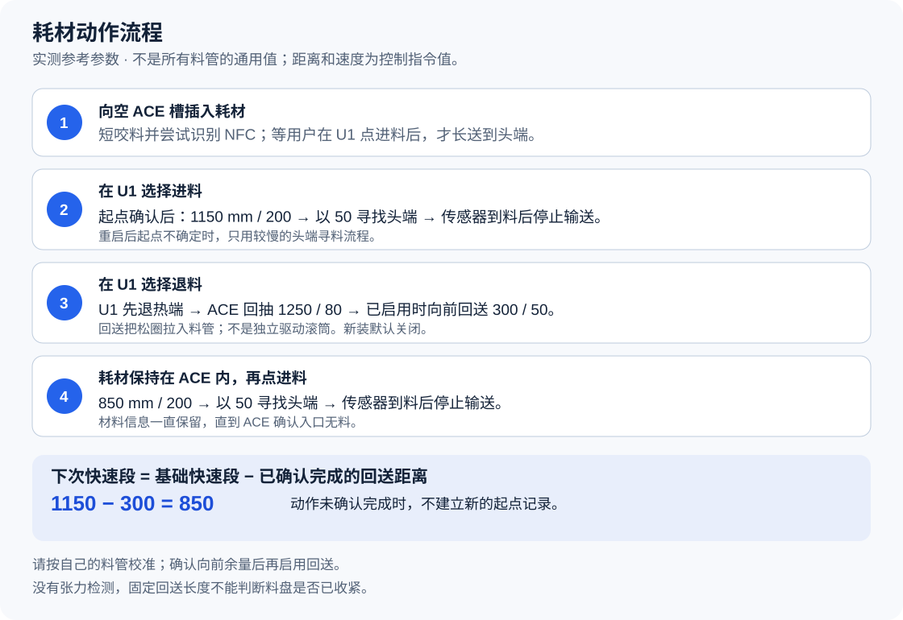

# 参数与校准

[English](configuration.md) · [新手安装向导](quick-start.zh-CN.md)

进料和退料由三个长度控制。四个槽共用这三个长度和速度设置，所以四条管路都要检查。
长度单位是毫米 mm。速度是请求值，单位 mm/s，不是实测的线材速度。

| 记号 | 设置文件中的名称 | 作用 | 仅供对照的参考值 |
| --- | --- | --- | --- |
| **A** | `retract_length` | 主退料长度：U1 完成热端退料后，ACE 把线材拉回的距离。 | 1250 mm，速度 80 |
| **B** | `fast_load_length` | 进料的快速段。必须在喷头之前结束，留出慢速接近段。 | 1150 mm，速度 200 |
| **C** | `forward_takeup_length` | 消松回送：A 完成后再往 U1 方向送一段，把松出的线材吸入 PTFE 管。 | 初次设 0；已测参考为 300 mm，速度 50 |

> [!CAUTION]
> **1250／1150／300 是一套已测试装置的参考值，不是通用值。**
> **不要把量到的管长直接填进 A、B、C。**
> 进料在 U1 喷头传感器检测到线材时停止，不会故意一直顶到堵转。
> 进料不成功时，由最大行程和超时限制停止。

<a id="settings-files"></a>

## 设置文件

- **第一次安装：**[安装向导](quick-start.zh-CN.md)会让你填写 A 和 B，C 从 0 开始。
- **已经安装：**再次运行向导**不会**应用新的 A／B／C。请按[应用新参数](#apply-changed-settings)操作。
- `config/settings.example.json` 是保守模板：C 为 0，保留已安装参数。`config/settings.local.json` 是下文流程使用的个人工作文件。
- `config/settings.tested-reference.json` 的 C 为 300，并要求替换已安装参数。不要拿它覆盖自己的配置。

| 名称 | 参考值 | 说明 |
| --- | --- | --- |
| `serial` | 你的 ACE USB 路径 | 保留导出的值。 |
| `auto_detect_serial` | `true` | 要求只有一个匹配的 ACE。 |
| `baud` | `115200` | 不要改。 |
| `feed_speed` | `200` | 只用于手动 `ACE_FEED`。 |
| `feed_length` | `1250` | 旧参数。**不是 B。** 不要改。 |
| `retract_speed` | `80` | A 的速度。 |
| `forward_takeup_length` | 初次用 `0` | C。0 表示不执行。 |
| `forward_takeup_speed` | `50` | C 的速度。 |
| `fast_load_speed` | `200` | 快速段速度。 |
| `sensor_load_speed` | `50` | 最后接近喷头的速度。 |
| `sensor_load_max_length` | `2500` | 整次进料的故障上限，不是目标长度。不要用加大它来掩盖送料失败。 |
| `max_dryer_temperature` | `55` | 烘干温度上限。保留原值。 |
| `calibrated_acknowledged` | 模板为 `false` | 检查实际长度和速度后改为 `true`。它不会测量任何东西。 |
| `apply_existing_settings` | 通常为 `false` | 要修改已安装参数时改为 `true`。 |

**请通过安装器改参数，不要自己修改 `ace.py`。**
安装器会拒绝超出下列限制的值。通过检查不代表这些值适合你的料管。

- C 为 0–500 mm，且小于 A 和 B。
- B 不大于 A，并小于 2500 mm 的进料上限。
- 快速段速度不超过 200，慢速段和消松回送速度不超过 50。

<a id="how-the-distances-interact"></a>

## A、B、C 如何一起工作

把线材插入 ACE，只会触发短距离咬料和 NFC 读取。在 U1 上选择“进料”后，才会长距离送料。

有可靠的起始位置记录时，程序这样计算：

```text
本次快速段 = max(0, B − 已记录的回送量)
本次慢速段最大余量 = 2500 − 本次快速段
```

- 两段中任何时候，喷头传感器都可以提前停止送料。慢速段速度为 50，余量是上限，不是目标。
- B = 1150、C = 300 并成功退料后，快速段为 850 mm。程序会自己减去已记录的 C。**C = 300 时，不要把 B 填成 850 来抵消。** 那样快速段会变成 550 mm。
- 重启、动作中断或位置不确定后，不使用快速段。这时第一次进料较慢是正常的。



退料：U1 释放热端，ACE 按速度 80 回抽 A，C 启用时再按速度 50 送 C，并记录 C 供下一次进料使用。
退料后，线材必须仍留在 ACE 入口和后方 PTFE 管内，U1 喷头传感器必须为空。

<a id="calibrate-the-ptfe-paths"></a>

## 校准 PTFE 管路

### 测量四条管路

1. 结束打印和所有进退料动作，等打印机冷却。拆管或拔接硬件前先断电。
2. 给每根管的两端标上 ACE 槽号和 U1 喷头号。
3. 沿安装后的弯曲路线量每根管，不要量直线距离。量不到的部分记为“未知”，不要当成 0。
4. 选定退料后尖端的停留点：靠近 ACE 一侧的 PTFE 管内。尖端不能到达喷头，也不能退出 ACE 入口。
5. 把所有料管重新接牢，再做通电测试。

- 软尺量不到 ACE 内部路径、初始咬入量、喷头内部路径和热端退料动作。测量只用来判断余量。
- 按到喷头的最短路径检查 B。参考值 A 和 B 相差 100 mm。这不代表你的机器也有 100 mm 的余量。
- 如果四条路径找不到安全的共用参数，先调整管路布局。

### 选择并测试 A 和 B

1. 这套管路已有正常工作的记录时，从记录的参数开始。先查清未知的尺寸，再填长回抽值。向导可以中途退出，不安装。
2. 把 C 设为 `0`。保持快速段速度 `200`、接近速度 `50`、退料速度 `80`。
3. B 选得短一些，保证到喷头前还有慢速接近段。A 要让尖端退回到停留点。
4. 在向导里填写 A 和 B（首次安装），或按[应用新参数](#apply-changed-settings)操作。
5. 在一个槽上，在 U1 依次点进料、退料、再进料。每个动作完成后再点下一个。
6. 运动停止后，检查尖端位置、喷头传感器、ACE 入口和松出的线材。滚筒转动时手不要靠近。拆管前先断电。
7. 用同一组参数在另外三个槽上重复，然后才正常打印。结果记在[验收清单](validation.md#repeat-the-acceptance-check)里。

### 调整

- 还在快速段，线材就到了喷头：减小 B。传感器能停下，不代表余量足够。
- 退料后尖端太靠近 U1 一侧，喷头为空，没有报错：在 ACE 一侧余量内小幅增加 A。保持 C = 0 重测。
- 尖端退出 ACE 入口：先恢复正确的物理状态，再减小 A。不要重复点“退料”来补救。
- 退料失败、喷头仍检测到线材、打滑或卡住：停止。检查热端释放和管路。不要盲目加大 A。
- 每次只改一个长度，幅度不超过你能确认的余量。换管或重新走管后，把 C 设为 0，重做本节。不要用旧参数去试新管是不是太短。
- 其他现象见[故障排查](troubleshooting.zh-CN.md)。

<a id="enable-forward-take-up"></a>

## 启用消松回送

C 在 A 之后按设定长度往 U1 方向送一段。它没有张力传感器。
**C = `0` 时四个槽的进料、退料、再进料都通过后，才能启用 C。**

1. 观察退料后松出的线材。
2. 按看到的松量和到喷头的余量，选一个有限的 C。已测的 C = 300（[第 4 槽记录](validation.md)）不是给你的推荐值。
3. `forward_takeup_speed` 保持不超过 `50`。
4. 应用参数，测试一次正常退料。喷头必须仍为空，ACE 入口必须仍有料。
5. 不拔出线材，再进料一次。
6. 在四个槽上重复这些检查。

- C 越大，停留的尖端离喷头越近。线材过紧、卡住或到达喷头时，停止，减小 C 或设为 0。
- 仍有松圈时，先确认线材移动顺畅。不要为了抵消过大的 C 而加大 A。

<a id="apply-changed-settings"></a>

## 应用新参数

本流程用于修改**已经安装**的参数。它先导出当前参数，所以串口路径和烘干温度上限会保留。
**不要拿通用模板覆盖整份配置。**

### 1. 准备打印机和项目文件夹

1. 结束打印和所有进退料动作。完成[安装前检查](installation.zh-CN.md#5-check-before-installation)。
2. 加热目标温度保持为 0，实际温度低于 50 °C。关闭 ACE 烘干和辅助送料。
3. 打开支持当前已安装版本的项目解压文件夹，进入包含 `installer.py` 和 `manifest.json` 的那层。
4. 在资源管理器地址栏输入 `powershell`，按回车。所有命令都在这个窗口执行。任何命令报错就停下。

```powershell
$ProjectDir = (Get-Location).Path
if (-not (Test-Path -LiteralPath .\installer.py)) { throw "Open the folder containing installer.py first." }
$PrinterAddress = Read-Host "Printer IP from the Wi-Fi page"
$PrinterTarget = "root@$PrinterAddress"
$RemoteDir = "/userdata/ultimate-u1-ace-tuning-" + (Get-Date -Format "yyyyMMdd-HHmmss")
Get-Command ssh, scp
$UploadDir = Join-Path ([IO.Path]::GetTempPath()) ("U1AceSettings-" + [guid]::NewGuid().ToString('N'))
$PublicFiles = @('installer.py', 'manifest.json', 'LICENSE', 'THIRD_PARTY.md', 'SOURCES.json',
    'payload/ace.py', 'payload/filament_feed.py', 'payload/filament_detect.py', 'payload/extruder.py',
    'tools/ace_usb/wizard_backend.py', 'tools/ace_usb/ace_iap.py', 'tools/ace_usb/protocol.py',
    'tools/ace_usb/prepare_profile.py', 'tools/ace_usb/fetch_firmware.py',
    'tools/ace_usb/images.json', 'tools/ace_usb/device-profile.json', 'config/settings.example.json')
foreach ($Name in $PublicFiles) {
    $Destination = Join-Path $UploadDir $Name
    New-Item -ItemType Directory -Force -Path (Split-Path $Destination -Parent) | Out-Null
    Copy-Item -LiteralPath (Join-Path $ProjectDir $Name) -Destination $Destination -ErrorAction Stop
}
scp -O -r "$UploadDir" "${PrinterTarget}:$RemoteDir"
if ($LASTEXITCODE -ne 0) { throw "Upload failed. Stop here." }
```

输入打印机 IP，并在要求时输入 root 密码。输入密码时不显示字符。出现新的主机密钥提示时，按[连接核对说明](installation.zh-CN.md#confirm-the-connection)确认。

### 2. 导出当前参数

这次检查是只读的。它先给已有的本地工作文件保存一份带时间戳的副本，再用记事本打开导出的参数。

```powershell
$PlanText = ssh $PrinterTarget "cd '$RemoteDir' && python3 installer.py check --settings config/settings.example.json"
if ($LASTEXITCODE -ne 0) { throw "Check failed. Stop here." }
$Plan = ($PlanText -join "`n") | ConvertFrom-Json
if ($Plan.compatible -ne $true -or $Plan.fresh_install -ne $false) { throw "This procedure requires a supported existing installation." }
if (Test-Path -LiteralPath .\config\settings.local.json) {
    Copy-Item -LiteralPath .\config\settings.local.json -Destination (".\config\settings.local.before-" + (Get-Date -Format "yyyyMMdd-HHmmss") + ".json")
}
$Plan.effective_settings | ConvertTo-Json -Depth 8 | Set-Content -LiteralPath .\config\settings.local.json -Encoding UTF8
notepad .\config\settings.local.json
```

### 3. 修改三个长度

只改下面这些项目。这只是**部分项目示例**，不能用来替换完整文件。数值请填你的校准记录。

```json
{
  "retract_length": 1250,
  "fast_load_length": 1150,
  "forward_takeup_length": 0,
  "apply_existing_settings": true,
  "calibrated_acknowledged": true
}
```

- 把 `retract_length` 改为你的 A，`fast_load_length` 改为你的 B，`forward_takeup_length` 改为你的 C。校准期间 C 用 0。
- 把 `apply_existing_settings` 改为 `true`。审查实际长度和速度后，把 `calibrated_acknowledged` 改为 `true`。
- 其他项目全部保留，包括 `feed_length` 和自定义的速度。数字用整数，不加引号和单位，`true` 用小写。保存文件，关闭记事本。

### 4. 检查、应用、验证

上传改好的文件，并运行只读检查：

```powershell
scp -O .\config\settings.local.json "${PrinterTarget}:$RemoteDir/config/settings.local.json"
if ($LASTEXITCODE -ne 0) { throw "Settings upload failed. Stop here." }
ssh $PrinterTarget "cd '$RemoteDir' && python3 installer.py check --settings config/settings.local.json"
if ($LASTEXITCODE -ne 0) { throw "Check failed. Do not install." }
```

在 `effective_settings` 里核对 A、B、C、速度、串口路径和烘干温度上限。
输出仍是旧值或报错时，不要安装。打印机空闲并冷却后，应用参数：

```powershell
ssh $PrinterTarget "cd '$RemoteDir' && python3 installer.py install --settings config/settings.local.json"
if ($LASTEXITCODE -ne 0) { throw "Install failed. Read the rollback result and backup ID. Stop here." }
```

保存输出的备份 ID，然后再运行一次只读检查：

```powershell
ssh $PrinterTarget "cd '$RemoteDir' && python3 installer.py check --settings config/settings.local.json"
if ($LASTEXITCODE -ne 0) { throw "Verification failed. Do not start a transport test." }
```

确认实际生效的值，然后重做四个槽的检查。
安装失败时，先看自动回滚结果。参考[更新与回退](update-and-rollback.zh-CN.md)和[故障排查](troubleshooting.zh-CN.md)。
