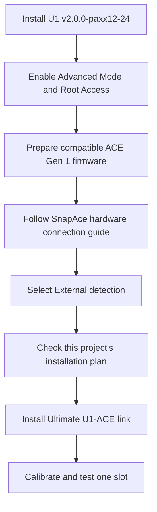

# Installation

This procedure uses Windows PowerShell, OpenSSH, and the printer's Python 3 interpreter.
The installer uses the Python standard library.
It does not require a package installation on the computer.
Use OpenSSH `scp` with `-O` for the file transfers below.
The printer runtime must already provide `pyserial` for the ACE module.
The preflight check refuses a missing dependency instead of installing packages automatically.

## 1. Prepare the prerequisite projects



1. Finish the current print.
2. Save a private copy of your printer configuration.
3. Download [`v2.0.0-paxx12-24`](https://github.com/paxx12-snapmaker-u1/SnapmakerU1-Extended-Firmware/releases/tag/v2.0.0-paxx12-24).
4. Install that release with the [upstream installation guide](https://snapmakeru1-extended-firmware.pages.dev/install).
5. Enable **Settings → Maintenance → Advanced Mode**.
6. Open **Settings → Maintenance → Root Access**.
7. Set Root Access to **Open**.
8. Restart the printer if its interface requests a restart.
9. Reconnect the printer to Wi-Fi if necessary.
10. Read the current address from the printer's Wi-Fi page.

Advanced Mode, Root Access, and persistence are separate controls.
Root Access enables SSH access, as described in the [upstream SSH guide](https://snapmakeru1-extended-firmware.pages.dev/ssh_access).
The installer manages the `/oem/.debug` persistence marker as part of its backed-up changes.
Firmware upgrades can remove that marker and system modifications. See [data persistence](https://snapmakeru1-extended-firmware.pages.dev/data_persistence).

11. Check the ACE generation and firmware against [the NFC baseline](nfc.md).
12. Complete any required ACE firmware preparation with [the ACE firmware guide](ace-firmware.md).
13. Prepare the cable with the [SnapAce hardware guide](https://github.com/BlackFrogKok/SnapAce#pinout-and-wiring).
14. Connect the four PTFE paths to their matching U1 channels.
15. Select External detection with [the NFC procedure](nfc.md#select-external-mode).

Do not perform the old SnapAce software-copy steps on U1 firmware 2.0.
This installer supplies the compatible replacement modules.
It does not automatically merge arbitrary edits in existing core files.


This diagram shows connections only.
It is not an assembly drawing or a source of cable dimensions.

## 2. Prepare Windows PowerShell

1. Download the project archive from [Alexantry/Ultimate-U1-ACE-link](https://github.com/Alexantry/Ultimate-U1-ACE-link).
2. Extract the archive into a local folder.
3. Open PowerShell in the folder that contains `installer.py`.
4. Check the required commands.

```powershell
Get-Command ssh, scp
```

Both commands must be available before you continue.

5. Set the local project directory.

```powershell
$ProjectDir = (Get-Location).Path
```

6. Enter the printer address.

```powershell
$PrinterAddress = Read-Host "Printer address from the Wi-Fi page"
```

7. Set the SSH target.

```powershell
$PrinterTarget = "root@$PrinterAddress"
```

8. Check SSH access.

```powershell
ssh $PrinterTarget "id"
```

The result must identify the root account.
Use your printer's SSH password when prompted.
The upstream SSH guide documents the factory credentials.

## 3. Prepare the local settings

1. Copy the conservative template.

```powershell
Copy-Item .\config\settings.example.json .\config\settings.local.json
```

2. List the printer's serial device links.

```powershell
ssh $PrinterTarget "ls -l /dev/serial/by-id/"
```

3. Identify the ACE USB serial path from your hardware connection.
4. Open the local settings file.

```powershell
notepad .\config\settings.local.json
```

5. Set `serial` to the exact ACE device path.
6. Set transport values with [the configuration guide](configuration.md).
7. Keep `forward_takeup_length` at `0` for initial calibration.
8. Set `calibrated_acknowledged` to `true` only after you review the path measurements.
9. Save the file.

The tested reference file contains 1250/80 retraction and 300/50 forward take-up.
Those values are not universal defaults for different PTFE paths.

Existing ACE settings remain unchanged unless `apply_existing_settings` is `true`.
The installation plan shows the effective values before installation.

## 4. Transfer the project

1. Set a new remote directory name.

```powershell
$RemoteDir = "/userdata/ultimate-u1-ace-stage-" + (Get-Date -Format "yyyyMMdd-HHmmss")
```

2. Copy the project to the printer.

```powershell
scp -O -r "$ProjectDir" "${PrinterTarget}:$RemoteDir"
```

3. Record the remote directory name.

```powershell
$RemoteDir
```

Each transfer uses a new directory.
Keep this PowerShell session open for the next commands.

## 5. Check before installation

The printer must be idle, with no active print or filament operation.
All nozzle and bed targets must be zero, with actual temperatures below 50 °C.
The ACE dryer and feed assist must be off.

For a first installation, all four ACE inlets and U1 head sensors must be empty.
This prevents initial tag recognition from changing the material baseline during installation.

1. Complete normal unloading before a first installation.
2. Remove filament from the four ACE inlets before a first installation.
3. Confirm that all four U1 head sensors report no filament before a first installation.

These steps do not apply to an update of an existing ACE installation.
An update preserves the existing filament positions and compares material data with the pre-update values.
On first installation, confirmed empty slots can clear stale material labels in the U1 interface.
The installer reports that change and requires three stable samples.

The result field `empty_slot_metadata_initialized` reports an empty-slot material reset during first installation.

### Stop active feed assist on an existing installation

This preparation applies only when an existing ACE installation reports active feed assist.
It does not require unloading all four slots.

**`ACE_DISABLE_FEED_ASSIST` causes movement.**
It stops feed assist, then requests a 5 mm retraction at speed 10.
The installer does not run this command automatically.

1. Confirm that no print or filament operation is active.
2. Open the printer's web console in Fluidd or Mainsail.
3. Keep your hands away from the rollers.
4. Run the command below.

```gcode
ACE_DISABLE_FEED_ASSIST
```

5. Wait for ACE to return to ready.

Alternatively, use the U1's normal Unload action for the active slot.
That alternative performs the complete configured unload cycle.
Repeat the cooling checks below after any unload cycle.

### Finish the idle checks

1. Set all heater targets to zero in the printer interface.
2. Stop the ACE dryer if it is active.
3. Wait until all nozzle and bed temperatures are below 50 °C.

On an existing ACE installation, `ACE_STOP_DRYING` stops the dryer through the web console.

1. Read the current installation status.

```powershell
ssh $PrinterTarget "cd '$RemoteDir' && python3 installer.py status"
```

2. Run the read-only check.

```powershell
ssh $PrinterTarget "cd '$RemoteDir' && python3 installer.py check --settings config/settings.local.json"
```

3. Review the reported versions, paths, and effective settings.
4. Resolve every check failure before installation.

An unknown core-file modification is a stop condition.
Preserve your modified file before you arrange a compatible migration.
Do not replace it merely to bypass the check.

## 6. Install

1. Confirm that the printer is idle.
2. Clear the printer movement area.
3. Run the installation command.

```powershell
ssh $PrinterTarget "cd '$RemoteDir' && python3 installer.py install --settings config/settings.local.json"
```

4. Wait for the command to finish.
5. Read the installation status.

```powershell
ssh $PrinterTarget "cd '$RemoteDir' && python3 installer.py status"
```

6. Confirm that Klipper and ACE are ready.
7. Continue with [the single-slot acceptance check](validation.md#repeat-the-acceptance-check).

The installer backs up changed files under `/userdata/ultimate-u1-ace-link/backups/`.
It does not issue feed, retract, home, or heater commands for an installation test.
Use [rollback](update-and-rollback.md) if the installed host software cannot start correctly.
