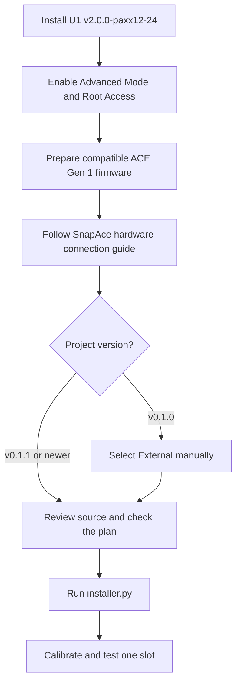

# Manual source installation

You can use this procedure without `START-HERE.cmd` or `Install.ps1`.
You enter the commands yourself and can inspect the source before execution.
**This procedure still runs the open-source `installer.py` on the printer.**
It is not an installer-free procedure.
Neither route requires AI, Codex, or an API key.

> [!CAUTION]
> **Do not copy old SnapAce `filament_feed.py` or `extruder.py` onto U1 firmware 2.0.**
> **This project replaces the upstream software installation steps.** Use the original SnapAce guide for hardware connections only.

| Route | What you run | Guide |
| --- | --- | --- |
| Optional Windows wizard | `START-HERE.cmd`, then `Install.ps1` and the printer's `installer.py` | [Guided installation](quick-start.md) |
| Manual source procedure | PowerShell, `scp`, `ssh`, and the printer's `installer.py` | This page |
| Preserved v0.1.0 | The original manual procedure with manual External selection | [Version choices and fixed downloads](install-options.md) |

The manual command sequence remains available in every release.
The current package includes **MANUAL-INSTALL.html** for offline reading.

> [!IMPORTANT]
> **Do not combine an installer, manifest, and payload from different versions.**
> **v0.1.0 needs manual External selection. v0.1.1 and v0.1.2 set External automatically.**

The computer needs Windows PowerShell and OpenSSH.
It does not need Python or additional Python packages.
The printer uses its existing Python 3 interpreter and `pyserial` dependency.
Use OpenSSH `scp` with `-O` for the file transfers below.
The preflight check refuses a missing dependency instead of installing packages automatically.

## 1. Prepare the prerequisite projects



1. Finish the current print.
2. Save a private copy of your printer configuration.
3. Download [`v2.0.0-paxx12-24`](https://github.com/paxx12-snapmaker-u1/SnapmakerU1-Extended-Firmware/releases/tag/v2.0.0-paxx12-24).
4. Install that release with the [upstream installation guide](https://snapmakeru1-extended-firmware.pages.dev/install).
5. Enable **Settings → Maintenance → Advanced Mode**.
6. Open **Settings → Maintenance → Root Access**.
7. Set Root Access to **Open**.
8. Restart the printer if its interface requests a restart.
9. Reconnect the printer to Wi-Fi if necessary.
10. Read the current address from the printer's Wi-Fi page.

**Expected:** the printer runs `2.0.0-paxx12-24`, and its address opens the web interface.
Advanced Mode, Root Access, and persistence are separate controls.
Root Access enables SSH access, as described in the [upstream SSH guide](https://snapmakeru1-extended-firmware.pages.dev/ssh_access).
The installer manages the `/oem/.debug` persistence marker as part of its backed-up changes.
Firmware upgrades can remove that marker and system modifications. See [data persistence](https://snapmakeru1-extended-firmware.pages.dev/data_persistence).

11. Check the ACE generation and firmware against [the NFC baseline](nfc.md).
12. Complete any required ACE firmware preparation with [the ACE firmware guide](ace-firmware.md).
13. Prepare the cable with the [SnapAce hardware guide](https://github.com/BlackFrogKok/SnapAce#pinout-and-wiring).
14. Connect the four PTFE paths to their matching U1 channels.
15. Keep the machine idle for installation.

Do not perform the old SnapAce software-copy steps on U1 firmware 2.0.
This installer supplies the compatible replacement modules.
It does not automatically merge arbitrary edits in existing core files.


This diagram shows connections only.
It is not an assembly drawing or a source of cable dimensions.

### External: select the instruction for your version

The option is named **External**.
`extended` is part of firmware and configuration names; it is not this reader option.

| Project version | Required action |
| --- | --- |
| v0.1.0 | Select External manually before `check` and `install`. |
| v0.1.1 / v0.1.2 | Leave the current selection unchanged; `install` sets and verifies External automatically. |

For v0.1.0, use these steps while the printer is idle:

1. Open `http://<printer-address>/firmware-config/` with the address from the printer screen.
2. Find **Snapmaker Components → Filament Detection**.
3. Select **External**.
4. Wait for the configuration change and Klipper restart to finish.
5. Refresh the page.
6. Confirm that **External** remains selected.

**Expected:** External is selected, and Klipper returns to ready.
The firmware applies the reader-service change through this control.
Changing a configuration word alone does not establish the correct service state.

In v0.1.1 and v0.1.2, `check` reports the planned External setting without applying it.
`install` backs up the previous setting and reader-service state before changing them.
It then verifies that the internal reader is disabled and OpenRFID is stopped.
External prevents competing U1 reader paths; it does not limit the ACE's supported tag brands.
See the [upstream RFID design](https://snapmakeru1-extended-firmware.pages.dev/design/rfid) and [this project's NFC guide](nfc.md).

## 2. Prepare Windows PowerShell

### Obtain and inspect the source

Choose one complete version from [the version and download page](install-options.md).
For this procedure, download [v0.1.2](https://github.com/Alexantry/Ultimate-U1-ACE-link/raw/refs/heads/main/downloads/Ultimate-U1-ACE-link-v0.1.2.zip) and inspect [the current source](https://github.com/Alexantry/Ultimate-U1-ACE-link).
Use its matching entry in [SHA256SUMS](../downloads/SHA256SUMS).
The checksum applies to the named project archive, not GitHub's generated source ZIP.
Earlier archives, fixed checksums, and their original instructions remain on the [version page](install-options.md).
A matching hash confirms the downloaded bytes match that published archive.
It does not replace your decision to trust or review the source.

1. Open Windows PowerShell.
2. Enter the downloaded project ZIP path.

```powershell
$ArchivePath = Read-Host "Full path to the downloaded project ZIP"
```

3. Calculate its checksum.

```powershell
Get-FileHash -LiteralPath $ArchivePath -Algorithm SHA256
```

4. Compare the result with the checksum for that exact archive.
5. Stop if the checksums differ.
6. Extract the matching archive into a new folder.
7. Enter the extracted folder containing `installer.py`.

```powershell
$ProjectDir = Read-Host "Full path to the folder containing installer.py"
Set-Location -LiteralPath $ProjectDir
$ProjectDir = (Get-Location).Path
```

8. Open the installer source for review.

```powershell
notepad .\installer.py
```

9. Open the manifest.

```powershell
notepad .\manifest.json
```

10. Inspect the four module files in `payload` with your text editor.

| File | Purpose |
| --- | --- |
| `installer.py` | Checks, backups, host-file changes, service handling, verification, and rollback. |
| `manifest.json` | Supported firmware, module destinations, and accepted file hashes. |
| `payload/ace.py` | ACE communication, NFC synchronization, and transport control. |
| `payload/filament_feed.py` | U1 loading and unloading workflow. |
| `payload/filament_detect.py` | Material retention and detection events. |
| `payload/extruder.py` | U1 extruder integration. |

These are readable Python and JSON files.
The install command executes the inspected `installer.py`; it does not download another installer or flash either device's firmware.
Keep private backups and NFC keys outside the project folder.

11. Check the required commands.

```powershell
Get-Command ssh, scp
```

**Expected:** PowerShell lists both `ssh` and `scp`.
If either command is missing, enable **OpenSSH Client** in Windows Optional Features before continuing.

### Confirm the connection

1. Enter the printer address.

```powershell
$PrinterAddress = Read-Host "Printer address from the Wi-Fi page"
```

2. Set the SSH target.

```powershell
$PrinterTarget = "root@$PrinterAddress"
```

3. Check SSH access.

```powershell
ssh $PrinterTarget "id"
```

**Expected:** the output includes `uid=0(root)`.
SSH can request host-key confirmation on the first connection.
Confirm the intended printer before accepting its key.
Stop if SSH reports that an existing host key changed unexpectedly.
Enter the printer's SSH password when prompted; password characters are not displayed.
Do not put the password in a command or settings file.
The [upstream SSH guide](https://snapmakeru1-extended-firmware.pages.dev/ssh_access) documents the factory credentials.

## 3. Prepare the local settings

1. Copy the conservative template.

```powershell
Copy-Item .\config\settings.example.json .\config\settings.local.json
```

2. List the printer's serial device links.

```powershell
ssh $PrinterTarget "ls -l /dev/serial/by-id/"
```

**Expected:** an ACE USB device appears in the list.
An absent or ambiguous device is a connection problem to resolve before installation.
Do not guess a `/dev/ttyUSB` or `/dev/ttyACM` number.

3. Identify the ACE USB serial path from your hardware connection.
4. Open the local settings file.

```powershell
notepad .\config\settings.local.json
```

5. Set `serial` to the exact ACE device path.
6. Set transport values with [the configuration guide](configuration.md).
7. Keep `forward_takeup_length` at `0` for initial calibration.

For v0.1.1 or v0.1.2, add `"auto_detect_serial": false` if you require the explicit `serial` value.
Do not add that option to v0.1.0, which requires the explicit serial path.
The current default can find one matching ACE automatically when no existing or custom serial choice applies.
JSON entries need separating commas; the final entry has no trailing comma.

8. Set `calibrated_acknowledged` to `true` only after you review the path measurements.
9. Save the file.

**Expected:** the JSON describes your connected ACE and measured paths.
The reference distances of 1250 mm and 1150 mm are not universal defaults.
The tested 300 mm forward take-up is optional; it has no tension feedback.

Existing ACE settings remain unchanged unless `apply_existing_settings` is `true`.
The installation plan shows the effective values before installation.

## 4. Transfer the project

1. Set a new remote directory name.

```powershell
$RemoteDir = "/userdata/ultimate-u1-ace-stage-" + (Get-Date -Format "yyyyMMdd-HHmmss")
```

2. Copy the project to the printer.

```powershell
scp -O -r "$ProjectDir" "${PrinterTarget}:$RemoteDir"
```

3. Record the remote directory name.

```powershell
$RemoteDir
```

4. Confirm that the main files arrived.

```powershell
ssh $PrinterTarget "ls '$RemoteDir/installer.py' '$RemoteDir/manifest.json' '$RemoteDir/config/settings.local.json'"
```

**Expected:** the three file paths appear without errors.
The transfer does not install the modules.
Each transfer uses a new directory.
Keep this PowerShell session open; subsequent commands use the same variables.

## 5. Check before installation

The printer must be idle, with no active print or filament operation.
All nozzle and bed targets must be zero, with actual temperatures below 50 °C.
The ACE dryer and feed assist must be off.

| Installation state | Required filament state |
| --- | --- |
| First installation | All four ACE inlets and all four U1 head sensors are empty. |
| Existing ACE update | Keep current filament positions and material data unchanged. |

Complete any necessary normal unloading before the cooling checks.
Do not unload all four slots merely to update an existing ACE installation.
First installation can clear stale material labels from confirmed empty slots.
The installer reports that change and requires three stable samples.

### Stop active feed assist on an existing installation

This preparation applies only when an existing ACE installation reports active feed assist.
It does not require unloading all four slots.

**`ACE_DISABLE_FEED_ASSIST` causes movement.**
It stops feed assist, then requests a 5 mm retraction at speed 10.
The installer does not run this command automatically.

1. Confirm that no print or filament operation is active.
2. Open the printer's web console in Fluidd or Mainsail.
3. Keep your hands away from the rollers.
4. Run the command below.

```gcode
ACE_DISABLE_FEED_ASSIST
```

5. Wait for ACE to return to ready.

Alternatively, use the U1's normal Unload action for the active slot.
That alternative performs the complete configured unload cycle.
Repeat the cooling checks below after any unload cycle.

### Finish the idle checks

1. Set all heater targets to zero in the printer interface.
2. Stop the ACE dryer if it is active.
3. Wait until all nozzle and bed temperatures are below 50 °C.

On an existing ACE installation, `ACE_STOP_DRYING` stops the dryer through the web console.

1. Read the current installation status.

```powershell
ssh $PrinterTarget "cd '$RemoteDir' && python3 installer.py status"
```

**Expected:** JSON reports `firmware: "2.0.0-paxx12-24"` and `klipper_state: "ready"`.
Before first installation, `ace_version` can be `null`, and `managed` can be `false`.
The current status also reports the reader mode, serial candidates, and existing ACE settings.

2. Run the read-only check.

```powershell
ssh $PrinterTarget "cd '$RemoteDir' && python3 installer.py check --settings config/settings.local.json"
```

**Expected:** `compatible` and `read_only` are `true`.
The `effective_settings` values must match your intended configuration.
Before installation, `calibration_acknowledged` must also be `true`.
In v0.1.1 and v0.1.2, `filament_detection: "external"` describes the plan; `previous_filament_detection` describes the current setting.

3. Review `destinations` and `effective_settings`.
4. Resolve every check failure before installation.

An unknown core-file modification is a stop condition.
Preserve your modified file before you arrange a compatible migration.
Do not replace it merely to bypass the check.
Neither `status` nor `check` changes printer files or starts an installation.

## 6. Install

1. Confirm that the printer remains idle and cold.
2. Clear the printer movement area.
3. Run the installation command once.

```powershell
ssh $PrinterTarget "cd '$RemoteDir' && python3 installer.py install --settings config/settings.local.json"
```

4. Wait for the command to finish.

**Expected:** the command prints a backup identifier, then JSON containing `installed: true` and `ready_samples: 3`.
The backup is under `/userdata/ultimate-u1-ace-link/backups/`.
The printer can briefly show Klipper disconnected while its service restarts.
In v0.1.1 and v0.1.2, the result also reports `filament_detection: "external"`.
The `empty_slot_metadata_initialized` field identifies any first-install empty-slot material reset.

5. Save the reported backup identifier privately.
6. Read the final status.

```powershell
ssh $PrinterTarget "cd '$RemoteDir' && python3 installer.py status"
```

**Expected:** `klipper_state` is `ready`, `managed` is `true`, and `ace_version` matches the project's manifest.
For v0.1.1 and v0.1.2, `internal_rfid_enabled` and `openrfid_running` must be `false`.
The install command also verifies ACE readiness before reporting success.
It does not issue feed, retract, home, or heater commands for an installation test.

7. Continue with [the single-slot acceptance check](validation.md#repeat-the-acceptance-check).

If SSH disconnects during installation, do not repeat the install command immediately.
Reconnect with the same remote directory and read `status` first.
An interrupted connection does not establish whether installation succeeded or failed.
Keep the printer idle until the result is established.

If installation fails, check whether automatic rollback was verified.
Preserve the backup identifier and error message.
Use [update and rollback](update-and-rollback.md) for recovery, including unavailable-status recovery.
Use [troubleshooting](troubleshooting.md) for a refused check or connection error.
