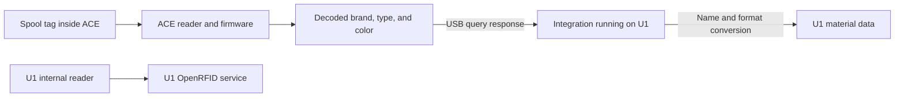

# NFC and material data

[简体中文](nfc.zh-CN.md)

The ACE reads and decodes the spool tag. The decoding comes from [OpenCubic](https://github.com/Jupsi/OpenCubic).
This project asks the ACE for the result and synchronizes brand, material, subtype, and color with the U1.

> [!IMPORTANT]
> **ACE and the U1 internal reader are separate systems.**
> **With the pinned OpenCubic firmware, users do not need to find or enter NFC keys for its supported tags.**
> Keep the U1 reader mode set to External.

## What you need

| Item | Required setup |
| --- | --- |
| Hardware | Anycubic ACE Pro Gen 1, connected to the U1. |
| ACE firmware | `CV1.3.863`, with OpenCubic CFW `1.1.1`. |
| Firmware download | `ACE_V1.3.863_20260716.bin` from [OpenCubic release v1.0.2](https://github.com/Jupsi/OpenCubic/releases/tag/v1.0.2). |
| U1 reader mode | **External**; the current installer sets this automatically. |
| Filament | A supported tag correctly positioned on the spool. |

Prepare the firmware with [the ACE firmware wizard](ace-wizard.md) or [the ACE stage in the manual guide](installation.md#ace-firmware).
Do not use an ACE 2 firmware image on ACE Pro Gen 1.

## Supported tags

The upstream column follows [OpenCubic's v1.0.2 support document](https://github.com/Jupsi/OpenCubic/blob/v1.0.2/docs/supported-spools.md).
The Anycubic generation labels describe tag variants, not the ACE hardware generation.

| Tag brand or format | Status in the detailed upstream document | Physical validation in this project |
| --- | --- | --- |
| Anycubic Gen 1 tags | Confirmed | Not tested here. |
| Anycubic Gen 2 tags | Confirmed | Not tested here. |
| Bambu Lab | Confirmed | Brand, filament type, and filament color recognition and synchronization physically verified. |
| TigerTag | Confirmed on ACE Pro Gen 1 | Not tested here. |
| OpenSpool | Confirmed on ACE Pro Gen 1 | Not tested here. |
| Elegoo | Implemented, untested | Not tested here. |
| OpenPrintTag, including Prusa format | Implemented, untested | Not tested here. |
| QIDI | Not supported; placeholder implementation only | Not tested here. |
| Creality | Not supported; placeholder implementation only | Not tested here. |

Our own tests cover Bambu tags only. They do not prove every spool, batch, or tag position.
For QIDI, Creality, and spools without a tag, enter the material on the U1.

## How recognition works

1. The ACE reader reads the tag. ACE firmware decodes it.
2. The integration on the U1 queries the ACE and receives the decoded brand, type, and color for that slot.
3. The integration converts names and color formats and writes the result to the U1. For example, `Bambu Lab` / `PLA Matte` becomes `Bambu` / `PLA` / `Matte`. An empty brand becomes `Generic`.

The U1 internal reader is a separate reader and is not used. The installer sets **External** and stops the U1 OpenRFID service.

## Check External mode

1. Open the printer's `/firmware-config/` page.
2. Find **Snapmaker Components**.
3. Check **Filament Detection**. The selected value must be **External**. The retained v0.1.0 package does not set it; select External manually there.

> [!CAUTION]
> **Keep External selected while using this ACE integration.**
> Do not enable internal OpenRFID to improve ACE recognition.
> That change activates a separate reader path and can conflict with ACE material handling.

## Check recognition

1. Insert filament into an empty ACE inlet. Keep your hands away from the rollers.
2. Wait for the short bite and NFC recognition to finish.
3. Open that slot's material details on the U1 and compare them with the spool.

- The filament waits at the ACE. Insertion does not load it to the print head.
- Recognition can take longer when several slots change close together. Do not issue repeated Load commands during recognition.
- Loading and unloading keep the material data while the ACE inlet remains occupied.
- A confirmed empty inlet clears that slot's data. An unknown or disconnected state does not.

## If recognition fails

| Observation | What to do |
| --- | --- |
| No tag on the spool | Enter material data manually on the U1. |
| QIDI or Creality spool | Enter material data manually. These decoders are not implemented. |
| A supported tag is not recognized | Check the exact ACE firmware, that the original tag is present, and the tag position. |
| Type and color appear, but brand is Generic | The ACE returned an empty brand. Set the brand manually if needed. |
| U1 shows Bambu, but the slicer does not | Check the slicer's filament profiles separately. |

This project contains no NFC keys. Do not publish configuration backups, credentials, or unredacted logs.
See [troubleshooting](troubleshooting.md) and [validation](validation.md).
