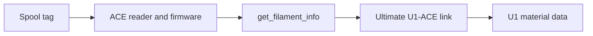

# NFC and material data

## Two separate reader paths

The ACE path works as follows:

ACE firmware reads and decodes the tag.
This project receives the decoded brand, material type, and color through `get_filament_info`.
It does not use the U1 internal reader to read a spool inside ACE.

The tested ACE baseline is Gen 1 `CV1.3.863`, with OpenCubic CFW `1.1.1`.
The matching image is an asset of [OpenCubic release v1.0.2](https://github.com/Jupsi/OpenCubic/releases/tag/v1.0.2).
The release tag and the embedded firmware version are different identifiers.
See [the ACE firmware guide](ace-firmware.md) before any optional firmware change.

The U1 internal OpenRFID path is separate.
Its user configuration is `/oem/printer_data/config/extended/openrfid_user.cfg`.
This project preserves that file.
It does not transfer its keys to ACE.

## Select External mode

The installer now sets External mode automatically.
It also applies the internal-reader configuration and stops the OpenRFID service.
The installation result verifies the active reader state.
Backups include the previous mode and service state for rollback.

The exact menu is **Snapmaker Components → Filament Detection → External**.
There is no reader option named **extended**.
Use the following manual steps only to inspect or troubleshoot the setting.

1. Open the printer's `/firmware-config/` page.
2. Find **Snapmaker Components**.
3. Select **External** for **Filament Detection**.
4. Apply the configuration with the page controls.
5. Follow the page's restart instruction, if shown.
6. Wait for the printer to become ready.

Some firmware documentation calls this control **RFID Detection System**.
External mode disables the internal readers, as described in the [extended firmware RFID design](https://snapmakeru1-extended-firmware.pages.dev/design/rfid).
It prevents the internal path from conflicting with ACE material updates.

The compatibility table's external-reader rows describe those specific readers.
They do not restrict every external device to OpenSpool.
ACE recognition still depends on ACE hardware and firmware.

## Brand conversion is not tag support

| Decoded ACE brand | U1 brand |
| --- | --- |
| `Bambu Lab`, `BambuLab`, or `Bambu` | `Bambu` |
| `Creality` | `Creality` |
| `Elegoo` | `Elegoo` |
| `Qidi` | `QIDI` |
| `Snapmaker` | `Snapmaker` |
| `Anycubic` | `Anycubic` |
| Another nonempty brand | The received brand text |
| Empty brand | `Generic` |

These conversions normalize names after a successful read.
They do not add a tag decoder or authentication key to ACE firmware.
The project therefore does not claim every OpenRFID-compatible tag also works with ACE.

For example, `PLA Matte` becomes material type `PLA` and subtype `Matte`.
Color transfers separately.
A valid brand does not guarantee that a slicer contains a matching filament profile.

## Keep keys private

Users must obtain any required proprietary keys independently.
This project does not provide keys or links to key sources.
Do not copy keys into this repository, issue reports, screenshots, or published backups.

Preserving `openrfid_user.cfg` preserves the U1 internal-reader configuration only.
It does not prove that ACE can authenticate the same tag.
Do not add the U1 key to this project's settings JSON.

## Check recognition

1. Insert filament into an empty ACE inlet.
2. Keep your hands away from the rollers.
3. Wait for the recognition movement to finish.
4. Open that slot's material details on the U1.
5. Compare the brand, type, subtype, and color with the spool.

ACE recognition can take longer when multiple slots change close together.
The host waits up to 180 seconds for readiness before the load movement budget starts.
Do not issue repeated Load commands during recognition.

Filament without an NFC tag can use manually entered material data.
Normal head loading and unloading retain that data while the ACE inlet remains occupied.
A confirmed empty inlet clears that slot's data.
An unknown or disconnected state does not count as an empty inlet.
