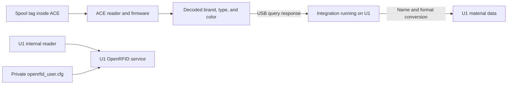

# NFC and material data

[简体中文](nfc.zh-CN.md)

With compatible ACE firmware, this project synchronizes recognized brand, material, subtype, and color with the U1.
It receives decoded tag data; it does not add tag decoders to ACE firmware.

**This project has physically verified Bambu brand, filament type, and filament color recognition and synchronization.**
The pinned ACE firmware also reports support for Anycubic and several open tag formats.
**This project has not physically tested those tags.**

> [!IMPORTANT]
> **ACE and the U1 internal reader are separate systems.**
> The tested ACE setup needs no additional Bambu key entry in this project's installer.
> The key-file instructions below apply only to the U1 internal OpenRFID reader.

## What you need for ACE recognition

| Item | Required setup |
| --- | --- |
| Hardware | Anycubic ACE Pro Gen 1, connected to the U1. |
| ACE firmware | `CV1.3.863`, with OpenCubic CFW `1.1.1`. |
| Firmware download | `ACE_V1.3.863_20260716.bin` from [OpenCubic release v1.0.2](https://github.com/Jupsi/OpenCubic/releases/tag/v1.0.2). |
| U1 reader mode | **External**; the current installer sets this automatically. |
| Filament | A supported tag correctly positioned on the spool. |

The release name `v1.0.2` and embedded CFW version `1.1.1` identify different parts of the release.
Use [the bilingual ACE firmware wizard](ace-wizard.md) to prepare the supported version.
The [manual firmware procedure](ace-firmware.md) remains available for source-based maintenance.
Do not use an ACE 2 firmware image on ACE Pro Gen 1.

The tested ACE firmware reads supported Bambu tags without a separate key supplied by this host project.
The project provides no ACE key-entry field.
The pinned OpenCubic documentation provides no supported runtime procedure for adding proprietary keys to ACE.
Do not put keys in this project's settings JSON.

## Supported tags: upstream status and our tests

The following table follows [OpenCubic's detailed v1.0.2 support document](https://github.com/Jupsi/OpenCubic/blob/v1.0.2/docs/supported-spools.md).
The Anycubic generation labels describe tag variants, not the required ACE hardware generation.

| Tag brand or format | Status in the detailed upstream document | Physical validation in this project |
| --- | --- | --- |
| Anycubic Gen 1 tags | Confirmed | Not tested here. |
| Anycubic Gen 2 tags | Confirmed | Not tested here. |
| Bambu Lab | Confirmed | Brand, filament type, and filament color recognition and synchronization physically verified. |
| TigerTag | Confirmed on ACE Pro Gen 1 | Not tested here. |
| OpenSpool | Confirmed on ACE Pro Gen 1 | Not tested here. |
| Elegoo | Implemented, untested | Not tested here. |
| OpenPrintTag, including Prusa format | Implemented, untested | Not tested here. |
| QIDI | Not supported; upstream reports unknown AES keys and a stub | Not tested here. |
| Creality | Not supported; upstream reports unknown AES keys and a stub | Not tested here. |

The same release's README still labels TigerTag and OpenSpool as untested.
Its detailed support document reports physical confirmation; this table uses that more specific document.
Our own physical NFC evidence is limited to Bambu tags.
It does not establish compatibility with every spool, production batch, or tag placement.

**Adding a key to the U1 configuration does not add QIDI or Creality support to ACE.**
Brand-name conversion also cannot add that support.
The supported OpenRFID formats on the U1 internal reader are a different compatibility list.

## Two separate reader paths



1. The ACE reader reads the tag. ACE firmware decodes the tag and identifies the material.
2. The integration on U1 queries ACE status. It uses `get_filament_info` to obtain the decoded data for that slot.
3. ACE returns fields such as `brand`, `type`, RGB `color`, `sku`, and the `rfid` state.
4. The integration converts brand names and color formats. It separates the material type and subtype, then writes them with `SET_PRINT_FILAMENT_CONFIG`.

**U1 requests the information, and ACE returns the decoded result. ACE does not directly edit U1 settings. U1 does not decrypt raw NFC tags in this path.**
For example, ACE can return `Bambu Lab`, `PLA Matte`, and an RGB color.
The integration converts these to `Bambu`, `PLA` / `Matte`, and the U1 color value.
The `rfid` field is a recognition state. It is not raw tag data for U1 to decode.
The U1 internal reader cannot read a spool remotely through the ACE USB connection.

The U1 OpenRFID service uses its own reader and private configuration.
Preserving that configuration does not transfer its keys to ACE.

## Select External mode

The current installer sets **External**, disables the internal reader path, and stops the U1 OpenRFID service.
It verifies those changes and backs up the previous configuration and service state.
The retained v0.1.0 package requires manual External selection.

1. Open the printer's `/firmware-config/` page.
2. Find **Snapmaker Components**.
3. Check **Filament Detection**.

**Expected:** the selected value is **External**.
For v0.1.0 setup or deliberate troubleshooting, select External and wait for the service changes to finish.
The correct option is **External**; there is no reader option named **extended**.
Some upstream documentation calls the control **RFID Detection System**.

External prevents the internal reader from competing with ACE material updates.
It does not restrict ACE to OpenSpool tags.
The external-reader rows in the [upstream RFID table](https://snapmakeru1-extended-firmware.pages.dev/design/rfid) describe those particular reader projects.
ACE recognition depends on its own firmware and tags.

> [!CAUTION]
> **Keep External selected while using this ACE integration.**
> Do not enable internal OpenRFID merely to enter keys or improve ACE recognition.
> That change activates a separate reader path and can conflict with ACE material handling.

## Check recognition and material retention

1. Insert filament into an empty ACE inlet.
2. Keep your hands away from the rollers.
3. Wait for the short bite and NFC recognition to finish.
4. Open that slot's material details on the U1.
5. Compare the brand, type, subtype, and color with the spool.

**Expected:** supported material data appears, while the filament waits for the U1 Load action.
Insertion does not automatically send the filament all the way to the print head.
Recognition can take longer when several slots change close together.
The host waits up to 180 seconds for readiness before starting the load movement budget.
Do not issue repeated Load commands during recognition.

Filament without a tag can use manually entered material data in the U1 interface.
Normal loading and unloading retain recognized or manually entered data while the ACE inlet remains occupied.
A confirmed empty inlet clears that slot's data.
An unknown or disconnected state does not count as an empty inlet.

## Brand conversion is not tag support

| Decoded ACE brand | U1 brand |
| --- | --- |
| `Bambu Lab`, `BambuLab`, or `Bambu` | `Bambu` |
| `Creality` | `Creality` |
| `Elegoo` | `Elegoo` |
| `Qidi` | `QIDI` |
| `Snapmaker` | `Snapmaker` |
| `Anycubic` | `Anycubic` |
| Another nonempty brand | The received brand text |
| Empty brand | `Generic` |

These conversions normalize names after a successful read.
They do not add a tag decoder or authentication key to ACE firmware.
For example, `PLA Matte` becomes material type `PLA` and subtype `Matte`.
Color transfers separately.
A valid brand does not guarantee that a slicer contains a matching filament profile.

## U1 internal OpenRFID key file: reference only

**Skip this section for normal ACE installation.**
It explains an existing U1 internal-reader configuration, not a missing ACE installation step.
The installer preserves this private file without reading its keys into ACE.

| Location | Path |
| --- | --- |
| Canonical printer path | `/oem/printer_data/config/extended/openrfid_user.cfg` |
| Equivalent path on supported U1 firmware | `/home/lava/printer_data/config/extended/openrfid_user.cfg` |
| Web file manager | **Configuration → extended → openrfid_user.cfg** |

### Find the file and save a private backup

1. Open the printer's normal web interface in your browser.
2. Open **Configuration**.
3. Open the `extended` folder.
4. Find `openrfid_user.cfg`.
5. Download a private backup with the file menu.
6. Store the backup outside the public project folder.
7. Open the original file in the web editor.

A missing file does not prevent ACE recognition.
Do not create it to fix ACE recognition.
For a separate U1 internal-reader configuration, create this exact filename only if it does not already exist.
The [upstream RFID design](https://snapmakeru1-extended-firmware.pages.dev/design/rfid) describes that separate reader system.

### Edit existing sections

A leading `#` makes a configuration line a comment.
Removing that `#` activates the line in the file; it does not start the disabled OpenRFID service.
Use an existing section when present.
Do not create a second section with the same name.
Keep unrelated sections and existing working values unchanged.

1. Find `[bambu_lab_tag_processor]` or its commented form.
2. Remove the leading `#` from the section header when configuring this internal reader.
3. Remove the leading `#` from its `key` line.
4. Replace its value with your independently obtained Bambu key.

Bambu configuration has one field:

```ini
[bambu_lab_tag_processor]
key = <YOUR_BAMBU_KEY_32_HEX>
```

The angle-bracket text is a placeholder, not a key.
Do not save that placeholder as a working value.
A key must contain exactly 32 hexadecimal characters: `0`–`9`, `a`–`f`, or `A`–`F`.
Do not add `0x`, quotation marks, spaces, or angle brackets.
A correctly formatted value is not necessarily the correct authentication key.

5. Check that no duplicate section or placeholder remains.
6. Save the file.

Creality internal-reader configuration has two separate fields:

```ini
[creality_tag_processor]
key = <YOUR_CREALITY_KEY_32_HEX>
encryption_key = <YOUR_CREALITY_ENCRYPTION_KEY_32_HEX>
```

1. Find the existing `[creality_tag_processor]` section when configuring the U1 internal reader.
2. Remove the leading `#` from that header.
3. Remove the leading `#` from the `key` line.
4. Remove the leading `#` from the `encryption_key` line.
5. Put the correct 32-character value in `key`.
6. Put the correct 32-character value in `encryption_key`.
7. Check that no duplicate section or placeholder remains.
8. Save the file.

**Do not assume `key` and `encryption_key` have the same value.**
The two fields serve different roles and require their corresponding values.
These settings do not enable Creality support in ACE.
Keep External selected for this project; the saved internal-reader configuration remains inactive.

## Keep keys private

Users must obtain required proprietary keys independently.
This project provides neither keys nor links to key sources.
Do not publish the file, its backup, screenshots containing keys, or keys in issue reports.
Do not add keys to the installer JSON, firmware download profile, or repository.
Keep private configuration when changing firmware or reinstalling the host integration.

## If recognition fails

| Observation | Next check |
| --- | --- |
| No tag on the spool | Enter material data manually. |
| Type and color appear, but brand is Generic | Check whether ACE supplied a nonempty brand. |
| A supported tag is not recognized | Check the exact ACE firmware, original tag presence, and tag position. |
| Recognition is still running | Wait for completion before starting a load. |
| QIDI or Creality fails on the pinned ACE firmware | Use manual material data; the U1 key file does not add ACE support. |
| U1 shows Bambu, but the slicer does not | Check the slicer's available filament profiles separately. |

See [troubleshooting](troubleshooting.md) and [the physical validation limits](validation.md).
