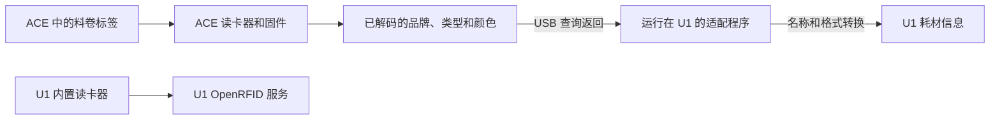

# NFC 与耗材信息

[English](nfc.md)

本项目把 ACE 已识别的品牌、材料类型、细分类型和颜色同步到 U1。
识别标签的是 ACE 自己的读卡器和固件；本项目负责接收、转换和保留这些信息。

**本项目已实测成功：拓竹品牌、耗材类型和耗材颜色的识别与同步。**
固定 ACE 固件还支持 Anycubic 和部分开放标签格式，**但本项目尚未实际测试这些标签**。

> [!IMPORTANT]
> **ACE 读卡器和 U1 内置读卡器是两套独立系统。**
> **使用本项目固定的 OpenCubic 固件及其支持的标签时，用户不需要自行寻找或填写 NFC 密钥。**
> U1 的耗材读取方式保持 External。

## 先确认 ACE 所需条件

| 项目 | 应当是什么 |
| --- | --- |
| 硬件 | Anycubic ACE Pro 第一代，已正确连接 U1。 |
| ACE 固件 | `CV1.3.863`，内含 OpenCubic CFW `1.1.1`。 |
| 对应下载 | [OpenCubic v1.0.2 发布页](https://github.com/Jupsi/OpenCubic/releases/tag/v1.0.2)中的 `ACE_V1.3.863_20260716.bin`。 |
| U1 耗材读取方式 | **External（外部）**；当前安装器会自动设置并检查。 |
| 料卷 | 带受支持的 NFC 标签，且标签位置适合 ACE 读取。 |

发布页标签 `v1.0.2` 和固件内部版本 `1.1.1` 不是同一种版本编号，因此同时出现是正常的。
需要准备 ACE 固件时，按[双语 ACE 固件向导](ace-wizard.zh-CN.md)操作即可。
选择手动安装时，从[中文手动指南的 ACE 步骤](installation.zh-CN.md#ace-firmware)开始。
[高级固件维护参考（英文）](ace-firmware.md)仍保留，供需要逐项检查维护工具的用户使用。不能把 ACE 2 的镜像刷入第一代 ACE。

OpenCubic 在 ACE 内部处理受支持的标签格式。
本安装流程没有需要用户提供 NFC 密钥的步骤。

## 哪些 NFC 标签受支持？

下表以 [OpenCubic v1.0.2 的详细支持文档](https://github.com/Jupsi/OpenCubic/blob/v1.0.2/docs/supported-spools.md)为依据。
**多品牌 NFC 解码能力由 OpenCubic 项目提供；Ultimate U1-ACE link 负责读取 ACE 返回的识别结果并同步到 U1。**
表中的“Anycubic 第一代／第二代”指标签格式，不表示本项目支持第二代 ACE 硬件。

| 标签品牌或格式 | 上游详细文档的状态 | 本项目的实机验证 |
| --- | --- | --- |
| Anycubic 第一代标签 | 已确认 | 本项目未实测。 |
| Anycubic 第二代标签 | 已确认 | 本项目未实测。 |
| Bambu Lab／拓竹 | 已确认 | 已实测品牌、耗材类型和耗材颜色的识别与同步。 |
| TigerTag | 已在第一代 ACE 上确认 | 本项目未实测。 |
| OpenSpool | 已在第一代 ACE 上确认 | 本项目未实测。 |
| Elegoo／智能派 | 已实现解析，尚未实测 | 本项目未实测。 |
| OpenPrintTag，包括 Prusa 格式 | 已实现解析，尚未实测 | 本项目未实测。 |
| QIDI／起迪 | 不支持；仅有占位实现 | 本项目未实测。 |
| Creality／创想三维 | 不支持；仅有占位实现 | 本项目未实测。 |

同一版本的 README 对 TigerTag 和 OpenSpool 仍写着“尚未实测”，更新滞后于详细支持文档。
这里采用详细文档明确列出的第一代 ACE 实测状态，并与本项目自己的测试结果分开说明。
**本项目自己的 NFC 实机证据仅覆盖拓竹标签，不代表每个品牌、批次或标签安装位置都已验证。**

**固定 ACE 固件尚未实现 QIDI 和 Creality 标签识别。** 这些料卷请手动设置材料信息，品牌名称映射不能增加标签支持。
U1 内置 OpenRFID 的品牌支持表与 ACE 的支持表也不能互相替代。

## 理解两条读卡路径

1. ACE 的读卡器读取标签，ACE 固件完成标签解码和材料识别。
2. 运行在 U1 上的适配程序查询 ACE 状态，并通过 `get_filament_info` 获取该槽的已解码信息。
3. ACE 返回品牌 `brand`、耗材类型 `type`、RGB 颜色 `color`、`sku` 和 `rfid` 状态等字段。
4. 适配程序统一品牌名称，分开材料类型与细分类型，转换颜色格式，再通过 `SET_PRINT_FILAMENT_CONFIG` 写入 U1。

**这是 U1 查询、ACE 返回识别结果的流程。ACE 不会直接修改 U1 配置；U1 也不在这条路径中解密原始 NFC 标签。**
例如，ACE 返回 `Bambu Lab`、`PLA Matte` 和 RGB 颜色后，适配程序把它们整理成 `Bambu`、`PLA`／`Matte` 和 U1 使用的颜色值。
这里的 `rfid` 是识别状态字段，不是供 U1 解码的原始标签内容。
U1 内置读卡器不会通过 USB 去读取 ACE 里面的料卷。

U1 的 OpenRFID 服务使用自己的读卡器和配置文件。
它与 ACE 解码路径独立，在本方案中保持停用。

## External 应该怎么设置？

当前安装器会自动选择 **External**、禁用 U1 内置读卡路径并停止 U1 的 OpenRFID 服务。
它会核对结果，并备份原来的设置和服务状态。
保留的旧版 v0.1.0 安装包仍需手动设置 External。

查看当前状态：

1. 在浏览器打开打印机的 `/firmware-config/` 页面。
2. 找到 **Snapmaker Components**。
3. 查看 **Filament Detection**。

**完成标准：选中值是 External。**
如果使用 v0.1.0 或正在明确排查这个设置，选择 External 后等待相关服务重启完成。
选项名称是 **External**，不是 `extended`；部分上游说明把该项称为 **RFID Detection System**。

External 的作用是避免 U1 内置读卡路径与 ACE 的材料更新互相干扰。
它不表示 ACE 只能读取 OpenSpool。
[上游 RFID 说明](https://snapmakeru1-extended-firmware.pages.dev/design/rfid)中的外置读卡器表格，描述的是表内那些具体项目，不是所有外接设备的共同上限。

> [!CAUTION]
> **使用本项目连接 ACE 时，请保持 External。**
> 不要为了修复 ACE 识别，改成内置 OpenRFID 模式。
> 切换后启用的是另一条读卡路径，可能干扰 ACE 的材料信息处理。

## 第一次检查识别结果

1. 向一个空 ACE 入口插入耗材。
2. 把手移开滚筒。
3. 等待短咬料和 NFC 识别结束。
4. 在 U1 屏幕打开该槽的耗材详情。
5. 对照料卷检查品牌、类型、细分类型和颜色。

**预期结果：识别信息出现，线材停在 ACE 端，等待你点击 U1“进料”。**
插入耗材不会自动长送到打印头。
先后插入多卷时，ACE 识别可能需要更长时间；本项目最多等待 180 秒就绪，然后才开始计算送料动作的时间限额。
识别期间不要反复点“进料”。

没有 NFC 标签的耗材，可以在 U1 耗材界面手动填写材料信息。
只要 ACE 入口仍检测到耗材，正常进料和退料都会保留自动识别或手填的数据。
真正从 ACE 入口拔出耗材后，该槽的信息才会清空。
断连、未知状态或暂时没有新状态，不会被当作“已拔出”。

## 品牌名称转换不等于增加标签支持

| ACE 返回的品牌文字 | U1 显示的品牌 |
| --- | --- |
| `Bambu Lab`、`BambuLab`、`Bambu` | `Bambu` |
| `Creality` | `Creality` |
| `Elegoo` | `Elegoo` |
| `Qidi` | `QIDI` |
| `Snapmaker` | `Snapmaker` |
| `Anycubic` | `Anycubic` |
| 其他非空品牌名 | 保留 ACE 返回的名称。 |
| 空品牌名 | `Generic` |

这些规则只整理成功读取后的品牌文字，不会给 ACE 增加标签解码器。
因此，映射表中出现 Creality、QIDI 或 Snapmaker，并不证明 ACE 能读取这些品牌的原装标签。

例如，`PLA Matte` 会分成材料类型 `PLA` 和细分类型 `Matte`，颜色单独同步。
U1 正确显示品牌，也不保证切片软件中存在同名材料预设。

## 保留私人配置

本项目不包含专有 NFC 密钥。
升级或重装前保留自己的私人配置；不要公开配置备份、凭据或未脱敏的维护日志。

## 没有识别时，先区分是哪种情况

| 看到什么 | 应检查什么 |
| --- | --- |
| 料卷没有 NFC 标签 | 在 U1 手动填写材料信息。 |
| 类型和颜色正确，品牌显示 Generic | ACE 是否返回了非空品牌名称。 |
| 声称支持的标签没有识别 | ACE 是否为准确固件、料盘是否确有原装标签、标签位置是否适合读取。 |
| 料盘仍在识别转动 | 等待识别结束，不要重复发送进料操作。 |
| 固定 ACE 固件读不出 QIDI 或 Creality | 使用手填材料；这些标签的解码尚未实现。 |
| U1 显示拓竹，切片软件不显示 | 单独检查切片软件的材料预设和显示限制。 |

更多信息见[故障排查](troubleshooting.zh-CN.md)和[实机验证范围](validation.md)。
