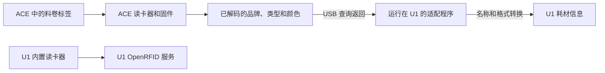

# NFC 与耗材信息

[English](nfc.md)

标签由 ACE 读取和解码，解码能力来自 [OpenCubic](https://github.com/Jupsi/OpenCubic)。
本项目向 ACE 查询结果，把品牌、材料类型、细分类型和颜色同步到 U1。

> [!IMPORTANT]
> **ACE 读卡器和 U1 内置读卡器是两套独立系统。**
> **使用本项目固定的 OpenCubic 固件及其支持的标签时，用户不需要自行寻找或填写 NFC 密钥。**
> U1 的耗材读取方式保持 External。

## 需要什么

| 项目 | 应当是什么 |
| --- | --- |
| 硬件 | Anycubic ACE Pro 第一代，已正确连接 U1。 |
| ACE 固件 | `CV1.3.863`，内含 OpenCubic CFW `1.1.1`。 |
| 对应下载 | [OpenCubic v1.0.2 发布页](https://github.com/Jupsi/OpenCubic/releases/tag/v1.0.2)中的 `ACE_V1.3.863_20260716.bin`。 |
| U1 耗材读取方式 | **External（外部）**；当前安装器会自动设置。 |
| 料卷 | 带受支持的标签，且标签位置正确。 |

用 [ACE 固件向导](ace-wizard.zh-CN.md)或[手动指南的 ACE 步骤](installation.zh-CN.md#ace-firmware)准备固件。
不要把 ACE 2 的固件镜像刷入第一代 ACE Pro。

## 支持的标签

“上游”一列以 [OpenCubic v1.0.2 的支持文档](https://github.com/Jupsi/OpenCubic/blob/v1.0.2/docs/supported-spools.md)为依据。
表中的“Anycubic 第一代／第二代”指标签格式，不是 ACE 硬件代数。

| 标签品牌或格式 | 上游详细文档的状态 | 本项目的实机验证 |
| --- | --- | --- |
| Anycubic 第一代标签 | 已确认 | 本项目未实测。 |
| Anycubic 第二代标签 | 已确认 | 本项目未实测。 |
| Bambu Lab／拓竹 | 已确认 | 已实测品牌、耗材类型和耗材颜色的识别与同步。 |
| TigerTag | 已在第一代 ACE 上确认 | 本项目未实测。 |
| OpenSpool | 已在第一代 ACE 上确认 | 本项目未实测。 |
| Elegoo／智能派 | 已实现解析，尚未实测 | 本项目未实测。 |
| OpenPrintTag，包括 Prusa 格式 | 已实现解析，尚未实测 | 本项目未实测。 |
| QIDI／起迪 | 不支持；仅有占位实现 | 本项目未实测。 |
| Creality／创想三维 | 不支持；仅有占位实现 | 本项目未实测。 |

本项目自己只测过拓竹标签，不代表每种料卷、批次或标签位置都已验证。
QIDI、Creality 和没有标签的料卷，请在 U1 上手动填写材料信息。

## 识别流程

1. ACE 的读卡器读取标签，ACE 固件完成解码。
2. 运行在 U1 上的适配程序向 ACE 查询，取得该槽已解码的品牌、类型和颜色。
3. 适配程序转换名称和颜色格式，再写入 U1。例如 `Bambu Lab`／`PLA Matte` 变成 `Bambu`／`PLA`／`Matte`。品牌为空时显示 `Generic`。

U1 内置读卡器是另一套读卡器，本方案不使用。安装器会设置 **External** 并停止 U1 的 OpenRFID 服务。

## 检查 External 模式

1. 打开打印机的 `/firmware-config/` 页面。
2. 找到 **Snapmaker Components**。
3. 查看 **Filament Detection**，选中值必须是 **External**。保留的旧版 v0.1.0 安装包不会自动设置，需要手动选择 External。

> [!CAUTION]
> **使用本项目连接 ACE 时，请保持 External。**
> 不要为了改善 ACE 识别而启用内置 OpenRFID。
> 这样会启用另一条读卡路径，可能干扰 ACE 的材料信息处理。

## 检查识别结果

1. 向一个空的 ACE 入口插入耗材，手远离滚筒。
2. 等待短咬料和 NFC 识别结束。
3. 在 U1 上打开该槽的耗材详情，对照料卷检查。

- 耗材停在 ACE 处等待。插入耗材不会自动送到打印头。
- 多个槽接连变化时，识别可能更久。识别期间不要反复点进料。
- 只要 ACE 入口仍有耗材，进料和退料都会保留材料信息。
- 确认入口为空后，该槽的信息才会清除。未知状态或断连状态不会清除。

## 识别失败时

| 看到什么 | 怎么办 |
| --- | --- |
| 料卷没有标签 | 在 U1 上手动填写材料信息。 |
| QIDI 或 Creality 料卷 | 手动填写材料信息；这些标签的解码尚未实现。 |
| 受支持的标签没有识别 | 检查 ACE 固件版本是否准确、是否确有原装标签、标签位置是否正确。 |
| 类型和颜色出现，但品牌显示 Generic | ACE 返回的品牌为空，需要时手动填写品牌。 |
| U1 显示 Bambu，切片软件不显示 | 单独检查切片软件的耗材预设。 |

本项目不包含 NFC 密钥。不要公开配置备份、凭据或未脱敏的日志。
更多信息见[故障排查](troubleshooting.zh-CN.md)和[验证范围](validation.md)。
