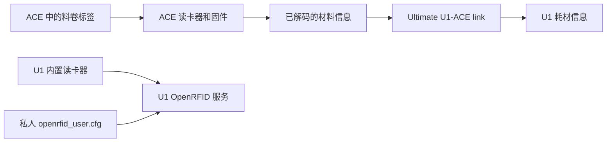

# NFC 与耗材信息

[English](nfc.md)

本项目把 ACE 已识别的品牌、材料类型、细分类型和颜色同步到 U1。
识别标签的是 ACE 自己的读卡器和固件；本项目负责接收、转换和保留这些信息。

> [!IMPORTANT]
> **ACE 读卡器和 U1 内置读卡器是两套独立系统。**
> 已验证的 ACE 固件不需要在本项目安装器里额外输入拓竹密钥。
> 下文的密钥文件说明仅供 U1 内置 OpenRFID 配置参考，不是 ACE 安装的必做步骤。

## 先确认 ACE 所需条件

| 项目 | 应当是什么 |
| --- | --- |
| 硬件 | Anycubic ACE Pro 第一代，已正确连接 U1。 |
| ACE 固件 | `CV1.3.863`，内含 OpenCubic CFW `1.1.1`。 |
| 对应下载 | [OpenCubic v1.0.2 发布页](https://github.com/Jupsi/OpenCubic/releases/tag/v1.0.2)中的 `ACE_V1.3.863_20260716.bin`。 |
| U1 耗材读取方式 | **External（外部）**；当前安装器会自动设置并检查。 |
| 料卷 | 带受支持的 NFC 标签，且标签位置适合 ACE 读取。 |

发布页标签 `v1.0.2` 和固件内部版本 `1.1.1` 不是同一种版本编号，因此同时出现是正常的。
需要准备 ACE 固件时，请先读[ACE 固件指南](ace-firmware.md)。不能把 ACE 2 的镜像刷入第一代 ACE。

对于已经验证的这套 ACE 固件，读取受支持的拓竹标签不需要本项目再向 ACE 提交一份密钥。
本项目没有“ACE 拓竹密钥”输入框；固定版本的 OpenCubic 公开文档也没有提供受支持的运行时专有密钥录入方法。
**不要把密钥填进安装参数 JSON，也不要把 U1 的密钥文件复制给 ACE。**

## 哪些 NFC 标签受支持？

下表以 [OpenCubic v1.0.2 的详细支持文档](https://github.com/Jupsi/OpenCubic/blob/v1.0.2/docs/supported-spools.md)为依据。
表中的“Anycubic 第一代／第二代”指标签格式，不表示本项目支持第二代 ACE 硬件。

| 标签品牌或格式 | 上游详细文档的状态 | 本项目的实机验证 |
| --- | --- | --- |
| Anycubic 第一代标签 | 已确认 | 本项目未实测。 |
| Anycubic 第二代标签 | 已确认 | 本项目未实测。 |
| Bambu Lab／拓竹 | 已确认 | 已确认品牌、PLA Matte 和颜色同步。 |
| TigerTag | 已在第一代 ACE 上确认 | 本项目未实测。 |
| OpenSpool | 已在第一代 ACE 上确认 | 本项目未实测。 |
| Elegoo／智能派 | 已实现解析，尚未实测 | 本项目未实测。 |
| OpenPrintTag，包括 Prusa 格式 | 已实现解析，尚未实测 | 本项目未实测。 |
| QIDI／起迪 | 不支持；上游标为缺少 AES 密钥，仅有占位实现 | 本项目未实测。 |
| Creality／创想三维 | 不支持；上游标为缺少 AES 密钥，仅有占位实现 | 本项目未实测。 |

同一版本的 README 对 TigerTag 和 OpenSpool 仍写着“尚未实测”，更新滞后于详细支持文档。
这里采用详细文档明确列出的第一代 ACE 实测状态，并与本项目自己的测试结果分开说明。
**本项目自己的 NFC 实机证据仅覆盖拓竹标签，不代表每个品牌、批次或标签安装位置都已验证。**

QIDI 和 Creality 不能通过在 U1 文件里填写密钥，就变成 ACE 支持的标签。
U1 内置 OpenRFID 的品牌支持表与 ACE 的支持表也不能互相替代。

## 理解两条读卡路径



ACE 通过 `get_filament_info` 把已经解码的数据交给本项目，再由本项目写入 U1 耗材信息。
U1 内置读卡器不会通过 USB 去读取 ACE 里面的料卷。

U1 的 OpenRFID 服务使用自己的读卡器和配置文件。
安装器保留该配置文件，不等于把里面的密钥传给了 ACE。

## External 应该怎么设置？

当前安装器会自动选择 **External**、禁用 U1 内置读卡路径并停止 U1 的 OpenRFID 服务。
它会核对结果，并备份原来的设置和服务状态。
保留的旧版 v0.1.0 安装包仍需手动设置 External。

查看当前状态：

1. 在浏览器打开打印机的 `/firmware-config/` 页面。
2. 找到 **Snapmaker Components**。
3. 查看 **Filament Detection**。

**完成标准：选中值是 External。**
如果使用 v0.1.0 或正在明确排查这个设置，选择 External 后等待相关服务重启完成。
选项名称是 **External**，不是 `extended`；部分上游说明把该项称为 **RFID Detection System**。

External 的作用是避免 U1 内置读卡路径与 ACE 的材料更新互相干扰。
它不表示 ACE 只能读取 OpenSpool。
[上游 RFID 说明](https://snapmakeru1-extended-firmware.pages.dev/design/rfid)中的外置读卡器表格，描述的是表内那些具体项目，不是所有外接设备的共同上限。

> [!CAUTION]
> **使用本项目连接 ACE 时，请保持 External。**
> 不要为了填密钥或修复 ACE 识别，改成内置 OpenRFID 模式。
> 切换后启用的是另一条读卡路径，可能干扰 ACE 的材料信息处理。

## 第一次检查识别结果

1. 向一个空 ACE 入口插入耗材。
2. 把手移开滚筒。
3. 等待短咬料和 NFC 识别结束。
4. 在 U1 屏幕打开该槽的耗材详情。
5. 对照料卷检查品牌、类型、细分类型和颜色。

**预期结果：识别信息出现，线材停在 ACE 端，等待你点击 U1“进料”。**
插入耗材不会自动长送到打印头。
先后插入多卷时，ACE 识别可能需要更长时间；本项目最多等待 180 秒就绪，然后才开始计算送料动作的时间限额。
识别期间不要反复点“进料”。

没有 NFC 标签的耗材，可以在 U1 耗材界面手动填写材料信息。
只要 ACE 入口仍检测到耗材，正常进料和退料都会保留自动识别或手填的数据。
真正从 ACE 入口拔出耗材后，该槽的信息才会清空。
断连、未知状态或暂时没有新状态，不会被当作“已拔出”。

## 品牌名称转换不等于增加标签支持

| ACE 返回的品牌文字 | U1 显示的品牌 |
| --- | --- |
| `Bambu Lab`、`BambuLab`、`Bambu` | `Bambu` |
| `Creality` | `Creality` |
| `Elegoo` | `Elegoo` |
| `Qidi` | `QIDI` |
| `Snapmaker` | `Snapmaker` |
| `Anycubic` | `Anycubic` |
| 其他非空品牌名 | 保留 ACE 返回的名称。 |
| 空品牌名 | `Generic` |

这些规则只整理成功读取后的品牌文字，不会给 ACE 增加解码器或认证密钥。
因此，映射表中出现 Creality、QIDI 或 Snapmaker，并不证明 ACE 能读取这些品牌的原装标签。

例如，`PLA Matte` 会分成材料类型 `PLA` 和细分类型 `Matte`，颜色单独同步。
U1 正确显示品牌，也不保证切片软件中存在同名材料预设。

## U1 内置 OpenRFID 密钥文件：仅供参考

**正常安装 ACE 可以跳过这一节。**
这一节用于解释已有的 U1 内置读卡配置，不是让 ACE 识别拓竹的补充安装步骤。

| 查看位置 | 路径 |
| --- | --- |
| 打印机实际配置路径 | `/oem/printer_data/config/extended/openrfid_user.cfg` |
| 在受支持固件中的等效路径 | `/home/lava/printer_data/config/extended/openrfid_user.cfg` |
| 网页文件管理器 | **Configuration（配置）→ extended → openrfid_user.cfg** |

### 找到文件，先留私人备份

1. 用浏览器打开打印机普通后台。
2. 打开 **Configuration（配置）**。
3. 打开 `extended` 文件夹。
4. 找到 `openrfid_user.cfg`。
5. 用文件菜单中的下载功能保存一份备份。
6. 把备份放在私人文件夹，远离准备公开的项目目录。
7. 在网页编辑器中打开打印机上的原文件。

如果没有这个文件，**不代表 ACE 缺少配置**，也不需要为 ACE 新建它。
仅当你另外配置 U1 内置读卡器时，才在确认文件不存在后新建这个准确文件名。
内置系统的工作方式见[上游 RFID 设计说明](https://snapmakeru1-extended-firmware.pages.dev/design/rfid)。

### 理解 `#` 和配置节

行首的 `#` 表示注释，这一行不会作为配置生效。
去掉配置节标题和参数前的 `#`，只是让文件中的这些行成为有效配置，不会启动被 External 停用的 OpenRFID 服务。

- 已有对应配置节时，直接编辑原节。
- 不要再添加第二个同名配置节。
- 不要覆盖其他品牌配置或已有的有效值。
- 下面尖括号中的文字都是占位符，不能原样当密钥保存。

### 拓竹的内置读卡配置

1. 找到 `[bambu_lab_tag_processor]`，或者前面带 `#` 的同名行。
2. 需要配置这个内置读卡器时，去掉节标题前的 `#`。
3. 去掉该节 `key` 行前的 `#`。
4. 用你自行获得的正确拓竹密钥替换等号后面的值。

结构如下：

```ini
[bambu_lab_tag_processor]
key = <YOUR_BAMBU_KEY_32_HEX>
```

真实值必须是 **32 个十六进制字符**，只能使用 `0`–`9`、`a`–`f` 或 `A`–`F`。
不要加 `0x`、引号、空格或尖括号。
长度和字符格式正确，也不等于密钥内容正确。

5. 检查没有重复配置节，也没有遗留的占位符。
6. 保存文件。

### Creality 的内置读卡配置

Creality 使用两个字段：

```ini
[creality_tag_processor]
key = <YOUR_CREALITY_KEY_32_HEX>
encryption_key = <YOUR_CREALITY_ENCRYPTION_KEY_32_HEX>
```

1. 找到已有的 `[creality_tag_processor]` 配置节。
2. 配置 U1 内置读卡器时，去掉节标题前的 `#`。
3. 去掉 `key` 和 `encryption_key` 参数行前的 `#`。
4. 在 `key` 中填写与该字段对应的 32 字符值。
5. 在 `encryption_key` 中填写与该字段对应的 32 字符值。
6. 检查没有重复配置节，也没有遗留的占位符。
7. 保存文件。

**不能假设 `key` 和 `encryption_key` 是同一个值。**
这两个字段作用不同，必须分别使用对应的正确值。
这些设置仍然不能给 ACE 增加 Creality 支持。
使用本项目时保持 External；保存的内置读卡配置不会因此自动启用。

## 密钥和备份不要公开

需要的专有密钥由用户自行寻找。
本项目不提供真实密钥，也不提供获取密钥的链接。
不要把密钥文件、文件备份或带密钥的截图发到仓库和问题讨论区。
不要把密钥写入安装参数 JSON、固件下载配置或公开的安装包。
升级固件、重装主机适配前，应保留自己的私人配置。

## 没有识别时，先区分是哪种情况

| 看到什么 | 应检查什么 |
| --- | --- |
| 料卷没有 NFC 标签 | 在 U1 手动填写材料信息。 |
| 类型和颜色正确，品牌显示 Generic | ACE 是否返回了非空品牌名称。 |
| 声称支持的标签没有识别 | ACE 是否为准确固件、料盘是否确有原装标签、标签位置是否适合读取。 |
| 料盘仍在识别转动 | 等待识别结束，不要重复发送进料操作。 |
| 固定 ACE 固件读不出 QIDI 或 Creality | 使用手填材料；修改 U1 密钥文件不会增加 ACE 支持。 |
| U1 显示拓竹，切片软件不显示 | 单独检查切片软件的材料预设和显示限制。 |

更多信息见[故障排查](troubleshooting.md)和[实机验证范围](validation.md)。
