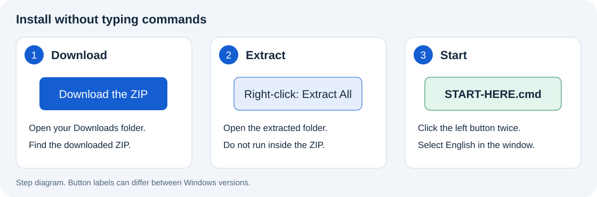
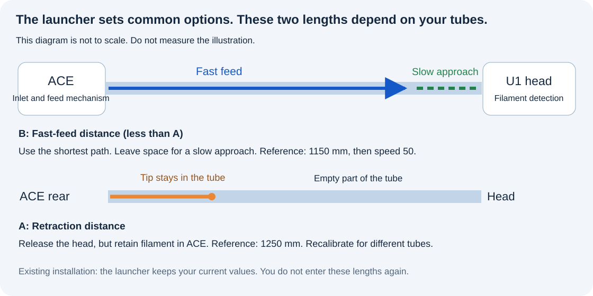

# Start here

You do not need programming knowledge, Codex, or an API key.
Use a Windows 10 or Windows 11 computer on the printer's network.
The guided launcher offers **English** and **中文** at startup.
The [manual source procedure](installation.md) remains available if you prefer to inspect and enter each command.
It skips the Windows launcher but still runs the open-source printer installer.
The [previous package](install-options.md#retained-v010) remains available unchanged.

> [!CAUTION]
> **Do not copy old SnapAce `filament_feed.py` or `extruder.py` onto U1 firmware 2.0.**
> **This project replaces the original SnapAce software installation steps.** Use its upstream guide for hardware connections only.

## Prepare the machine

The same wizard now includes [U1 firmware preparation](u1-preparation.md).
Select that path if the required firmware is not already installed.
It downloads and verifies the original `2.0.0-paxx12-24` file, then copies it to your selected FAT32 USB drive.

1. Follow the wizard's screen instructions to install the prepared file on U1.
2. Enable Advanced Mode on the U1 screen and complete the requested restart.
3. Set Root Access to Open on the screen.
4. Connect the ACE Pro Gen 1 and its four PTFE paths.
5. Use the ACE stage in this wizard to check or prepare its required firmware.
6. Finish the current print.
7. Let the nozzle and bed cool.

The tested ACE firmware is `CV1.3.863` with OpenCubic `1.1.1`.
See [prerequisite instructions](installation.md#1-prepare-the-prerequisite-projects).
The launcher prepares the U1 file and guides the physical steps. The printer performs the update after your screen confirmation.
It also offers a controlled ACE update for the tested source version. It does not change hardware.
Follow [the bilingual ACE prompts](ace-wizard.md); no shell commands or device-profile edits are needed.

**First installation:** empty all four ACE inlets and all four U1 heads before installation.
**Existing installation:** an update does not require all four channels to be emptied.

## Install with the launcher

1. Download [the project ZIP](https://github.com/Alexantry/Ultimate-U1-ACE-link/raw/refs/heads/main/downloads/Ultimate-U1-ACE-link-v0.1.4.zip).
2. Right-click the ZIP in your Downloads folder.
3. Select Extract All.
4. Open the extracted `Ultimate-U1-ACE-link` folder.
5. Double-click `START-HERE.cmd`.
6. Select **2. English**.
7. Complete U1 preparation, or select the already-prepared path. Enter the current printer address.
8. Complete the ACE firmware stage, or confirm an existing supported build as instructed.
9. Review the host installation summary and confirm when the machine is idle and cold.
10. Wait for the complete success result.

Do not run the launcher from inside the ZIP viewer.

Password entry shows no characters or asterisks.
The launcher does not save passwords.
Open `START-HERE.en.html` for this guide without an internet connection.
Use `START-HERE.html` for the Chinese guide.

## What the installer sets

| Item | Automatic action |
| --- | --- |
| U1 firmware preparation | Download and verify v24, then copy it to selected FAT32 USB. Screen approval remains manual. |
| ACE firmware preparation | Download and verify upstream images. Check the source version. Run one supported update after confirmation. |
| File transfer | Copy the required public files to a new staging directory. |
| Existing parameters | Keep the current ACE settings. |
| ACE interface | Use the existing interface or identify one matching device. |
| Filament Detection | Set **External** and disable the internal reader path. |
| Persistence | Create the required debug marker when missing. |
| Configuration | Add the ACE and save-variable settings as needed. |
| Recovery | Save the original files before changes. |
| Completion | Restart services and verify the active settings. |

The setting name is **External**.
The word **extended** describes the firmware and its configuration files.
You do not need to select External manually before guided installation.

## Values that depend on your machine

> [!IMPORTANT]
> **Do not copy the example lengths without checking your tube arrangement.**
> **The installer cannot measure physical tube lengths or filament tension.**

The first installation asks for reviewed fast-feed and retract distances.
Existing installations keep their current settings.

| Letter in the launcher | Meaning |
| --- | --- |
| **A** | Retract from the head while keeping the tip inside ACE and its rear tube. |
| **B** | Feed quickly from the known starting position, stopping before the head. Use a value smaller than A. |

The tested distances are 1150 mm for fast feed and 1250 mm for retraction.
These distances are examples for one tube arrangement.
Use [the calibration guide](configuration.md#calibrate-the-ptfe-paths) for a different arrangement.

Common speed defaults are 200 for fast feed, 50 for the final approach, and 80 for retraction.
Forward take-up is disabled on a new installation.
Enable it only after the initial load and unload check.

## Check one slot

1. Insert filament into one empty ACE inlet.
2. Wait for the short bite and NFC recognition.
3. Confirm that automatic full loading does not start.
4. Select Load on the U1.
5. Wait for load completion.
6. Select Unload.
7. Confirm that material data remains available.
8. Select Load again without removing the filament.

Keep your hands away from the rollers.
The installer does not run this physical test.
See [the validation limits](validation.md).

## If the launcher stops

| Message or situation | Next action |
| --- | --- |
| No characters appear during password entry | Type the password, then press Enter. Hidden input is normal. |
| Upload failed before installation | Check the current address, Root Access, password, and network. |
| The machine is busy or hot | End the task and dryer operation. Set heater targets to zero. Wait for temperatures below 50°C. |
| ACE feed assist is still active | Use the U1 screen to unload that channel normally, then wait for cooling. |
| No unique ACE interface | Check power and the correct USB connection. Connect only one ACE. |
| Installation started but success was not confirmed | Keep the window and diagnostic file. Do not repeat installation or start printing. |

The launcher never automatically repeats installation after a lost connection.
It shows the private diagnostic file and printer staging directory.
See [recovery instructions](update-and-rollback.md) before further changes.
Successful automatic recovery records `Automatic rollback VERIFIED` in the diagnostic output.
A failed recovery records `automatic rollback FAILED` and a backup identifier.
Remove private details before sharing diagnostics. Do not publish NFC keys or printer backups.

### Missing Windows OpenSSH client

1. Select Start in Windows.
2. Search for Optional Features.
3. Open the matching settings page.
4. Select View features or Add a feature.
5. Search for OpenSSH.
6. Select **OpenSSH Client**.
7. Complete installation with the displayed buttons.
8. Start the launcher again.

The client is required. The server is not required.
Your administrator can add the component if the computer is managed.
See [Microsoft's component instructions](https://learn.microsoft.com/en-us/windows-server/administration/openssh/openssh_install_firstuse).

## Development

This project was built with **OpenAI Codex**.
The user supplied requirements, observed the machine, and performed physical tests.
Codex wrote and integrated the code, installer, and documentation.
Upstream contributions and licenses remain listed in [THIRD_PARTY.md](../THIRD_PARTY.md).
