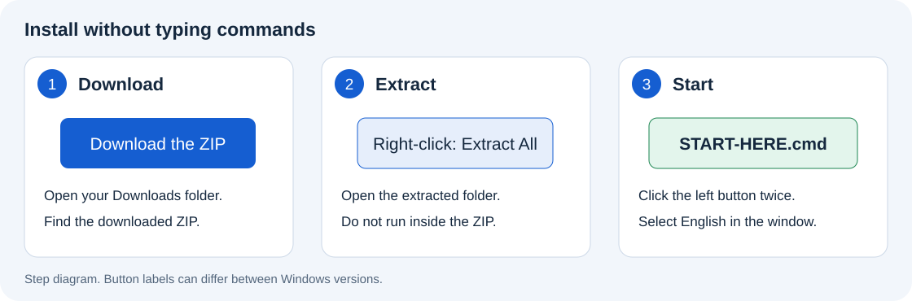
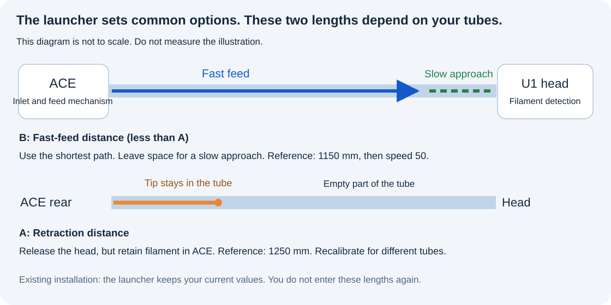

# Quick start

[简体中文](quick-start.zh-CN.md) · [Manual installation](installation.md) · [Home](../README.md)

Use a Windows 10 or 11 computer and follow the wizard. You do not need programming knowledge.

> [!CAUTION]
> **Do not copy old SnapAce `filament_feed.py` or `extruder.py` onto U1 firmware 2.0.**
> **This project replaces the original SnapAce software installation steps.** Use the upstream guide for hardware connections only.

## 1. Prepare the devices

1. Finish the print and all filament operations. Turn off heating and ACE drying. Wait until the nozzles and the bed are below 50°C.
2. First installation: unload normally on the U1, then pull the filament out of all four ACE inlets. For an update, you can keep the filament.
3. Make sure that the feeder is an **ACE Pro Gen 1**, not an ACE 2 Pro.
4. Turn both devices off. Connect the ACE-to-USB cable and the four PTFE tubes as in the [SnapAce hardware guide](https://github.com/BlackFrogKok/SnapAce#pinout-and-wiring). Then turn the power on. A normal charging cable is not a substitute.
5. Connect the computer and the U1 to the same network. Both need internet access.

If the U1 has your own configuration changes, save a backup first. The project backup does not protect changes made before a firmware update.
Chinese readers who are new to the hardware and screen steps can read the [preparation guide](before-you-start.zh-CN.md).

## 2. Download, extract, start

1. [Download the ZIP](https://github.com/Alexantry/Ultimate-U1-ACE-link/raw/refs/heads/main/downloads/Ultimate-U1-ACE-link-v0.1.6.zip).
2. In the Downloads folder, right-click the ZIP and select **Extract All**.
3. Open the extracted `Ultimate-U1-ACE-link` folder and double-click **START-HERE.cmd**.
4. Type **2** for English and press Enter.

Do not run the file from inside the ZIP preview. The `.html` files are offline instructions, not installers.

## 3. Select a menu

| Menu | When to select it |
| --- | --- |
| **1. U1 is ready** | The U1 has `2.0.0-paxx12-24`, Advanced Mode is on, and Root Access is Open. The wizard checks the ACE firmware and then installs. |
| **2. Prepare U1 firmware USB** | The U1 does not have the specified firmware. You need a USB drive that is already FAT32 with 300 MB free. The wizard does not format it. |
| **3. Manual installation** | You want to run each command yourself. This only opens the instructions and does not connect to the printer. |
| **4. ACE firmware** | You only maintain the ACE, or you want the result of the last ACE update. This does not install the U1 integration. |

For menu 2, see [U1 firmware preparation](u1-preparation.md) for each screen step. The printer address can change after the update.
If the U1 has a different or custom firmware, check compatibility separately. Do not overwrite it only to pass the check.

## 4. Enter the connection information

| Prompt | What to enter |
| --- | --- |
| Printer address | The IP on the U1 Wi-Fi page. Enter only the numeric address. |
| First SSH connection | Compare the address with the screen, then confirm. See [first connection](installation.md#confirm-the-connection). |
| `password:` | The SSH root password of the printer, not the Wi-Fi password. No characters appear while you type. This is normal. |

If you did not change them, the user is `root` and the initial password is `snapmaker`. See the [upstream SSH notes](https://snapmakeru1-extended-firmware.pages.dev/ssh_access).
The wizard does not store the password and can ask for it more than once.

## 5. ACE firmware

A first installation enters this stage automatically.

1. Select the automatic check.
2. Wait while the wizard downloads and verifies the firmware and checks the ACE model, current version, and idle state.
3. Compare the source and target versions in the window, then confirm the update.
4. Until the result appears, do not remove power and do not disconnect USB.

The only supported route is from **`V1.3.856` / boot `V1.0.1`** to **OpenCubic CFW 1.1.1 (shown as `CV1.3.863`)**.
The wizard stops for other versions. Do not force it. See the [ACE firmware wizard](ace-wizard.md).

## 6. Review tube distances, then install

> [!IMPORTANT]
> **The installer cannot measure your tube lengths. The example values are not universal. Do not copy them.**

A first installation asks for two distances. An existing installation keeps its values.

| Letter | Meaning |
| --- | --- |
| **A** | The distance the ACE pulls back on unload. The filament tip must stay in the tube behind the ACE. |
| **B** | The fast feed distance on load. It must end before the print head and be less than A. |

1. Measure your tube paths with [settings and calibration](configuration.md#calibrate-the-ptfe-paths) and select A and B.
2. Compare the settings in the window, then confirm installation.

The tested machine uses A = 1250 mm and B = 1150 mm. These are for comparison only.
The installer makes a backup of the files it changes and sets Filament Detection to **External** automatically.

## 7. After success, test each slot

Wait until the window reports that this project is installed. A message about the ACE firmware only is not sufficient.

1. Put filament into one empty ACE inlet and release the spool. Wait for the grip and the NFC read to end.
2. Make sure that it did not feed to the print head by itself and that the material data is correct. You can enter unrecognized material manually.
3. Select **Load** on the U1 and wait for completion.
4. Select **Unload**. Make sure that the filament stays in the ACE and the material data stays.
5. Do not remove the filament. Select **Load** again.
6. When this slot passes, test the other three slots one at a time.

Stop immediately if there is a jam, slipping, or an error. See [daily use](daily-use.md).

## If a step stops

| Situation | What to do |
| --- | --- |
| The OpenSSH Client is missing | Add it with the steps below. You do not need Python. |
| Connection or upload fails before installation | Check the current IP, the network, Root Access, and the SSH password. |
| The machine is hot, busy, or drying | End the operation, turn off heating and drying, and wait until below 50°C. |
| No single ACE interface is found | Check the power and the cable. Connect only one ACE. Do not guess the serial port. |
| The U1 screen reports an update error | Stop and record the text. See [U1 firmware preparation](u1-preparation.md). |
| The ACE update has no result, or the computer disconnects | Keep power and USB connected. Open the wizard again from the same package version and select menu 4. **Do not send the update again.** |
| Installation possibly started but no success message | Keep the window. Do not install again. Follow [update and rollback](update-and-rollback.md). |

`Automatic rollback VERIFIED` means that the files on the U1 were restored. **It does not mean that the ACE firmware was restored.**
For other problems, see [troubleshooting](troubleshooting.md).

### Install the Windows OpenSSH Client if needed

1. Select **Start**, then search for and open **Optional features**.
2. Select **View features** or **Add a feature**.
3. Search for **OpenSSH**. Select **OpenSSH Client** and install it. Do not select OpenSSH Server.
4. Run **START-HERE.cmd** again.

See the [Microsoft instructions](https://learn.microsoft.com/en-us/windows-server/administration/openssh/openssh_install_firstuse).

## About this project

The user set the requirements and did the physical tests. **OpenAI Codex** wrote the code, the installer, and the documentation. You do not need Codex to install or use the project.
See [THIRD_PARTY.md](../THIRD_PARTY.md) for upstream sources and licenses.
