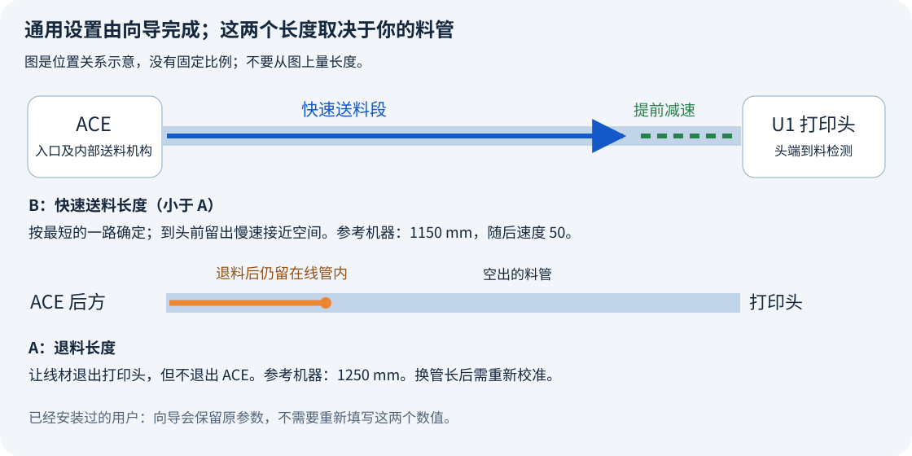

# 新手安装：从这里开始

你不需要会编程，也不需要安装 Codex。
安装向导会替你输入命令、传送文件、保存备份和修改通用设置。
你只需双击文件，再按中文提示操作。

> [!CAUTION]
> **禁止把旧 SnapAce 的 `filament_feed.py` 或 `extruder.py` 覆盖到 U1 2.0。**
> **本项目替代原 SnapAce 的软件安装步骤。** 上游只参考硬件接线部分。

## 第一次使用：向导也能准备 U1 固件

需要一台 Windows 10 或 Windows 11 电脑。
电脑和 U1 要连接同一个家庭网络。
打印机应已结束打印，喷头和热床已冷却。

| 机器上必须先准备好什么 | 完成标准 |
| --- | --- |
| U1 扩展固件 | 版本为 `2.0.0-paxx12-24`。 |
| 远程访问 | Advanced Mode 已开启；Root Access 为 Open。 |
| ACE 与连接线 | ACE Pro 第一代，USB 和四根料管已按对应槽位接好。 |
| ACE NFC 固件 | 已验证组合为 `CV1.3.863` / OpenCubic `1.1.1`。 |

还没有指定 U1 固件时，可以先启动向导，选择“准备 U1 固件”。
向导会下载、校验原版 v24，并复制到你选定的 FAT32 U 盘。
窗口随后引导你在 U1 屏幕确认本地更新、开启 Advanced Mode、将 Root Access 设为 Open。
完成后在同一窗口继续安装；详细过程见[固件准备说明](u1-preparation.zh-CN.md)。
U1 固件更新和访问开关仍需屏幕操作，线缆仍需亲手准备。
ACE 固件检查、下载校验及受支持的刷写，已纳入后续双语向导；见[ACE 向导说明](ace-wizard.zh-CN.md)。
[机器准备图文说明](before-you-start.zh-CN.md)保留全部手动步骤。

**后台耗材读取选项的准确名称是 External（外部）。安装向导会自动设置它。**
你无需先寻找这个选项。

## 1. 下载

1. 点开[下载安装包](https://github.com/Alexantry/Ultimate-U1-ACE-link/raw/refs/heads/main/downloads/Ultimate-U1-ACE-link-v0.1.4.zip)。
2. 等待浏览器下载完成。
3. 打开电脑的“下载”文件夹。
4. 找到名称含 `Ultimate-U1-ACE-link-v0.1.4` 的压缩文件。

## 2. 解压

1. 在下载的压缩文件上点鼠标右键。
2. 点击“全部解压缩”或“解压全部”。
3. 点击“提取”或“解压”。
4. 打开刚得到的 `Ultimate-U1-ACE-link` 文件夹。

不要直接在压缩包窗口内运行安装程序。

## 3. 双击启动

1. 找到 `START-HERE.cmd`。
2. 快速点鼠标左键两次。
3. 在第一个菜单选择 **1. 中文**，再按提示操作。
4. 选择“已经准备好”或“准备 U1 固件”。首次安装会提示 ACE 固件阶段。
5. 只想检查 ACE 或查看上次更新结果时，选择主菜单中的 ACE 固件入口。

主菜单仍保留“手动安装”，可以直接打开完整命令说明。

需要英文时选择 **2. English**。后续向导提示会使用所选语言。

如果电脑隐藏文件后缀，文件可能显示为 `START-HERE`，类型为“Windows 命令脚本”。
`START-HERE.html` 是中文离线图文说明；`START-HERE.en.html` 是英文离线说明。
你不需要双击 Python 文件，也不需要自行打开 PowerShell。

**不想运行 Windows 向导：直接打开 [手动源代码安装步骤](installation.md)，或压缩包里的 MANUAL-INSTALL.html。**
完整命令说明为英文；手动入口也在向导菜单中。
该方法仍运行开源 `installer.py`；原版安装包与说明见[安装方式和旧版保留](install-options.md)。

## 4. 按提示填写

| 窗口问你什么 | 你要做什么 |
| --- | --- |
| 打印机地址 | 在 U1 屏幕打开 Wi-Fi 页面，输入页面显示的地址。 |
| 是否信任首次连接 | 确认地址是你的 U1；按窗口说明完成首次连接。 |
| SSH 密码 | 输入打印机的 root 密码，再按回车。输入时不会显示字符或星号。 |
| 数字选项 | 输入选项前的数字，再按回车。 |
| 管路对应的长度 | 新装用户按下图和提示填写；已有配置会自动保留。 |
| 是否开始安装 | 核对摘要，再按提示确认。 |

密码不显示字符是正常现象，不表示键盘失灵。
连接过程中可能需要再次输入密码；向导不会保存密码。
原厂 SSH 密码的说明在[机器准备指南](before-you-start.zh-CN.md)。

首次安装前，需要取出四个 ACE 入口和四个打印头里的耗材。
已有集成的更新不要求把四路耗材全部取出。
如果向导提示设备正在送料、烘干、打印或加热，先在设备上结束相应操作。

### 哪两个长度需要自己确认？

> [!IMPORTANT]
> **示例长度不能直接当成所有机器的通用值。**
> **软件无法自动测量管长或线材张力。** 新装前必须确认实物；已有安装默认保留原参数。

- **A：退料长度。** 让耗材离开打印头，但仍留在 ACE 及其后面的料管里。
- **B：快速送料长度。** 让耗材在到达打印头前提前减速。按四条路径中最短的一条确定，且小于 A。

已测试机器使用快速送料 `1150 mm`、退料 `1250 mm`。
这些是示例，不能代表所有人的料管长度。
不要把卷尺量到的管长直接当作已验证的退料长度。
如果你不知道这两个数值，先按[管路测量和首次校准说明](configuration.zh-CN.md)准备，再继续向导。

速度已经预填：快速送料 `200`、靠近打印头 `50`、退料 `80`。
首次安装默认关闭退料后的回送消松；完成一次正常进退料后，再按[参数说明](configuration.zh-CN.md)启用。
原有安装中的回送距离和其他参数会保留。

## 5. 等到安装完成

向导会自动完成这些工作：

- 检查 U1 版本和设备状态。
- 查找唯一匹配的 ACE 接口，或保留原接口。
- 保存可用于回退的原文件。
- 设置 **Filament Detection → External** 并停止内置读卡路径。
- 配置重启后的持久化、ACE 模块和所需配置段。
- 重新启动软件服务，检查连接、设置和材料信息。

只有窗口明确报告安装成功后，才进行耗材测试。
如果安装失败，按窗口显示的处理方法操作；不要重复点击安装。

## 6. 只测试一槽

1. 先向一个空 ACE 槽插入耗材。
2. 等待短咬料和 NFC 识别结束。
3. 确认耗材没有自动长送到打印头。
4. 在 U1 屏幕点该槽的“进料”。
5. 等待正常完成，再点“退料”。
6. 确认耗材仍留在 ACE 中，材料信息仍在。
7. 不拔插耗材，再点一次“进料”。

首次测试时留在机器旁边，手离开滚筒。
安装向导本身不会替你执行这些送料动作。

## 关于 Codex

本项目由用户提出需求、观察设备并完成实机测试，使用 **OpenAI Codex** 编写和整合代码、安装工具及文档。
安装或使用本项目不需要 Codex、ChatGPT 订阅或 API 密钥。
SnapAce、扩展固件、OpenCubic 等上游项目的作者和许可见[项目来源](../THIRD_PARTY.md)。
本项目不提供 NFC 密钥；需要的专有密钥由用户自行寻找。

## 故障处理：先看窗口停在哪一步

| 看到什么 | 怎么做 |
| --- | --- |
| 找不到 `START-HERE.cmd` | 先“全部解压缩”，再打开解压后的 `Ultimate-U1-ACE-link` 文件夹。 |
| 输入密码时屏幕没有变化 | 正常输入密码，再按回车。终端不会显示字符或星号。 |
| 上传或连接失败，尚未开始安装 | 核对打印机当前 IP、同一网络、Root Access 和密码，再运行向导。 |
| 提示缺少 OpenSSH 客户端 | 按下面的 Windows 组件安装步骤处理。电脑不需要 Python。 |
| 提示机器忙、未冷却或 ACE 未空闲 | 结束打印和烘干，关闭加热。若某路仍在送料辅助状态，先在 U1 对该路正常退料，再等温度低于 50℃。 |
| 提示没有唯一 ACE 接口 | 检查 ACE 电源和专用 USB 线；只连接一台 ACE。不要猜接口。 |
| 显示安装可能已开始，但未报告成功 | 保留窗口，暂不打印、拔线或重复安装。按下面的恢复说明处理。 |

### Windows 提示缺少 OpenSSH 客户端

1. 点击 Windows“开始”按钮。
2. 输入“可选功能”，打开找到的系统设置页面。
3. 点击“查看功能”或“添加功能”。
4. 搜索 `OpenSSH`。
5. 选择 **OpenSSH 客户端**，再按页面按钮安装。
6. 等待安装完成，再双击 `START-HERE.cmd`。

不要选择 OpenSSH 服务器。若电脑由公司管理而无法安装，请由电脑管理员添加该系统组件。
这些系统组件步骤参考 [Microsoft 的 OpenSSH 安装说明](https://learn.microsoft.com/en-us/windows-server/administration/openssh/openssh_install_firstuse)。

### 安装中断后的恢复

向导不会在断线后自动重发安装命令。
窗口会显示本次安装目录和诊断文件位置。
诊断文件保存在电脑上；用鼠标选中并复制显示的路径，然后粘贴到文件资源管理器地址栏，可以打开它。

如果原安装仍在后台运行，重复启动可能使状态更难判断。
先查看打印机屏幕是否正常，并保留诊断文件。
已成功回退会在诊断中记录 `Automatic rollback VERIFIED`；回退失败会记录 `automatic rollback FAILED` 和备份编号。
需要进一步恢复时，按[回退说明](update-and-rollback.md)由维护者核对备份，不要随机覆盖文件。
公开分享诊断前，先去掉私人地址和个人信息；不要分享 NFC 密钥或打印机备份。
