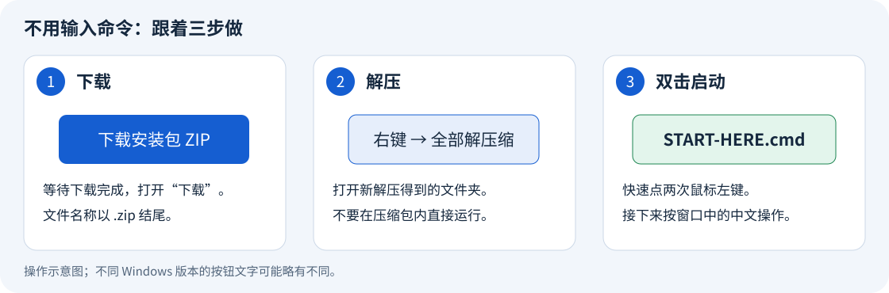
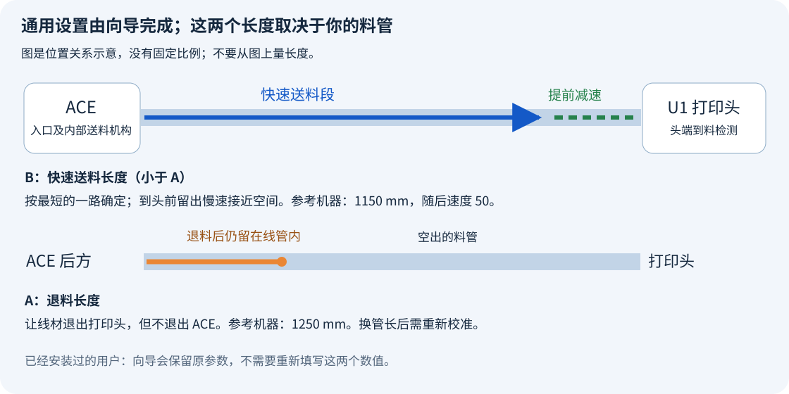

# 快速开始

[English](quick-start.md) · [手动安装](installation.zh-CN.md) · [返回首页](../README.zh-CN.md)

用一台 Windows 10 或 11 电脑，跟着向导走完即可，不需要会编程。

> [!CAUTION]
> **禁止把旧 SnapAce 的 `filament_feed.py` 或 `extruder.py` 覆盖到 U1 2.0。**
> **本项目替代原 SnapAce 的软件安装步骤。** 上游只参考硬件接线部分。

## 1. 准备设备

1. 等打印和进退料全部结束，关闭加热和 ACE 烘干，等喷嘴和热床低于 50℃。
2. 第一次安装：先在 U1 上正常退料，再把四路耗材拔出 ACE 入口。只是更新则不用清空。
3. 确认是 **ACE Pro 第一代**，不是 ACE 2 Pro。
4. 关闭两台设备的电源，按 [SnapAce 硬件指南](https://github.com/BlackFrogKok/SnapAce#pinout-and-wiring)接好专用 USB 线和四路料管，再开机。普通充电线不能代替。
5. 让电脑和 U1 连同一个网络，两者都要能上网。

U1 有自己改过的配置时，先另存备份；本项目的备份不保护固件升级前的改动。
型号、接线、屏幕操作不熟悉，先看[安装前准备](before-you-start.zh-CN.md)。

## 2. 下载、解压、启动

1. [下载安装包](https://github.com/Alexantry/Ultimate-U1-ACE-link/raw/refs/heads/main/downloads/Ultimate-U1-ACE-link-v0.1.6.zip)。
2. 在“下载”文件夹里右键这个压缩文件，点 **全部解压缩**。
3. 打开解压出的 `Ultimate-U1-ACE-link` 文件夹，双击 **START-HERE.cmd**。
4. 输入 **1** 选中文，按回车。

不要在压缩包预览窗口里直接运行。`.html` 文件是离线说明，不是安装程序。

## 3. 选择菜单

| 菜单 | 什么时候选 |
| --- | --- |
| **1. U1 已准备好** | U1 已是 `2.0.0-paxx12-24`，Advanced Mode 开启，Root Access 为 Open。向导检查 ACE 固件后安装。 |
| **2. 准备 U1 固件 U 盘** | U1 还没装指定固件。需要一个已是 FAT32、空闲 300 MB 以上的 U 盘，向导不会格式化它。 |
| **3. 手动安装** | 想自己逐条执行命令。只打开说明，不连接打印机。 |
| **4. ACE 固件** | 只维护 ACE，或查看上次 ACE 更新结果。不安装 U1 适配。 |

选菜单 2 时，屏幕上的每一步见 [U1 固件准备](u1-preparation.zh-CN.md)。升级后打印机地址可能变化。
U1 上是其他版本或自改固件时，先单独核对兼容性，不要为了通过检查而覆盖。

## 4. 填写连接信息

| 窗口提示 | 输入什么 |
| --- | --- |
| 打印机地址 | U1 的 Wi-Fi 页面显示的 IP，只填数字地址。 |
| 首次 SSH 连接 | 对照屏幕核对地址后确认，见[首次连接说明](installation.zh-CN.md#confirm-the-connection)。 |
| `password:` | 打印机的 SSH root 密码，不是 Wi-Fi 密码。输入时不显示字符是正常的。 |

没改过的话，用户名是 `root`，初始密码是 `snapmaker`，见[上游 SSH 说明](https://snapmakeru1-extended-firmware.pages.dev/ssh_access)。
向导不保存密码，可能会问多次。

## 5. ACE 固件

第一次安装会自动进入这一步。

1. 选自动检查。
2. 等向导下载并校验固件，核对 ACE 的型号、当前版本和空闲状态。
3. 核对窗口显示的源版本和目标版本，再确认更新。
4. 出结果之前，不要断电，不要拔 USB。

只支持从 **`V1.3.856`／引导 `V1.0.1`** 升级到 **OpenCubic CFW 1.1.1（显示 `CV1.3.863`）**。
其他版本向导会停下，不要强行继续。详见 [ACE 固件向导](ace-wizard.zh-CN.md)。

## 6. 核对管路长度，再安装

> [!IMPORTANT]
> **安装器不能测量实际管长。示例数值不是通用参数，不要直接照抄。**

第一次安装会问两个长度，已有安装保留原值。

| 字母 | 含义 |
| --- | --- |
| **A** | 退料时 ACE 回抽的距离。退完后耗材尖端要留在 ACE 后方的料管里。 |
| **B** | 进料时快速送料的距离。要在到达打印头之前结束，并且小于 A。 |

1. 按[参数与校准](configuration.zh-CN.md#calibrate-the-ptfe-paths)测量自己的管路，选出 A 和 B。
2. 核对窗口列出的设置，确认安装。

已测机器用的是 A = 1250 mm、B = 1150 mm，仅供对照。
安装器会备份要改的文件，并自动把 Filament Detection 设为 **External**。

## 7. 成功后逐槽测试

等窗口明确提示本项目安装成功。只提示 ACE 固件成功不算。

1. 向一个空的 ACE 入口插入耗材，手离开滚筒，等它咬料并读完 NFC。
2. 确认它没有自己一路送到打印头，材料信息正确。没识别的可手动填写。
3. 在 U1 上点 **进料**，等完成。
4. 点 **退料**，确认耗材留在 ACE 里，材料信息还在。
5. 不拔耗材，再点一次 **进料**。
6. 这一槽通过后，其余三槽一次测一槽。

卡料、打滑或报错时立即停止。日常操作见[日常使用](daily-use.zh-CN.md)。

## 某一步停住时怎么办

| 情况 | 怎么处理 |
| --- | --- |
| 提示缺少 OpenSSH 客户端 | 按下面的步骤添加，不需要装 Python。 |
| 连接或上传失败，还没开始安装 | 核对当前 IP、同一网络、Root Access 和 SSH 密码。 |
| 提示机器热、忙或在烘干 | 结束动作，关闭加热和烘干，等低于 50℃。 |
| 找不到唯一的 ACE 接口 | 检查电源和专用线，只连一台 ACE。不要猜串口。 |
| U1 屏幕升级报错 | 停下并记下原文，见 [U1 固件准备](u1-preparation.zh-CN.md)。 |
| ACE 更新没出结果或电脑断线 | 保持供电和 USB。用同一版本安装包重开向导，选菜单 4 查看结果。**不要重发更新。** |
| 适配安装可能已开始但没提示成功 | 保留窗口，不要重装，按[更新与回退](update-and-rollback.zh-CN.md)核对。 |

`Automatic rollback VERIFIED` 指 U1 上的文件已回退，**不表示 ACE 固件已回退**。
其他问题见[故障排查](troubleshooting.zh-CN.md)。

### Windows 提示缺少 OpenSSH 客户端

1. 点 **开始**，搜索并打开 **可选功能**。
2. 点 **查看功能** 或 **添加功能**。
3. 搜索 **OpenSSH**，选 **OpenSSH 客户端** 并安装。不要选 OpenSSH 服务器。
4. 重新运行 **START-HERE.cmd**。

见 [Microsoft 的组件说明](https://learn.microsoft.com/en-us/windows-server/administration/openssh/openssh_install_firstuse)。

## 关于本项目

用户提出需求并完成实机测试，**OpenAI Codex** 编写代码、安装器和文档。安装和使用不需要 Codex。
上游来源与许可见 [THIRD_PARTY.md](../THIRD_PARTY.md)。
